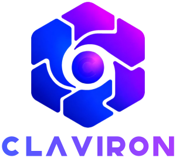
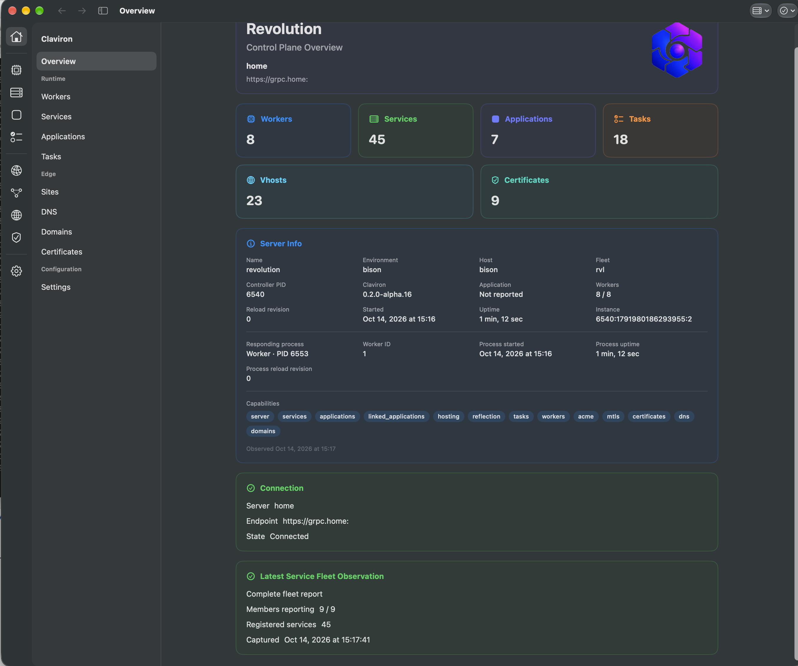
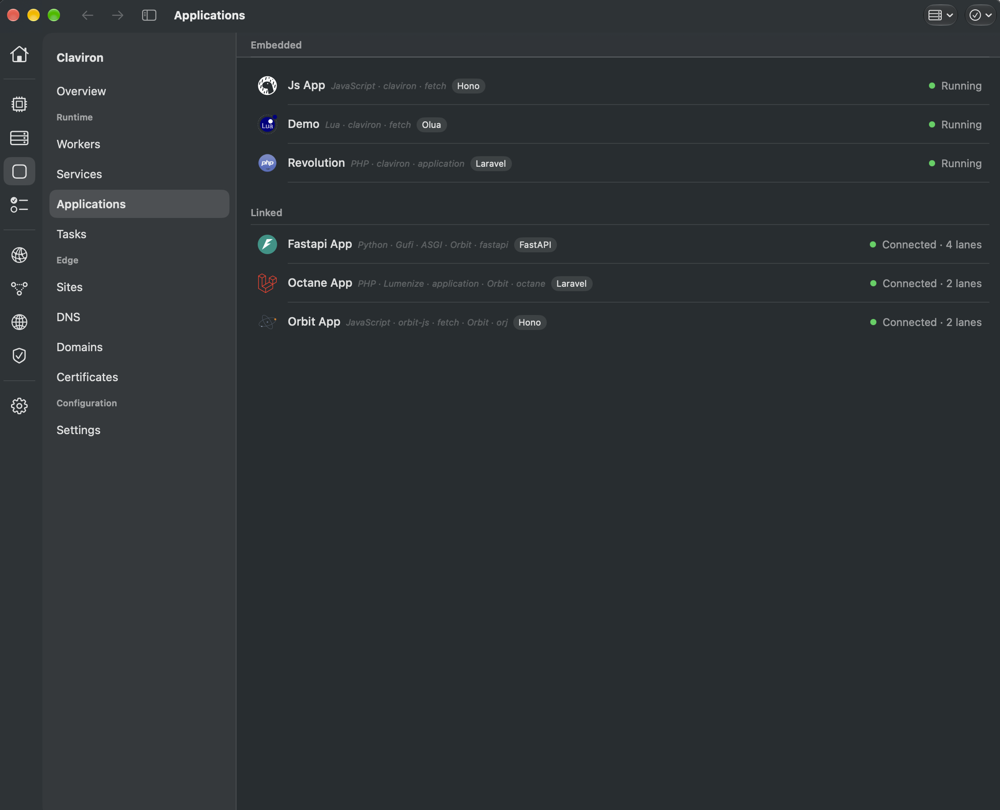
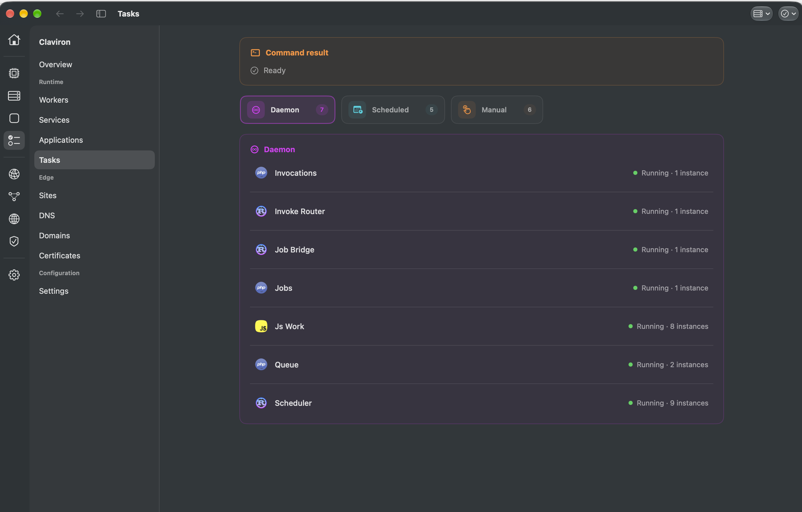

  

# Claviron

Claviron is an embeddable Rust application runtime and server fabric. It brings
service lifecycle, HTTP hosting, application execution, process supervision, and
same-host shared state into one composable system.

Your application owns its binary, business logic, configuration, and deployment.
Claviron supplies the infrastructure around it: register the services you need,
select how requests reach them, and manage their execution through a common
lifecycle.

## What Claviron provides

- **Managed services:** typed dependency registration, configuration, boot,
  validation, reload, background execution, drain, and finalization.
- **An HTTP edge:** HTTP/1.1, HTTP/2, and optional HTTP/3 over QUIC; TLS/mTLS;
  virtual hosts; host admission; native routes; static files; and upstream
  application dispatch.
- **Application hosting:** shared identity and control contracts for execution
  engines, plus a runner shell for hosting one application without a multi-host
  edge.
- **Process supervision:** standalone or master/worker execution, worker
  recovery, rotation, rolling restart, and lifecycle observation.
- **Shared runtime state:** Orbit integration for same-host events, keyed state,
  counters, locks, invocation transport, and application links.
- **Optional infrastructure:** tasks, database pools, cache stores, authentication
  contracts, WebSockets, broadcasting, logging, and metrics.

Cargo features select capabilities; typed registration and configuration
determine how they run.

The [design notes](docs/design/README.md) explain the choices behind application
routing, host identity, same-OS cooperation and lifetime ownership.
[Graceful ownership](docs/design/GRACEFUL_OWNERSHIP.md) defines who owns accepted
work and what authorizes shutdown escalation.

## Crate guide and feature relationships

The root `claviron` crate is the public facade. Applications select its features
and import through paths such as `claviron::runtime` and `claviron::edge`.
The tables link every subsystem README and name its facade feature or selection
path.

### Runtime, applications, and shared execution

| Crate | Responsibility | Facade selection |
| --- | --- | --- |
| [runtime](crates/runtime/README.md) | Claviron-owned `AppState`, registry integration, process context, configuration, local events, and lifecycle bindings. | `runtime` |
| [app](crates/app/README.md) | Runtime-qualified application identity, controllers, status, and application events. | `application` |
| [runner](crates/runner/README.md) | Launch options, HTTP and Orbit ingress, and routing around one application owner. | `runner` |
| [supervisor](crates/supervisor/README.md) | Ownership and control of a master/worker process family. | `supervisor` |
| [orbit](crates/orbit/README.md) | Shared-memory resources, fleet event bridges, placement, and same-host transport bound to Claviron's lifecycle. | `orbit` |
| [tasks](crates/tasks/README.md) | Managed Rust, command, and hosted-language work with explicit triggers, placement, and cancellation. | `tasks` |

### HTTP hosting, transport, and routing

| Crate | Responsibility | Facade selection |
| --- | --- | --- |
| [edge](crates/edge/README.md) | Virtual-host publication, admission, response-owner selection, and consumer-defined route extensions. Also documents the `edge_config` alias. | `edge` |
| [http](crates/http/README.md) | Transport-neutral bodies, HTTP policies, listener declarations, and shared routing contracts. | `http`; Axum integration: `axum` |
| [edge::tcp](crates/edge/docs/tcp/README.md) | Edge's native HTTP/1.1 and HTTP/2 listener and connection drivers. | Selected by `edge` |
| [edge::quic](crates/edge/docs/quic/README.md) | Edge's HTTP/3 over QUIC and native request/connection integration. | `http3` (includes `tls`) |
| [tls](crates/tls/README.md) | TLS handshakes, shared certificate resolution, and mTLS client-auth policy. | `tls` (includes `ssl`) |
| [files](crates/files/README.md) | Static-file serving, caching, and response construction. | `files`; included by `edge`, usable without it |
| [upstream](crates/upstream/README.md) | HTTP origin selection, pools, forwarding, and reload. | `upstream` (includes resolver contracts) |
| [resolver](crates/resolver/README.md) | DNS client contracts and optional Hickory implementation. | `resolver`; built-in driver: `resolver-hickory` |

Upstream applications bind their resolver implementation explicitly.

`ssl` provides certificate primitives; `tls` adds endpoint policy and resolution.
Database-backed certificate management, local CA/mTLS issuance, and ACME renewal
are available through the [managed extensions](#managed-extensions-and-clients).

### Data, identity, and hosting records

| Crate | Responsibility | Facade selection |
| --- | --- | --- |
| [cache](crates/cache/README.md) | Configured cache stores, local access, and fleet coherence. | `cache`; optional Redis support: `redis` |
| [db](crates/db/README.md) | Runtime-owned database pools and shared database capabilities. | `db`; backends: `postgres`, `mysql`, `sqlite` |
| [auth](crates/auth/README.md) | Schema-independent authentication, session, and CSRF contracts. | `auth` |
| [hosting](crates/hosting/README.md) | Persistent vhost, alias, and certificate records. | `hosting` (includes `tls` and `db`) |
| [geoip](crates/geoip/README.md) | IP-based location lookup through configured data providers. | `geoip` |

### Language engines and framework adapters

| Crate | Responsibility | Facade selection |
| --- | --- | --- |
| [php](crates/php/README.md) | Shared PHP configuration and execution-adapter contracts. | `php` |
| [php-embed](crates/php-embed/README.md) | Embedded ZTS PHP with request-scoped Script mode, persistent Application mode, native functions, and fixed or elastic pools. | `php_embed` (includes `php`) |
| [php-fcgi](crates/php-fcgi/README.md) | Dispatch to PHP-FPM through FastCGI rather than embedding Zend. | `php_fcgi` (includes `php`) |
| [lua](crates/lua/README.md) | Lua 5.5 scripts, managed Olua applications, and Rust-provided modules. | `lua` (includes outbound HTTP) |

**Script mode** runs PHP request startup and shutdown for each request, including
an ordinary Laravel or Symfony front controller. **Application mode** keeps the
application booted: the Laravel Octane adapter or Symfony persistent-kernel
adapter receives native request envelopes and returns responses through an
explicit receive/respond loop. Both modes support elastic pools that grow within
declared capacity and retire excess idle instances.

Install the companion Composer package for Laravel or Symfony integration.
Lua likewise supports fresh script states and persistent application states.

Laravel's native and Composer adapters live in the independent
[Lumenize library](https://github.com/claviron/lumenize). A custom Edge host
registers those adapters during its own boot without using Lumenize Runner.
The [Symfony Composer adapter](crates/symfony/README.md) remains available as PHP
source; it has no Rust workspace package or facade feature. The general PHP
engine stays framework-independent, selected with `php_embed`.

### Companion JavaScript integrations

These independent packages support embedded JavaScript or a separate application
process:

| Package | Integration |
| --- | --- |
| [claviron-deno](https://crates.io/crates/claviron-deno) | Slim embedded `deno_core`/V8 for persistent JS/TS applications, with native `claviron:*` modules for Orbit events, cells, counters, locks, and invocations. Provides selected Web APIs rather than the full Deno CLI environment. |
| [orbit-js](https://github.com/claviron/orbit-js) / `@claviron/orbit` | Native Node-API addon for Deno, Node, and Bun. A separate application joins an [Orbit Link](https://crates.io/crates/orbitive) fleet and handles Web `Request`/`Response` exchanges over SHM-based asynchronous streams, with events, shared cells, and lifecycle controls. |

[Orbit Link](https://crates.io/crates/orbitive) connects same-host processes
through shared-memory (SHM)-based asynchronous streams rather than requiring an
HTTP or Unix-domain-socket hop. Its body transport uses Orbitive's
[`orbit-stream`](https://crates.io/crates/orbit-stream) primitives for bounded,
duplex flow with backpressure and native wakeups. One standalone process or
multiple application instances can join while retaining their own runtime.

### Realtime protocols and delivery

| Crate | Responsibility | Facade selection |
| --- | --- | --- |
| [http::upgrade](crates/http/docs/upgrade/README.md) | HTTP/1 WebSocket admission and listener-owned handoff; also exposed as `claviron::websocket`. | `websocket` |
| [pusher](crates/pusher/README.md) | Pusher-compatible wire messages, signing, and channel authorization primitives. | Through `broadcast::protocol::pusher`; no separate facade feature |
| [broadcast](crates/broadcast/README.md) | Live broadcast applications, publication, presence, and delivery. | `broadcast` (includes `websocket`) |

### Observability and native benchmark workloads

| Crate | Responsibility | Facade selection |
| --- | --- | --- |
| [logging](crates/logging/README.md) | Tracing setup and optional declared, fleet-written log channels. | `logging`; channels: `log-pipeline`; OTLP adapter: `log-otlp` |
| [runtime::metrics](crates/runtime/docs/metrics/README.md) | Runtime-owned metric-family composition; also exposed as `claviron::metrics`. | `metrics` |
| [bench](docs/bench/README.md) | Façade module with shared native HTTP workloads and explicit Edge or runner registration. | `bench`; combine with `edge` or `runner` for its adapter |

### Shared primitives and code generation

| Crate | Responsibility | Facade selection |
| --- | --- | --- |
| [helpers](crates/helpers/README.md) | Shared parsing, deserialization, overrides, and utility contracts. | Always available as `claviron::helpers` |
| [types](crates/types/README.md) | Canonical host identities and optional certificate primitives. | Host types through consumers; certificate toolkit: `ssl` |
| [macros](crates/macros/README.md) | Task registration and configuration override generation. | Task macro through `tasks`; config derive is implementation-facing |
| [sys](crates/sys/README.md) | Native socket, process-identity, and OS resource primitives. | `sys`; older Linux support: `legacy-linux` |
| [ffi](crates/ffi/README.md) | Foreign handler ABI, buffered responses, and streaming buffer ownership. | `ffi` |

### Combining optional capabilities

Features combine at the facade:

- `lua` + `tasks` installs the Lua task executor; `lua` + `websocket` enables its
  socket integration.
- `tls`, `files`, `broadcast`, and `websocket` extend an already-selected runner
  where supported; they do not select `runner` themselves.
- `metrics` and `log-pipeline` add instrumentation to selected subsystems.
- `postgres`, `mysql`, and `sqlite` each select `db`, exposing the shared database
  API and its standard server registration as well as the chosen backend.
- `webtransport` selects `edge` and `http3` (including TLS).

Cargo's `dependency?/feature` forwarding extends a dependency only when it is
already selected. See the [manifest](Cargo.toml) for the complete feature graph.

## Managed extensions and clients

The [Claviron Extra](https://github.com/claviron/claviron-extra) repository groups
optional infrastructure crates, registered separately from the core facade.

| Crate | Capabilities |
| --- | --- |
| [claviron-acme](https://crates.io/crates/claviron-acme) | ACME account and certificate operations, HTTP-01 challenge integration, database-backed certificate issuance, and automatic renewal through a configured managed task. |
| [claviron-dns](https://crates.io/crates/claviron-dns) | Managed authoritative DNS zones and records, UDP/TCP nameserver listeners, optional DNS-over-HTTPS, and database-driven snapshot updates. |
| [claviron-domains](https://crates.io/crates/claviron-domains) | GoDaddy and Namecheap registrar clients, domain registration and renewal, delegation and DNS record management, and managed synchronization tasks. |
| [claviron-grpc](https://crates.io/crates/claviron-grpc) | mTLS-secured administration over a dedicated HTTP/2 listener or an Edge vhost: workers, services, applications, tasks, hosting, certificates, DNS, domains, and ACME through selected capabilities. |

TLS serves prepared certificate snapshots from the hosting store without a
database query per handshake. The management extension adds local CA creation,
mTLS certificate issuance, and renewal. ACME renewal runs through its configured
task; domain renewal is a registrar operation, separate from synchronization.

[claviron-chat](https://crates.io/crates/claviron-chat) is a separate project for
fleet-aware, multi-worker chat: rooms, private messages, presence, persisted
history, delivery/read receipts, and an embeddable JavaScript client. It supports
WebSocket, HTTP/2 CONNECT, optional WebTransport, and a raw QUIC prototype.

Claviron GUI is a native Apple management client connected directly through
mTLS-secured gRPC. It displays fleet state and controls workers, services,
applications, and tasks, alongside certificate, DNS, and domain management.
User management is planned.

**Fleet overview** — worker, service, application, and task counts with server
and connection details.

**Applications** — one Claviron management API for embedded apps and separate
processes or fleets connected through [Orbit Link](https://crates.io/crates/orbitive)
on the same host.

**Tasks** — daemon, scheduled, and manual task groups; the daemon list shows
running instance counts.

## Edge or Runner?

[Edge](crates/edge/README.md) combines virtual hosts, native services, scripts,
embedded applications, static files, and upstreams under host-aware routing and
admission policy.

Use [Runner](crates/runner/README.md) for one framework or application that does
not need a virtual-host table. Serve HTTP directly, run behind a proxy, or receive
same-host requests over [Orbit Link](https://crates.io/crates/orbitive). Edge can
host applications directly or route to dedicated runners.

## Dependency injection and service lifecycle

Register a service once and resolve the same typed `Arc` within that process.
Trait bindings expose that instance through an interface without creating a
second copy. Components declare their dependencies, and the runtime orders
configuration, boot, validation, reload, and shutdown around those declarations.

Claviron's `AppState` owns the registry and process context.
[Continuo](https://crates.io/crates/continuo) supplies the DI and lifecycle traits;
Claviron implements them for `AppState` and uses `continuo::Runtime<AppState>`.
Services opt into the hooks they need, including `Runnable` for managed
background work.

These service instances are process-local. Orbit supplies shared state and
coordination between workers.

## Extend with Rust, migrate at your own pace

Intercept selected requests in Rust and leave the rest with your existing
application, embedded or upstream. Keep this mixed-language setup or migrate
one endpoint at a time without changing client URLs.

### Routable and selective interception

Implement [`claviron::edge::Routable`](crates/edge/README.md#application-shapes)
on a managed service and register its shared instance with
`claviron::edge::register_routable`. The service selects its vhosts and contributes
Rust routes to their existing pipelines. Host selection and route construction
happen during boot or reload.

Requests not claimed by native routes continue to the configured owner: an
embedded application, PHP-FPM, an HTTP upstream, or an Orbit-linked application.

Host admission still applies. Authentication, CSRF, and authorization for the
intercepted routes must be composed explicitly; native handlers do not inherit
an external framework's middleware automatically. The separate
`claviron::http::routing::Routable` contract constructs host-independent routes
for single-application composition rather than selecting Edge vhosts.

Independent runner projects include [Gufi](https://crates.io/crates/gufi) for
Python/ASGI and [Lumenize](https://crates.io/crates/lumenize) for PHP/Laravel. They
own their engine/framework integration and use Claviron's runner contracts.
An ordinary HTTP upstream can also be used without adopting Runner.

## One configuration and environment foundation

[Congif](https://crates.io/crates/congif) provides typed configuration catalogs
and prepared snapshots. [Dotenw](https://crates.io/crates/dotenw) prepares
environment values from the captured base, declared files, deployment variants,
and explicit overrides. `AppState` owns their shared preparation context.

Services implement Congif's `Configurable` contract with a typed schema, sources,
and validation. Custom services add their own configuration without changing
Claviron's schemas. Consumers read prepared snapshots; `ConfigObserver` opts
into change notifications. The owner determines reload or restart behavior.

Routing configuration is extensible too. A service's `Routable::route_extensions`
can supply [route directives](crates/edge/README.md#route-extensions) with their
own codecs and compilers. Edge prepares them with the host's routes; requests
use the compiled handlers rather than interpreting configuration again.
A framework running on Claviron can use this API to add its own typed vhost
and route settings, such as a locale or `csrf: true`. The framework defines
their behavior and responses; Claviron provides the extension points, not
application conventions.

The same environment preparation serves Claviron services, embedded applications,
and external programs. Each execution receives its declared values. Preparation
does not mutate the process environment; an already running child keeps its
environment until its owner refreshes or replaces it.

## From one process to a managed fleet

Run standalone, add supervised workers, or separate applications into dedicated
runners.

The [supervisor](crates/supervisor/README.md) can add or remove workers at runtime
within the declared fleet capacity. Adding boots the new worker; removing drains
the outgoing worker. Retained workers keep their processes and identities.
Rolling restart handles deliberate replacement.

A replacement master can adopt surviving workers from a failed master after
verifying their exact process identities and completing an ownership handshake.
The host's service manager remains responsible for restarting the master.

Orbit binds [Orbitive](https://github.com/iadev09/orbitive) primitives into this
lifecycle for same-host coordination and transport. SHM segments can outlive
processes; bounded event history is not a durable queue.

## Choose a composition

The facade has no default features. Start with the surface your application
actually needs:

- `runtime` exposes Claviron state and composition primitives without server
  bootstrap.
- `server` adds the standalone server lifecycle, application contracts, logging,
  and Orbit integration. It does not select HTTP listeners or worker supervision.
- `runner` adds the single-application launch and ingress shell; the integration
  registers its engine and routing.
- `supervisor` adds managed worker processes to the server lifecycle.
- `edge` composes the supervised HTTP edge with Axum routing, static-file
  support, and native cleartext HTTP/1 and HTTP/2 ingress.

Add `tls`, `http3`, `php_embed`, `tasks`, or `cache` as needed.

Applications register their own components through `Server::register` or
`Server::with_services`, then provide the configuration and adapters their
composition requires. The crate READMEs provide focused integration examples.

## Examples

[examples](https://github.com/claviron/claviron/tree/main/examples) is an open
playground where applications built on Claviron come to life. Its FastAPI,
JavaScript and Laravel examples connect to one edge over Orbit Link. Each keeps
its own application process and dependencies; the edge owns HTTP ingress. Launchers live in
`examples`. These sources are available in Git, not the Cargo package.

[Benchmark results](examples/BENCHMARKS.md) cover native and language application
paths on macOS ARM64 and Linux x86-64, with configurations, latency and errors.

## Architectural Design Contracts

These notes explain the choices behind Claviron's behavior, not new protocol
standards. Their identifiers are stable search keys across code and documentation.

- [BYPASS_PIPELINE](docs/design/BYPASS_PIPELINE.md) — routing shaped around your application, including gradual adoption of Rust.
- [HOST_BINDING](docs/design/HOST_BINDING.md) — bind TLS connections to the host selected at acceptance.
- [EARLY_DATA_POLICY](docs/design/EARLY_DATA_POLICY.md) — separate 0-RTT support from permission to execute early requests.
- [CONNECTION_HIJACK](docs/design/CONNECTION_HIJACK.md) — let PHP and Rust use the same request-owned PostgreSQL session.
- [LIFETIME_POLICY](docs/design/LIFETIME_POLICY.md) — prepare work before the hot path without moving safety checks away from their evidence.
- [GRACEFUL_OWNERSHIP](docs/design/GRACEFUL_OWNERSHIP.md) — accepted work owns its drain; no implicit termination deadline.
- [HOT_CLIENT_POOL](docs/design/HOT_CLIENT_POOL.md) — retain usable clients with explicit warm-capacity and reuse policies.
- [WORKER_ADOPTION](docs/design/WORKER_ADOPTION.md) — transfer surviving workers through verified identity and explicit acceptance.
- [INCARNATION_MASKING](docs/design/INCARNATION_MASKING.md) — preserve worker slots and service roles without making applications track process incarnations.
- [FLEETAWARE](docs/design/FLEETAWARE.md) — cooperate across sibling processes on one OS, not an implied cloud cluster.
- [ORBIT_CELL](docs/design/ORBIT_CELL.md) — bind declared shared values to runtime-managed cell lifetimes.
- [ORBIT_LINK](docs/design/ORBIT_LINK.md) — connect named applications through bounded inboxes and asynchronous SHM streams.
- [LINK_INVOKE](docs/design/LINK_INVOKE.md) — call independent services through logical targets and reserved, correlated result channels.
- [PRODUCTION_ENVIRONMENT](docs/design/PRODUCTION_ENVIRONMENT.md) — choose the deployment environment explicitly and control what hosted execution inherits.

## Development status

Claviron is in alpha and available on [crates.io](https://crates.io/crates/claviron).

APIs and configuration may change between alpha releases. Backward compatibility
is not guaranteed.

## Contributing

See [CONTRIBUTING.md](CONTRIBUTING.md) for development, testing, and pull request
guidelines. Report vulnerabilities privately through [SECURITY.md](SECURITY.md).

## License

Claviron is licensed under either the [MIT License](LICENSE-MIT) or the
[Apache License, Version 2.0](LICENSE-APACHE), at your option.
Third-party source files retain their own license notices.
