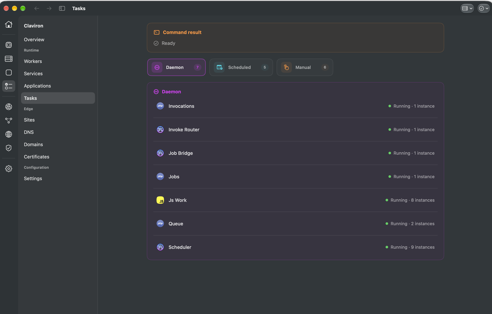

<p align="center">
  
</p>

# Claviron

Claviron is an embeddable Rust application runtime and server fabric. It brings
service lifecycle, HTTP hosting, application execution, process supervision, and
same-host shared state into one composable system.

Compose it as an Edge, an application runner, a managed client, a task service
or a VPN service. Select capabilities through Cargo features and service
registration; keep them together or connect separate processes through explicit
application contracts.

Your application owns its binary, business logic, configuration, and deployment.
Claviron supplies the infrastructure around it: register the services you need
and manage their execution through a common lifecycle.

## Write your own edge

Select the `edge` feature. Your binary starts the server; `http.yaml` declares
listeners and `vhost.yaml` declares the hosts and their routes.

```rust
use claviron::{Result, Server, Workers};

#[tokio::main]
async fn main() -> Result<()> {
    Server::new().config_dir("config")
        .workers(Workers::Available)
        .serve().await
}
```

`Workers::Available` opens one worker process per OS-reported available logical
CPU, plus the supervisor master. Use `workers(4)` for an explicit count. The
resolved count must fit the compiled fleet capacity; it is never silently capped.
This selects processes, independently of your Tokio runtime and listener execution.

Each listener is a managed runnable. Edge prepares a pipeline for each selected
listener/host combination; unused layers contribute no request-time action.
Serve files, register Rust handlers or route to embedded and Orbit Link apps.
See the [Edge guide](crates/edge/README.md) for configuration and host registration.

## Write your own application server

Use `claviron-runner` with `axum` and `socket`. Bring your router. Runner supplies
application lifecycle and the shared listener/pipeline implementation.

```rust
use claviron::axum::{routing::get, Router};
use claviron_runner::Runner;

#[tokio::main]
async fn main() -> claviron::Result<()> {
    Runner::new()
        .with_router(|_| Router::new().route("/", get(|| async { "Hello from Rust" })))
        .run().await
}
```

```yaml
# runner.yaml
name: hello
listeners:
  http:
    transport: tcp
    listen: 127.0.0.1:8000
    protocols: [h1]
```

For an Orbit-only application, select Runner features `orbit` and `axum` and replace
`listeners` with `fleet_name: apps` and `orbit: { link: {} }`.
An Edge on the same host can then reach this application by fleet and name.
Warp and other Rust HTTP services use the same [Runner API](https://github.com/claviron/runner).
The Rust entry points above use Tokio's `macros` and `rt-multi-thread` features.

## Write reusable extensions

A **backend** owns request execution. A **layer** contributes request or response
work around that owner. Both use the shared [pipeline](crates/pipeline/README.md)
contracts, so an integration can serve one application or selected Edge hosts.

### A backend

This registration function supplies a Rust response owner to a `SiteRegistry`.
It uses `edge` or `rust`, plus `axum`.

```rust
use claviron::{axum::{routing::get, Router}, http::RustRouter, pipeline::SiteRegistry};
use claviron::pipeline::factory::{backend, BackendPlacement::BeforeFiles, BackendScope};
use std::sync::Arc;

pub fn register(sites: &SiteRegistry) -> claviron::registry::Result<()> {
    sites.register_backend(backend("hello", BackendScope::site(), BeforeFiles, |_| {
        let router = Router::new().route("/", get(|| async { "Hello from a backend" }));
        Ok(vec![Arc::new(RustRouter::Axum(router))])
    }))
}
```

Call it during service registration. Edge exposes its shared site registry through
`HostAppRegistry::site()`; Runner registers `SiteRegistry` in the process registry.
Use `BackendScope::host` or `.at(prefix)` to restrict the scopes it serves.
A custom engine implements `DispatchStep` and `BackendHandler`; its
`BackendContract` declares identity export and response lifetime.

### A layer

A reusable response hook, with the same `axum` selection as above:

```rust
use claviron::axum::http::HeaderValue;
use claviron::pipeline::extension::{HostLayerBuilder, RouteLayer};

pub struct ServiceHeader;
impl RouteLayer for ServiceHeader {
    fn prepare(&self, layer: &mut HostLayerBuilder) -> claviron::pipeline::Result<()> {
        layer.after(|reply, _| {
            reply.headers.insert("x-service", HeaderValue::from_static("hello"));
        });
        Ok(())
    }
}
```

Expose it through `Routable::layers` for selected Edge hosts, or return
`RouteEffect::Layer` from a typed `RouteExtension` directive. Preparation happens
at boot/reload; request-time code runs only the actions that were installed.
See [HostPipeline](docs/design/HOST_PIPELINE.md) and the
[backend contract](docs/design/EDGE_BACKENDS.md) for ordering and ownership.

### A configuration directive: CSRF

An application can add typed configuration without changing Claviron's schema.
Here `sites` is its `SiteRegistry`, `CsrfLayer` implements `RouteLayer`, and
`verifier` owns session/token verification and rejection responses:

```rust
use claviron::pipeline::extension::{directive, RouteEffect};
use std::sync::Arc;

sites.register_route_extension(directive::<bool, _>("csrf", move |_, enabled| {
    Ok(RouteEffect::Layer(Arc::new(CsrfLayer::new(enabled, verifier.clone()))))
}))?;
```

The registered directive can then be selected for a path:

```yaml
routes:
  /account:
    csrf: true
```

`CsrfLayer::prepare` installs its request-head check only when enabled, before
that scope's application handler. The application decides which methods require
verification and how cookies, tokens and session scope are validated. `csrf` is
an application-owned directive, not an implicit built-in policy. Typed decoding
and layer preparation happen at boot/reload.

## Embed PHP in your server

[Claviron PHP](https://github.com/claviron/php) supplies in-process PHP SAPI and
an independent FastCGI backend. Embed supports ordinary request scripts and
persistent application mode. Register its backend in the same pipeline as Rust
handlers and files.

PHP Embed's native extensions expose selected host services: cache stores,
SQL pools, events, shared state and logging. With a cache store prepared by the
host, PHP can use it directly:

```php
$cache = claviron_cache_store();
claviron_cache_put($cache, 'greeting', ['message' => 'Hello from PHP']);
header('Content-Type: application/json');
echo json_encode(claviron_cache_get($cache, 'greeting'), JSON_THROW_ON_ERROR);
```

The [claviron/sapi package](https://github.com/claviron/php/tree/main/php)
supplies PHP declarations and a Monolog adapter. The native host selects and
prepares the services; Composer alone does not provide them. See the
[PHP integration guide](https://github.com/claviron/php#pipeline-integration)
for engine and backend registration.

## Use a framework runner

The framework keeps its routes, middleware and application conventions.
The runner embeds its engine in an application-owned Rust process and serves it
through TCP, Unix sockets or Orbit Link.

### Laravel with Lumenize

Enable Lumenize's `runner` feature and supply `lumenize.yaml`:

```rust
use lumenize::Runner;

#[tokio::main]
async fn main() -> lumenize::Result<()> {
    Runner::new().with_config_path("lumenize.yaml")?.run().await
}
```

[Lumenize](https://github.com/claviron/lumenize) owns the Laravel integration,
including its Composer package and persistent application mode.
See its [Runner guide](https://github.com/claviron/lumenize/blob/main/docs/runner/README.md)
for the launch configuration.

Its `claviron/laravel` extensions connect Laravel cache, sessions, queues,
database connections, logging and broadcasting to selected native host services.
Laravel keeps its container, routes, Eloquent and authorization. After configuring
a Claviron-backed default cache store, application code remains ordinary Laravel:

```php
use Illuminate\Support\Facades\Cache;

Cache::put('greeting', 'Hello from Laravel');
return response()->json(['message' => Cache::get('greeting')]);
```

Persistent Octane execution is an explicit mode. The same integration can be
registered in an application-owned Edge without selecting Lumenize's Runner.
See the [Laravel adapters](https://github.com/claviron/lumenize/tree/main/php).

### Python / ASGI with Gufi

Point Gufi at your ASGI application, such as `app = FastAPI()` in `main.py`:

```rust
use gufi::Runner;

#[tokio::main]
async fn main() -> gufi::Result<()> {
    Runner::new("main:app").name("hello").run().await
}
```

[Gufi](https://github.com/claviron/gufi) manages ASGI lifespan, streaming requests
and shutdown. `gufi.yaml` selects its listeners and Orbit membership.
Both runners accept additional Rust service registration and native routes.

## Use native bindings

Keep your language's own executable and runtime. The binding joins an Orbit
fleet; Edge owns public connections and routes requests to the named application.

### JavaScript: Deno, Node or Bun

Install `@claviron/orbit`. From Deno:

```javascript
import { serve } from "npm:@claviron/orbit";

await serve({ fleet: "apps", name: "hello" }, (request) => {
  return Response.json({ path: new URL(request.url).pathname });
});
```

Node and Bun use the same API with the import `"@claviron/orbit"`.
The [JavaScript package](https://github.com/claviron/js) includes native library
installation and [complete examples](https://github.com/claviron/js/tree/main/examples).

### Go: a standard HTTP handler

Inside your Go application, with `ctx` as its shutdown context and the
`context`, `fmt`, `net/http` and `github.com/claviron/go/orbit` imports:

```go
app, err := orbit.Open(orbit.Options{
    Fleet: "apps", Name: "hello", Incarnation: 1,
    NativeThreads: 1, MaxInFlight: 128, IOBufferBytes: 8192,
}, http.HandlerFunc(func(w http.ResponseWriter, r *http.Request) {
    fmt.Fprintln(w, "Hello from Go")
}))
if err != nil { return err }
defer app.Close()
select {
case <-ctx.Done(): return app.Shutdown(context.Background())
case <-app.Done(): return app.Err()
}
```

The [Go binding](https://github.com/claviron/go) documents native library setup;
its [complete example](https://github.com/claviron/go/tree/main/examples/plain)
owns signals and process shutdown.

### C or C++: a native callback

With the binding's `orbit.h`, write an HTTP handler:

```c
static uint32_t hello(orbit_request *request, void *context) {
    (void)context;
    uint32_t status = orbit_response_begin(request, 200);
    if (status != ORBIT_OK) return status;
    status = orbit_response_write(request, (const uint8_t *)"Hello!\n", 7);
    return status == ORBIT_OK ? orbit_response_finish(request) : status;
}
```

After opening a runtime and joining application `hello` on fleet `apps`:

```c
orbit_http_handler http = {.request = hello};
uint32_t status = orbit_serve(app, &http, NULL, NULL);
```

The [C binding](https://github.com/claviron/c) provides runtime creation,
explicit budgets and lifecycle APIs. Callbacks run on the calling thread;
native Orbit I/O uses the selected runtime. The same handlers can attach to
an existing event loop, including libuv. See its
[complete example](https://github.com/claviron/c/blob/main/examples/echo.c)
for error handling, shutdown and resource release.

### Java: a handler on your executor

Use `dev.claviron.orbit` with `CompletableFuture` and `Executors`. Within your
application's lifecycle, `stopped` is a caller-owned `CountDownLatch` signalled
during shutdown:

```java
var options = new ApplicationOptions("apps", "hello", 1, 128, 64, 64);
try (var library = NativeLibrary.load();
     var runtime = library.openRuntime(1024, 16 * 1024 * 1024, 2);
     var handlers = Executors.newVirtualThreadPerTaskExecutor();
     var app = runtime.join(options)) {
    app.serve(request -> CompletableFuture.completedStage(
            OrbitResponse.text("Hello from Java")), handlers);
    stopped.await();
}
```

The [Java binding](https://github.com/claviron/java) uses JDK FFM and a matching
native library. Your application owns its JVM, executor and shutdown signal.
See the [complete Java example](https://github.com/claviron/java/blob/main/examples/plain/PlainApplication.java)
for imports and lifecycle setup, and the package guide for native-access flags.

For any application above, an Edge host can select it with:

```yaml
# config/vhost.yaml
example.test:
  root: public
  transport: { non_ssl: serve, protocols: [h1] }
  orbit:
    - { fleet: apps, application: hello }
```

Embedded JavaScript is a separate choice: [claviron-deno](https://github.com/claviron/deno)
runs Deno Core/V8 **inside** the Claviron process. Its application exports a Fetch
handler rather than joining through a native binding:

```javascript
export default {
  fetch(request) {
    return Response.json({ path: new URL(request.url).pathname });
  },
};
```

## Crate guide and feature relationships

The root `claviron` crate is the public facade. Applications select its features
and import through paths such as `claviron::runtime` and `claviron::edge`.
The tables link every subsystem README and name its facade feature or selection
path.

### Runtime, applications, and shared execution

| Crate | Responsibility | Facade selection |
| --- | --- | --- |
| [runtime](crates/runtime/README.md) | Claviron-owned `AppState`, registry integration, process context, configuration, local events, and lifecycle bindings. | `runtime` |
| [app](crates/app/README.md) | Runtime-qualified application identity, controllers, status, and application events. | `application` |
| [runner](https://github.com/claviron/runner) | Launch options, HTTP and Orbit ingress, and routing around one application owner. | Separate crate |
| [supervisor](crates/supervisor/README.md) | Ownership and control of a master/worker process family. | `supervisor` |
| [orbit](crates/orbit/README.md) | Shared-memory resources, fleet event bridges, placement, and same-host transport bound to Claviron's lifecycle. | `orbit` |
| [tasks](crates/tasks/README.md) | Managed Rust, command, and hosted-language work with explicit triggers, placement, and cancellation. | `tasks` |

### HTTP hosting, transport, and routing

| Crate | Responsibility | Facade selection |
| --- | --- | --- |
| [edge](crates/edge/README.md) | Virtual-host publication, admission, response-owner selection, and consumer-defined route extensions. Also documents the `edge_config` alias. | `edge` |
| [http](crates/http/README.md) | Transport-neutral bodies, HTTP policies, listener declarations, and shared routing contracts. | `http`; Axum integration: `axum` |
| [pipeline](crates/pipeline/README.md) | Prepared request plans, backend contracts and route extensions shared by Edge and Runner. | `pipeline` |
| [transport](crates/transport/README.md) | Named listener runnables and socket/HTTP connection driving shared by Edge and Runner. | `transport` |
| [tls](crates/tls/README.md) | TLS handshakes, shared certificate resolution, and mTLS client-auth policy. | `tls` (includes `ssl`) |
| [files](crates/files/README.md) | Static-file serving, caching, and response construction. | `files`; included by `edge`, usable without it |
| [upstream](crates/upstream/README.md) | HTTP origin selection, pools, forwarding, and reload. | `upstream`; selecting `edge` also enables its Edge adapter |
| [resolver](crates/resolver/README.md) | DNS client contracts and optional Hickory implementation. | `resolver`; built-in driver: `resolver-hickory` |

Upstream applications bind their resolver implementation explicitly.

`ssl` provides certificate primitives; `tls` adds endpoint policy and resolution.
Database-backed certificate management, local CA/mTLS issuance, and ACME renewal
are available through the [managed extensions](#managed-extensions-and-clients).

### Data, identity, and hosting records

| Crate | Responsibility | Facade selection |
| --- | --- | --- |
| [cache](crates/cache/README.md) | Configured cache stores, local access, and fleet coherence. | `cache`; optional Redis support: `redis` |
| [db](crates/db/README.md) | Runtime-owned database pools and shared database capabilities. | `db`; backends: `postgres`, `mysql`, `sqlite` |
| [auth](crates/auth/README.md) | Schema-independent authentication, session, and CSRF contracts. | `auth` |
| [hosting](crates/hosting/README.md) | Persistent vhost, alias, and certificate records. | `hosting` (includes `tls` and `db`) |
| [geoip](crates/geoip/README.md) | IP-based location lookup through configured data providers. | `geoip` |

### Language engines and framework adapters

Language engines and realtime backends live in independent repositories:

| Integration | Project |
| --- | --- |
| Embedded PHP and FastCGI | [claviron-php](https://github.com/claviron/php) |
| Embedded Python / ASGI | [claviron-asgi](https://github.com/claviron/asgi) |
| Embedded Lua | [claviron-lua](https://github.com/claviron/lua) |
| Broadcast and Pusher compatibility | [claviron-broadcast](https://github.com/claviron/broadcast) |

Applications register their selected adapters; each prepares its backend through
the shared pipeline contract.

Laravel's native and Composer adapters live in the independent
[Lumenize library](https://github.com/claviron/lumenize). The
[Symfony integration](https://github.com/claviron/skene)
lives in Skene.

### Companion JavaScript integrations

These independent packages support embedded JavaScript or a separate application
process:

| Package | Integration |
| --- | --- |
| [claviron-deno](https://crates.io/crates/claviron-deno) | Slim embedded `deno_core`/V8 for persistent JS/TS applications, with native `claviron:*` modules for Orbit events, cells, counters, locks, and invocations. Provides selected Web APIs rather than the full Deno CLI environment. |
| [`@claviron/orbit`](https://github.com/claviron/js) | Native Node-API addon for Deno, Node, and Bun. A separate application joins an [Orbit Link](https://crates.io/crates/orbitive) fleet and handles Web `Request`/`Response` exchanges over SHM-based asynchronous streams, with events, shared cells, and lifecycle controls. |

[Orbit Link](https://crates.io/crates/orbitive) connects same-host processes
through shared-memory (SHM)-based asynchronous streams rather than requiring an
HTTP or Unix-domain-socket hop. Its body transport uses Orbitive's
[`orbit-stream`](https://crates.io/crates/orbit-stream) primitives for bounded,
duplex flow with backpressure and native wakeups. One standalone process or
multiple application instances can join while retaining their own runtime.

### Realtime protocols and delivery

| Crate | Responsibility | Facade selection |
| --- | --- | --- |
| [http::upgrade](crates/http/docs/upgrade/README.md) | HTTP/1 WebSocket admission and listener-owned handoff; also exposed as `claviron::websocket`. | `websocket` |

### Observability and native benchmark workloads

| Crate | Responsibility | Facade selection |
| --- | --- | --- |
| [logging](crates/logging/README.md) | Tracing setup and optional declared, fleet-written log channels. | `logging`; channels: `log-pipeline`; OTLP adapter: `log-otlp` |
| [runtime::metrics](crates/runtime/docs/metrics/README.md) | Runtime-owned metric-family composition; also exposed as `claviron::metrics`. | `metrics` |
| [bench](docs/bench/README.md) | Façade module with shared native HTTP workloads and explicit Edge or runner registration. | `bench`; combine with Edge or the separate Runner crate |

### Shared primitives and code generation

| Crate | Responsibility | Facade selection |
| --- | --- | --- |
| [helpers](crates/helpers/README.md) | Shared parsing, deserialization, overrides, and utility contracts. | Always available as `claviron::helpers` |
| [types](crates/types/README.md) | Canonical host identities and optional certificate primitives. | Host types through consumers; certificate toolkit: `ssl` |
| [macros](crates/macros/README.md) | Task registration and configuration override generation. | Task macro through `tasks`; config derive is implementation-facing |
| [sys](crates/sys/README.md) | Native socket, process-identity, and OS resource primitives. | `sys`; older Linux support: `legacy-linux` |
| [module](crates/module/README.md) | Compiled libraries loaded into the process, registering themselves as services and applications over a C ABI. | `module` |

### Combining optional capabilities

Features combine at the facade:

- `metrics` and `log-pipeline` add instrumentation to selected subsystems.
- `postgres`, `mysql`, and `sqlite` each select `db`, exposing the shared database
  API and its standard server registration as well as the chosen backend.
- `webtransport` selects `edge` and `http3` (including TLS).

Cargo's `dependency?/feature` forwarding extends a dependency only when it is
already selected. See the [manifest](Cargo.toml) for the complete feature graph.

## Managed extensions and clients

These independent backend services register through Claviron's public APIs:

| Crate | Capabilities |
| --- | --- |
| [claviron-acme](https://github.com/claviron/acme) | ACME account and certificate operations, HTTP-01 challenge integration, database-backed certificate issuance, and automatic renewal through a configured managed task. |
| [claviron-dns](https://github.com/claviron/dns) | Managed authoritative DNS zones and records, UDP/TCP nameserver listeners, optional DNS-over-HTTPS, and database-driven snapshot updates. |
| [claviron-domains](https://github.com/claviron/domains) | GoDaddy and Namecheap registrar clients, domain registration and renewal, delegation and DNS record management, and managed synchronization tasks. |
| [claviron-grpc](https://github.com/claviron/grpc) | mTLS-secured administration through selected Edge vhosts: workers, services, applications, tasks, hosting, certificates, DNS, domains, and ACME through selected capabilities. |

TLS serves prepared certificate snapshots from the hosting store without a
database query per handshake. The management extension adds local CA creation,
mTLS certificate issuance, and renewal. ACME renewal runs through its configured
task; domain renewal is a registrar operation, separate from synchronization.

[claviron-chat](https://crates.io/crates/claviron-chat) is a separate project for
fleet-aware, multi-worker chat: rooms, private messages, presence, persisted
history, delivery/read receipts, and an embeddable JavaScript client. It supports
WebSocket, HTTP/2 CONNECT, optional WebTransport, and a raw QUIC prototype.

[Claviron Apple](https://github.com/claviron/apple) is a native management client
connected through mTLS-secured gRPC. It displays fleet state and controls workers, services,
applications, and tasks, alongside certificate, DNS, and domain management.

**Fleet overview** — worker, service, application, and task counts with server
and connection details.

<p><a href="assets/gui-overview.png"></a></p>

**Applications** — one Claviron management API for embedded apps and separate
processes or fleets connected through [Orbit Link](https://crates.io/crates/orbitive)
on the same host.

<p><a href="assets/gui-applications.png"></a></p>

**Tasks** — daemon, scheduled, and manual task groups; the daemon list shows
running instance counts.

<p><a href="assets/gui-tasks.png"></a></p>

## Dependency injection and service lifecycle

Register a service once and resolve the same typed `Arc` within that process.
Trait bindings expose that instance through an interface without creating a
second copy. Components declare their dependencies, and the runtime orders
configuration, boot, validation, reload, and shutdown around those declarations.

Claviron's `AppState` owns the registry and process context.
[Continuo](https://crates.io/crates/continuo) supplies the DI and lifecycle traits;
Claviron implements them for `AppState` and uses `continuo::Runtime<AppState>`.
Services opt into the hooks they need, including `Runnable` for managed
background work.

These service instances are process-local. Orbit supplies shared state and
coordination between workers.

## Add Rust routes to an existing application

A managed service implementing `claviron::edge::Routable` selects hosts during
preparation and contributes handlers, layers or typed configuration directives.
Register it through `claviron::edge::register_routable`. Requests it leaves
unhandled continue to the configured backend; a response, including a 404,
is final. Host policy still applies.

The host-independent `claviron::pipeline::routing::Routable` contributes Axum
routes to a single application. Native routes can sit in front of a framework's
owner while the remaining requests keep reaching that framework. Compose their
authentication and authorization explicitly.

## One configuration and environment foundation

[Congif](https://crates.io/crates/congif) provides typed configuration catalogs
and prepared snapshots. [Dotenw](https://crates.io/crates/dotenw) prepares
environment values from the captured base, declared files, deployment variants,
and explicit overrides. `AppState` owns their shared preparation context.

Services implement Congif's `Configurable` contract with a typed schema, sources,
and validation. Custom services add their own configuration without changing
Claviron's schemas. Consumers read prepared snapshots; `ConfigObserver` opts
into change notifications. The owner determines reload or restart behavior.

Routing configuration is extensible too. A service's `Routable::route_extensions`
can supply [route directives](crates/edge/README.md#route-extensions) with their
own codecs and compilers. Edge prepares them with the host's routes; requests
use the compiled handlers rather than interpreting configuration again.
A framework running on Claviron can use this API to add its own typed vhost
and route settings, such as a locale or `csrf: true`. The framework defines
their behavior and responses; Claviron provides the extension points, not
application conventions.

The same environment preparation serves Claviron services, embedded applications,
and external programs. Each execution receives its declared values. Preparation
does not mutate the process environment; an already running child keeps its
environment until its owner refreshes or replaces it.

## From one process to a managed fleet

Run standalone, add supervised workers, or separate applications into dedicated
runners.

The [supervisor](crates/supervisor/README.md) can add or remove workers at runtime
within the declared fleet capacity. Adding boots the new worker; removing drains
the outgoing worker. Retained workers keep their processes and identities.
Rolling restart handles deliberate replacement.

A replacement master can adopt surviving workers from a failed master after
verifying their exact process identities and completing an ownership handshake.
The host's service manager remains responsible for restarting the master.

Orbit binds [Orbitive](https://github.com/iadev09/orbitive) primitives into this
lifecycle for same-host coordination and transport. SHM segments can outlive
processes; bounded event history is not a durable queue.

## Choose a composition

The facade has no default features. Start with the surface your application
actually needs:

- `runtime` exposes Claviron state and composition primitives without server
  bootstrap.
- `server` adds the standalone server lifecycle, application contracts, logging,
  and Orbit integration. It does not select HTTP listeners or worker supervision.
- [`claviron-runner`](https://github.com/claviron/runner) adds a single-application
  launch and ingress shell. Its native builder accepts a router or Tower service.
- `supervisor` adds managed worker processes to the server lifecycle.
- `edge` composes the supervised HTTP edge with native host routing, static-file
  support, and native cleartext HTTP/1 and HTTP/2 ingress.

Add `axum` for Axum Rust applications, or `tls`, `http3`, `tasks`, and `cache`
as needed.

Applications register their own components through `Server::register` or
`Server::with_services`, then provide the configuration and adapters their
composition requires. The examples above and the crate READMEs show each
composition.

## Architectural Design Contracts

These notes explain the choices behind Claviron's behavior, not new protocol
standards. Their identifiers are stable search keys across code and documentation.

- [ROLE_COMPOSITION](docs/design/ROLE_COMPOSITION.md) — compose the same runtime libraries into different application roles and explicit deployment boundaries.
- [HOST_PIPELINE](docs/design/HOST_PIPELINE.md) — connection binding, prepared host policy and native application dispatch.
- [EARLY_DATA_POLICY](docs/design/EARLY_DATA_POLICY.md) — separate 0-RTT support from permission to execute early requests.
- [CONNECTION_HIJACK](docs/design/CONNECTION_HIJACK.md) — let PHP and Rust use the same request-owned PostgreSQL session.
- [LIFETIME_POLICY](docs/design/LIFETIME_POLICY.md) — prepare work before the hot path without moving safety checks away from their evidence.
- [GRACEFUL_OWNERSHIP](docs/design/GRACEFUL_OWNERSHIP.md) — accepted work owns its drain; no implicit termination deadline.
- [HOT_CLIENT_POOL](docs/design/HOT_CLIENT_POOL.md) — retain usable clients with explicit warm-capacity and reuse policies.
- [WORKER_ADOPTION](docs/design/WORKER_ADOPTION.md) — transfer surviving workers through verified identity and explicit acceptance.
- [INCARNATION_MASKING](docs/design/INCARNATION_MASKING.md) — preserve worker slots and service roles without making applications track process incarnations.
- [FLEETAWARE](docs/design/FLEETAWARE.md) — cooperate across sibling processes on one OS, not an implied cloud cluster.
- [ORBIT_CELL](docs/design/ORBIT_CELL.md) — bind declared shared values to runtime-managed cell lifetimes.
- [ORBIT_LINK](docs/design/ORBIT_LINK.md) — connect named applications through bounded inboxes and asynchronous SHM streams.
- [LINK_INVOKE](docs/design/LINK_INVOKE.md) — call independent services through logical targets and reserved, correlated result channels.
- [PRODUCTION_ENVIRONMENT](docs/design/PRODUCTION_ENVIRONMENT.md) — choose the deployment environment explicitly and control what hosted execution inherits.

## Development status

Claviron is in alpha and available on [crates.io](https://crates.io/crates/claviron).

Examples follow the API on this branch. Use matching integration versions.
APIs and configuration may change between alpha releases.

## Contributing

See [CONTRIBUTING.md](CONTRIBUTING.md) for development, testing, and pull request
guidelines. Report vulnerabilities privately through [SECURITY.md](SECURITY.md).

## License

Claviron is licensed under either the [MIT License](LICENSE-MIT) or the
[Apache License, Version 2.0](LICENSE-APACHE), at your option.
Third-party source files retain their own license notices.
