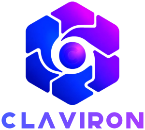
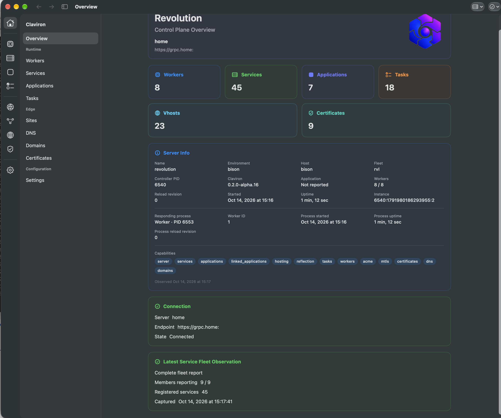

<p align="center">
  
</p>

# Claviron

**An application-first web server.**

Build a web server around your application. Serve Rust handlers, applications
in other languages, and static files from the same Edge. Run them together as
a modular monolith or deploy them as independent services. Start with the
architecture that fits today and move to Rust one route at a time.

Configure listeners, host routing, and request and response policies from
your application. Add your own handlers, backends, and layers where you need
them. A layer you leave out adds no work per request.

## Move to Rust without a full rewrite

Keep your application behind Claviron and add a **Rust intercept** for the first
route you want to move. Claviron runs the Rust handler first. Requests it leaves
unhandled continue to the existing application. You can move one API, a hot path,
or a security check at a time while keeping the public URL and host policies.

Start with a route that benefits from Rust's type and memory safety, or one
where you want to reduce latency or CPU use. Claviron can run the new Rust code
alongside your PHP, Python, JavaScript, Go, Java, or C/C++ application. Each part
can keep its existing runtime and move on its own schedule.

## Build your own Edge

Add `claviron` with the `edge` feature and Tokio with `macros` and
`rt-multi-thread`. Define your listeners and hosts in `config/`.

```rust
use claviron::{Result, Server, Workers};

#[tokio::main]
async fn main() -> Result<()> {
    Server::new()
        .config_dir("config")
        .workers(Workers::Available)
        .serve()
        .await
}
```

Start with the [Edge example](https://github.com/claviron/examples/tree/main/edge-server)
or the [Edge configuration guide](crates/edge/README.md).

## Bring your application

- **Rust** — Serve an Axum or Warp application with [Claviron Runner](https://github.com/claviron/runner), or add [reusable backends and layers](docs/design/EDGE_BACKENDS.md) to your Edge.
- **PHP** — [Embed PHP or use FastCGI](https://github.com/claviron/php). Run Laravel with [Lumenize](https://github.com/claviron/lumenize) or Symfony with [Skene](https://github.com/claviron/skene).
- **Python** — Run FastAPI and other ASGI applications with [Gufi](https://github.com/claviron/gufi).
- **JavaScript, Go, Java, and C/C++** — Use the native bindings to connect an application to Claviron over [Orbit Link](docs/design/ORBIT_LINK.md). [Browse runnable examples](https://github.com/claviron/examples).

## Performance

In a Linux HTTP/1.1 plaintext benchmark with 128 loopback connections and
1,280 target outstanding requests, both servers met the same SLA.

| Server | Responses/s | Server CPU/response |
| --- | ---: | ---: |
| Caddy 2.11.8 | 287,280 | 75.36 µs |
| Claviron with Axum | 788,552 | 25.49 µs |

[Benchmark setup and full results](https://git.claviron.dev/claviron/bench-http/issues/5)

## Run and manage your services

Start with one process and add supervised workers as traffic grows. Serve
HTTP/1.1, HTTP/2, and HTTP/3, and host services with WebSockets or WebTransport.
Use [Claviron for Apple](https://github.com/claviron/apple) to inspect running
applications, workers, and tasks.

<p><a href="https://github.com/claviron/apple"></a></p>

[Crates.io](https://crates.io/crates/claviron) · [API documentation](https://docs.rs/claviron) · [Contributing](CONTRIBUTING.md) · [Security](SECURITY.md)

Licensed under [MIT](LICENSE-MIT) or [Apache 2.0](LICENSE-APACHE).
