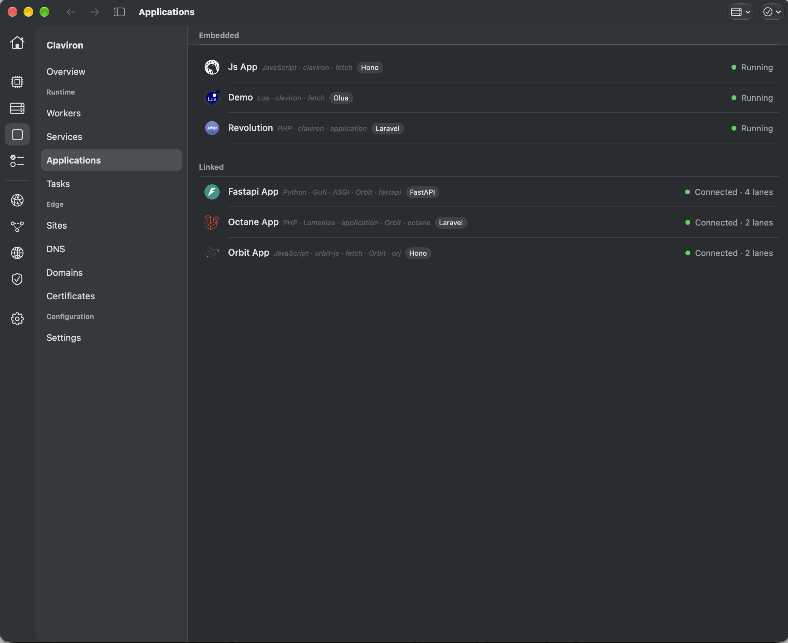
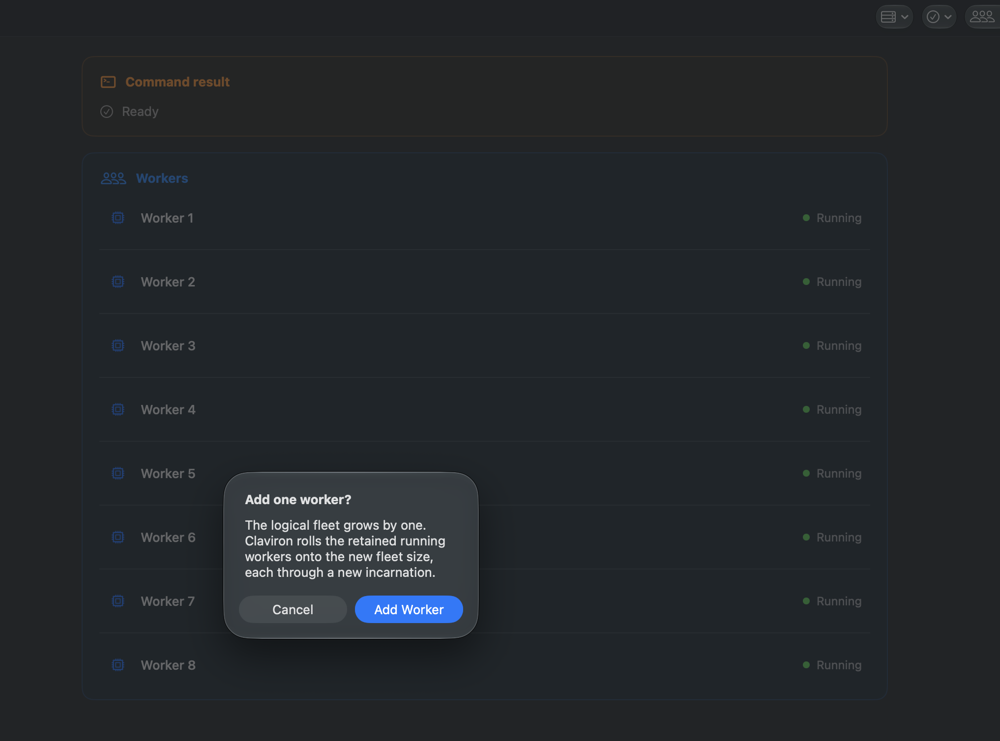

<p align="center">
  
</p>

# Claviron

**Retire middlemen. Let the others go!**

Claviron is an application-first toolkit for building and running services.
Run Rust alongside your existing applications. Keep them together as a modular
monolith or distribute them across independent processes.

Build your own Edge and serve public traffic directly. Terminate TLS, route
requests, serve files, and dispatch to your applications at the Edge. Your
application controls every layer, from listeners and access rules to handlers
and response policies. Enable what you need. An omitted layer adds no work
per request.

## Fleetware

**Taste the power of Orbit.** Let your processes share memory, exchange
requests, and publish events on the same host. Orbit's shared-memory waits use
Linux futexes, FreeBSD umtx, and shared address waits on macOS 14.4 and later.

[Fleet awareness](docs/design/FLEETAWARE.md) · [Orbit Link](docs/design/ORBIT_LINK.md)

## Move to Rust without a full rewrite

Keep your application behind Claviron and add a **Rust intercept** for the first
route you want to move. Claviron runs the Rust handler first. Requests it leaves
unhandled continue to the existing application. You can move one API, a hot path,
or a security check at a time while keeping the public URL and host policies.

Start with a route that benefits from Rust's type and memory safety, or one
where you want to reduce latency or CPU use. Claviron can run the new Rust code
alongside your PHP, Python, JavaScript, Go, Java, or C/C++ application. Each part
can keep its existing runtime and move on its own schedule.

## Design contracts

- [Role composition](docs/design/ROLE_COMPOSITION.md) · [Hot pipeline](docs/design/HOT_PIPELINE.md) · [Edge backends](docs/design/EDGE_BACKENDS.md)
- [Early data](docs/design/EARLY_DATA_POLICY.md) · [Connection hijack](docs/design/CONNECTION_HIJACK.md) · [Lifetime policy](docs/design/LIFETIME_POLICY.md)
- [Graceful ownership](docs/design/GRACEFUL_OWNERSHIP.md) · [Hot client pool](docs/design/HOT_CLIENT_POOL.md) · [Worker adoption](docs/design/WORKER_ADOPTION.md) · [Incarnation masking](docs/design/INCARNATION_MASKING.md)
- [Fleet awareness](docs/design/FLEETAWARE.md) · [Orbit Cell](docs/design/ORBIT_CELL.md) · [Orbit Link](docs/design/ORBIT_LINK.md) · [Link Invoke](docs/design/LINK_INVOKE.md)
- [Production environment](docs/design/PRODUCTION_ENVIRONMENT.md) · [All design contracts](docs/design/README.md)

## Build your own Edge

Add `claviron` with the `edge` and `supervisor` features and Tokio with
`macros` and `rt-multi-thread`. Define your listeners and hosts in `config/`.

```rust
use claviron::{Result, Server, Workers};

#[tokio::main]
async fn main() -> Result<()> {
    Server::new()
        .config_dir("config")
        .workers(Workers::Available)
        .serve()
        .await
}
```

Start with the [Edge example](https://github.com/claviron/examples/tree/main/edge-server)
or the [Edge configuration guide](crates/edge/README.md).

Add ACME certificate automation and gRPC administration with typed service
registration. DNS plugs into the same lifecycle through its registration
function. Use compatible releases of the three backend crates and enable their
server features.

```rust
use claviron::{Result, Server, Workers};
use claviron_acme::AcmeProvider as AcmeService;
use claviron_grpc::server::provider::GrpcServiceProvider as GrpcAdmin;

#[tokio::main]
async fn main() -> Result<()> {
    Server::new()
        .config_dir("config")
        .workers(Workers::Available)
        .with_services::<(AcmeService, GrpcAdmin)>()
        .register(claviron_dns::register)
        .serve()
        .await
}
```

[ACME](https://github.com/claviron/acme) · [gRPC administration](https://github.com/claviron/grpc) · [DNS](https://github.com/claviron/dns)

## Bring your application

- **Rust** — Serve an Axum or Warp application with [Claviron Runner](https://github.com/claviron/runner), or add [reusable backends and layers](docs/design/EDGE_BACKENDS.md) to your Edge.
- **PHP** — [Embed PHP or use FastCGI](https://github.com/claviron/php). Run Laravel with [Lumenize](https://github.com/claviron/lumenize) or Symfony with [Skene](https://github.com/claviron/skene).
- **Python** — Run FastAPI and other ASGI applications with [Gufi](https://github.com/claviron/gufi).
- **JavaScript, Go, Java, and C/C++** — Use the native bindings to connect an application to Claviron over [Orbit Link](docs/design/ORBIT_LINK.md). [Browse runnable examples](https://github.com/claviron/examples).

## Put boundaries where they belong

Let your Edge apply CORS and verify CSRF before a request reaches PHP.
Claviron includes CORS policy. Register a route extension for CSRF and give
it the application's session and token verifier. The Edge can then enforce
the check on the routes you select.

```yaml
routes:
  /account:
    csrf: true
```

[Register a route extension](crates/edge/README.md#route-extensions)

## Serve static files at the Edge

Mount asset directories, serve directory indexes, and configure `try_files`
or an SPA fallback. Large files stream from disk with backpressure. Small
files can be cached in memory and shared across workers when the fleet cache
is enabled.

| Capability | HTTP specification |
| --- | --- |
| ETag and Last-Modified, conditional requests, and single byte ranges | [RFC 9110 §§8.8, 13–14](https://www.rfc-editor.org/rfc/rfc9110.html#section-8.8) |
| Browser freshness via Cache-Control and Expires, with opt-in immutable assets | [RFC 9111 §5](https://www.rfc-editor.org/rfc/rfc9111.html#section-5), [RFC 8246](https://www.rfc-editor.org/rfc/rfc8246.html) |
| Negotiated Brotli and Zstandard representations | [RFC 9110 §12.5](https://www.rfc-editor.org/rfc/rfc9110.html#section-12.5), [RFC 7932](https://www.rfc-editor.org/rfc/rfc7932.html), [RFC 8878](https://www.rfc-editor.org/rfc/rfc8878.html) |

[Static file configuration and caching](crates/files/README.md)

## Performance

**Plain HTTP.** At the highest load all three configurations passed in the
same Linux HTTP/1.1 run, Claviron with Axum delivered 3.27× Caddy's throughput
with 68% less server CPU per response.

| Server | Responses/s | CPU/response |
| --- | ---: | ---: |
| Caddy 2.11.9 | 268,817 | 74.76 µs |
| Claviron + Axum, 32 workers | 879,753 | 24.09 µs |

A separate run reached **1,045,500 responses/s** with Claviron and Warp.
[Matched Caddy comparison](docs/bench/http1-plain-caddy.md) · [Warp peak](docs/bench/http1-plain-128.md)

**Persistent PHP.** With 128 PHP instances and 1,024 connections, both servers
completed the five-minute runs without errors. Each cell shows responses per
second and server CPU per response.

| Workload | Claviron | FrankenPHP 1.13.5 |
| --- | ---: | ---: |
| Plain PHP | 299,896 / 64.72 µs | 90,015 / 227.23 µs |
| Symfony, with Skene on Claviron | 88,139 / 312.43 µs | 41,398 / 565.52 µs |

[FrankenPHP comparison](docs/bench/php-frankenphp.md) · [Laravel/Lumenize results](https://github.com/claviron/examples/blob/main/BENCHMARKS.md)

## Near-native throughput with managed workers

On Linux with 1,024 HTTP/1.1 connections, Claviron Other delivered **93% of
native Hyper's throughput** at the highest load both passed. Its 40 supervised
worker processes kept meeting the SLA up to 38,912 outstanding requests.

| Server | Responses/s at 16,384 outstanding | Server CPU/response | Last passing outstanding target |
| --- | ---: | ---: | ---: |
| Native Hyper, 40 runtime threads | 1,811,355 | 14.50 µs | 16,384 |
| Claviron Other, 40 worker processes | 1,678,101 | 16.31 µs | 38,912 |

[HTTP/1.1 benchmark and methodology](docs/bench/http1-plain-1024.md)

With [Claviron for Apple](https://github.com/claviron/apple), see embedded and
linked applications together and add workers from the same app.

<p>
  
</p>
<p>
  
</p>

[Crates.io](https://crates.io/crates/claviron) · [API documentation](https://docs.rs/claviron) · [Contributing](CONTRIBUTING.md) · [Security](SECURITY.md)

[Examples](https://github.com/claviron/examples) · [Bench HTTP](https://github.com/claviron/bench-http) · [Break](https://github.com/iadev09/break)

Licensed under [MIT](LICENSE-MIT) or [Apache 2.0](LICENSE-APACHE).
