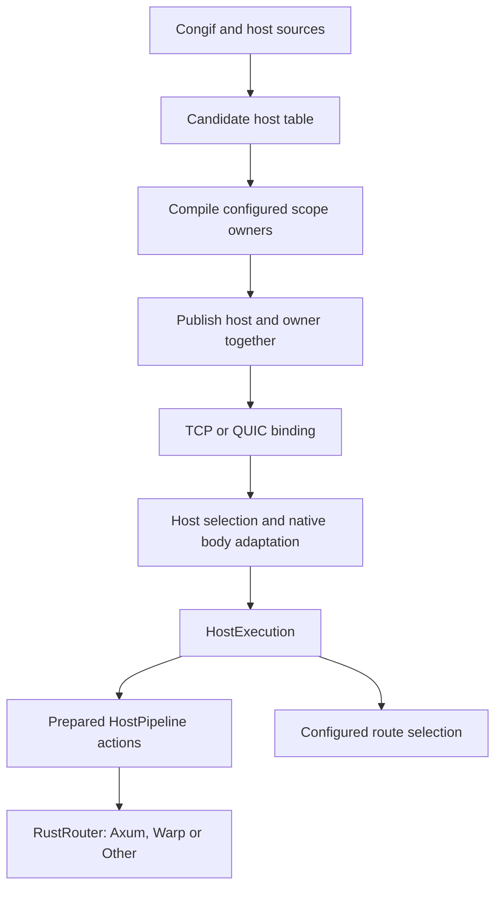

# claviron-edge

HTTP host selection, native dispatch and optional TCP/QUIC drivers.

## Boundaries

- `loader` prepares host declarations and publishes names, policy and applications
  together. Congif owns configuration reads and source watching.
- `service` binds an accepted transport/request to a ready host plan.
- `pipeline` prepares host actions and request owners. Axum is a Rust application
  adapter; files, Embed, Upstream and Link use native dispatch.
- `tcp` and `quic` own wire framing, native body adaptation, accepted connections
  and sessions. Engine execution belongs to the corresponding runtime crate.

`HostLayer` is a cold preparation contract. Active head checks, asynchronous
waits, consuming calls and response hooks share one flat plan. `Unhandled`
transfers the same unread body; a handled status never signals fallthrough.
Only reached layers shape a reply. Axum is an application adapter.

## HostPipeline order

[`host/compile.rs`](src/pipeline/host/compile.rs) builds each host's scope plans at
boot/reload, before publication. Each host retains its own compiled plan.
Only declared or registered actions enter it. `HostLayer::prepare` may add
nothing; the builder retains no runtime node for an empty layer. Requests execute
the prepared actions without checking whether each capability is enabled.

Host selection precedes the pipeline. Multiple prefix scopes or entry conditions
add `RouteSelectionLayer`; a single unconditional root scope uses its plan
directly. Prefix and condition matching still happen per request.

Within the selected scope, entries follow this order. Undeclared entries are
absent from the compiled plan:

| Order | Entry | Selected by |
| --- | --- | --- |
| 1 | Trusted proxy / real IP | Nonempty forwarding headers and trusted networks on listeners exposing this host. |
| 2 | Deny → IP ACL | Nonempty HTTP deny defaults; restrictive host/prefix ACL rules. |
| 3 | Quota admission | Prepared host quota rules. |
| 4 | Registered route layers, then resolved directive layers | Matching Routable providers in registration order; directives in name order. |
| 5 | H1 WebSocket endpoints | H1 upgrades enabled and registered endpoints present. |
| 6 | Rust contributions, scope handler, then `RustRouter` | Matching Routables, a handler directive, or an explicit Axum/Warp/Other binding. |
| 7 | Broadcast REST → Static → TryFiles | Configured broadcast endpoints, static mounts, enabled TryFiles. |
| 8 | Link → Lua → PHP → Upstream | Configured backend declarations and their compiled features. |
| 9 | Index/SPA file fallback | An index or SPA declaration. |

Proxy and ACL borrow accepted connection facts. Forwarding changes only the
request's `RealIpExt`; an untrusted peer cannot choose its ACL or quota identity.
ACL refusals do not charge quota. Quota refusals do not enter application
extensions. Authentication, sessions and CSRF remain application/framework work.
An allow-all ACL alone installs no action; an allow-all child remains an explicit
exception when a parent is restrictive. A deny-all rule remains active.

`Handled` ends dispatch, including error responses. `Unhandled` transfers the
same unread request to the next entry. If nothing handles it, the plan returns
404. A terminal `RustRouter` with no preceding actions uses the direct-call path.

Response-head and body hooks run in reverse order, only for reached scopes.
Registered route layers determine custom policy order after quota. The compiler
connects proxy, deny, ACL and quota declarations to their prepared layers;
`RouteConfig.cors` is not yet connected to `CorsLayer` in this composition.
Broadcast's own CORS policy is separate. Response-head deadline ownership remains
separate from transport limits.

## Reload and ownership

Host preparation runs before table publication. A rejected host candidate keeps
the old table. Unchanged declarations retain identity and prepared applications.
Compilation captures one HTTP snapshot per batch; changed HTTP defaults or
listener policies invalidate cached host executions.
TLS/H3 retain the accepted binding; cleartext selects the current host/application
per request. HostBinding observes publications to retire changed connections.
Accepted bodies, sessions and capacity remain with their native owners through
drain; the [graceful ownership contract](../../docs/design/GRACEFUL_OWNERSHIP.md)
defines termination authority. Configured quota changes currently require restart.

`HttpServer`, `HttpsServer` and `H3Server` remain configuration/DI owners.
Each declares one `Listener:<id>` runnable per configured listener. Unchanged
allocations retain their management identity; removals cancel and drain only
that listener. Re-adding a draining declaration retains its handle. Changing
transport ownership requires stopping the old instance and reconciling before
starting the replacement. All addresses of one listener share its gate and
run generation; sibling listeners have independent lifetimes.

`http.yaml` may select `plain_execution: current_thread`: each cleartext
listener gets a named, process-local executor domain reused across its
generations. Its reactor survives provider finalization for pooled I/O cleanup.
The default `shared` uses ambient Tokio; TLS/H2/H3 execution is unchanged.
Bind, accept and connection tasks stay on the selected executor. Execution
changes apply to the next instance start/restart, never an active connection.

Relative disk paths remain process-working-directory relative. Prefix mappings
inherit the nearest declared `directory`; URL-derived dot segments are rejected.
Policy-only children retain applicable static mounts and mount-relative rules
unless they remap directories. Backend owners and TryFiles are not inherited.

## Features

| Feature | Enables |
| --- | --- |
| `server` | Provider, host compilation and transport-facing APIs. |
| `tcp`, `tls` | Native cleartext H1; optional TLS H1/H2. |
| `http3`, `quic` | H3 contracts; native Quinn/H3 driver. |
| `axum` | Rust router adapter and HostConfigExt extractor. |
| `lua` | Native Lua backend. |
| `php`, `php_embed`, `php_fcgi` | PHP declarations; Embed or FastCGI adapters. |
| `orbit`, `upstream` | Link or HTTP-upstream dispatch. |
| `websocket`, `webtransport` | Native session bindings and combined runtime adapters. |
| `broadcast` | Pusher REST and broadcast session composition. |
| `rate-limit`, `access-log` | Optional quota and access-record paths. |
| `db`, `postgres` | Hosting alias hydration; PostgreSQL notification adapter. |
| `metrics`, `geoip` | HTTP metrics and peer country lookup. |

Features compile capabilities; declarations and registration select what runs.
Transport snapshots retain wire/listener settings. New policy execution uses
explicit host layers; TCP handoff installs no fallback policy executor. H3 still
owns native framing and buffered/streamed body bounds during this transition.

## `src/`

### Entry points

- [`lib.rs`](src/lib.rs) — Public exports and registration; master/serving-process composition.
- [`config.rs`](src/config.rs) — Host identity, transport policy and normalized route views; read-only backend accessors.
- [`provider.rs`](src/provider.rs) — Congif HTTP configuration owner; validate capabilities and atomically publish HttpSnapshot.
- [`log`](src/log.rs) — Optional access-record producer and response-body accounting guard.
- [`listener.rs`](src/listener.rs) — Hosting alias notifications and atomic candidate updates; PostgreSQL NOTIFY or hosting events.
- [`transport.rs`](src/transport.rs) — Public transport-facing re-exports; loader and service remain internal.
- [`transport/instances.rs`](src/transport/instances.rs) — Cold listener declarations, retained handles and weak references to draining instances.

### `config/`

- [`routing.rs`](src/config/routing.rs) — One RouteConfig schema for root/prefix declarations; `directory` selects disk mapping. Scope settings retain one declaration owner.
- [`routing/statics.rs`](src/config/routing/statics.rs) — Compile directory groups into static mounts with derived URL prefixes.
- [`quota.rs`](src/config/quota.rs) — Validate the same rate-limit declaration at every scope without opening stores.

### `loader/`

- [`loader.rs`](src/loader.rs) — Module boundary for declaration loading and host publication.
- [`config.rs`](src/loader/config.rs) — VhostDocument, recursive includes, partial reads and unchanged declaration reuse.
- [`error.rs`](src/loader/error.rs) — Declaration and load errors.
- [`table.rs`](src/loader/table.rs) — Canonical names, validated aliases, listener/log selectors and prepared dependencies.
- [`snapshot.rs`](src/loader/snapshot.rs) — Candidate host/alias edits and optional database alias hydration.
- [`resolver.rs`](src/loader/resolver.rs) — Retained sources, dependent preparation, atomic table publication and binding retirement.

### `service/`

- [`service.rs`](src/service.rs) — Transport handoff exports; no file loading or backend execution engine.
- [`authority.rs`](src/service/authority.rs) — Validated cleartext authority and connection-local name identity reuse.
- [`bindings.rs`](src/service/bindings.rs) — Pair live names with the captured TLS policy epoch.
- [`extensions.rs`](src/service/extensions.rs) — VhostCtx and connection-time SNI selection/rejections.
- [`host.rs`](src/service/host.rs) — HostService and native request handoff; no fixed Ingress/Identity/Access chain.
- [`host/cache.rs`](src/service/host/cache.rs) — Cleartext metadata cache and current-publication owner selection.
- [`host/dispatch.rs`](src/service/host/dispatch.rs) — Execute the prepared host owner; retain the direct-call optimization only for a plan without preceding actions.
- [`response.rs`](src/service/response.rs) — Typed early host replies, before native wire framing.

### `pipeline/`

- [`pipeline.rs`](src/pipeline.rs) — Public native composition contracts and optional adapter exports.
- [`apps.rs`](src/pipeline/apps.rs) — Retained factories, directives and per-host application snapshot preparation/reuse.
- [`routable.rs`](src/pipeline/routable.rs) — Provider-owned contributions, native layers and exclusive host bindings.
- [`extension.rs`](src/pipeline/extension.rs) — Typed directives and boot-time RouteContext; borrow inherited settings and prepare effective policy.
- [`routing.rs`](src/pipeline/routing.rs) — Shared prefix dispatch and route-extension re-exports.
- [`apps/axum.rs`](src/pipeline/apps/axum.rs) — Axum host registration, ApplicationHandler/HostHandler adaptation and HostConfigExt extractor.
- [`apps/warp.rs`](src/pipeline/apps/warp.rs) — Warp host registration and native handler adaptation.
- [`apps/other.rs`](src/pipeline/apps/other.rs) — Other host registration and re-exports of the shared HTTP handler contract.
- [`connect.rs`](src/pipeline/connect.rs) — H2 CONNECT registry, explicit binding execution, authentication payload and session context.
- [`wt.rs`](src/pipeline/wt.rs) — Native WebTransport handler/session API and exact/fallback registry.
- [`upstream.rs`](src/pipeline/upstream.rs) — Configured upstream selection after local file steps.
- [`apps/broadcast.rs`](src/pipeline/apps/broadcast.rs) — Broadcast H1/H2/H3 session bindings and session admission.
- [`apps/broadcast/rest.rs`](src/pipeline/apps/broadcast/rest.rs) — Claim configured REST endpoints without wrapping unrelated requests.

### `pipeline/host/`

Scope compilation puts extensions, WebSocket endpoints, Rust contributions,
Static, TryFiles and configured backends into the same flat layer builder.
There is no separate application/dispatch chain or automatic SelectedRoute
extension insertion. Rust router and backend calls implement `HostLayer`.
HostExecution retains the compiled host plan. Only an empty prefix of actions
may retain a direct Rust call; selecting Other never bypasses host layers.
Disabled file steps allocate no prepared file owner.

- [`host.rs`](src/pipeline/host.rs) — HostLayer/HostPipeline types and typed request/reply capabilities.
- [`builder.rs`](src/pipeline/host/builder.rs) — Flatten active actions once; failed layer preparation changes nothing.
- [`request.rs`](src/pipeline/host/request.rs) — Flat head/async/request execution, unread body transfer and reached response scopes.
- [`response.rs`](src/pipeline/host/response.rs) — Run only reached response/body actions, in reverse registration order.
- [`binding.rs`](src/pipeline/host/binding.rs) — Accepted connection facts and narrowed declaration data; no implicit actions.
- [`protocol.rs`](src/pipeline/host/protocol.rs) — Independent authority, rejection, early-data and H1-upgrade layers.
- [`identity.rs`](src/pipeline/host/identity.rs) — Explicit typed metadata layer; retain accepted connection ownership without normalization copies.
- [`identity/extensions.rs`](src/pipeline/host/identity/extensions.rs) — Typed metadata in request-owned extension boxes.
- [`deny.rs`](src/pipeline/host/deny.rs) — Explicit nonempty URI matcher; no transport snapshot or proof wrapper.
- [`proxy.rs`](src/pipeline/host/proxy.rs) — Trusted-peer forwarding layer; only request RealIpExt changes.
- [`acl.rs`](src/pipeline/host/acl.rs) — Explicit ACL layer; borrow accepted identity or a selected forwarding result.
- [`acl/path.rs`](src/pipeline/host/acl/path.rs) — Compiled segment ACLs and unambiguous comparison paths.
- [`redirect.rs`](src/pipeline/host/redirect.rs) — Scoped redirects and prepared Location values; URL selection belongs to the common route table.
- [`quota.rs`](src/pipeline/host/quota.rs) — Rate-admission layer for typed or native replies and its committed snapshot.
- [`quota/prepare.rs`](src/pipeline/host/quota/prepare.rs) — Config/Rust quota bindings, resource validation and store lifetime.
- [`cors.rs`](src/pipeline/host/cors.rs) — Explicit CORS layer, boot-compiled origin matcher and request-owned accepted origin.
- [`cors/rules.rs`](src/pipeline/host/cors/rules.rs) — Origin admission, preflight response and CORS response headers.
- [`http01.rs`](src/pipeline/host/http01.rs) — Optional ACME file layer with validated single-component tokens.
- [`headers.rs`](src/pipeline/host/headers.rs) — Separate Set/Clear layers and cold header inheritance.
- [`body`](src/pipeline/host/request_body.rs) — Explicit size/idle bounds; empty bodies keep their original owner.
- [`reply.rs`](src/pipeline/host/reply.rs) — Explicit response size/idle guards; absent limits install no guard.
- [`log`](src/pipeline/host/access_log.rs) — Optional access-channel selection and record/body lifetime transfer.
- [`application.rs`](src/pipeline/host/application.rs) — Consuming terminal call with its concrete future.
- [`handler.rs`](src/pipeline/host/handler.rs) — Routable contributions; Unhandled retains the unread body capability.
- [`dispatch.rs`](src/pipeline/host/dispatch.rs) — Consume synchronous DispatchCall decisions before await; only compact pending futures enter suspended state, reusing existing application erasure.
- [`selection.rs`](src/pipeline/host/selection.rs) — Prefix/condition selection as a HostLayer; single-scope hosts omit it.
- [`execution.rs`](src/pipeline/host/execution.rs) — Published host execution; separate from the Axum/Other router choice.
- [`compile.rs`](src/pipeline/host/compile.rs) — Compile prefix scopes, conditions, Rust contributions and backend owners.
- [`backend.rs`](src/pipeline/host/backend.rs) — Prepare configured backend steps and residual index/SPA fallback.
- [`files.rs`](src/pipeline/host/files.rs) — Separate Static and TryFiles steps using the shared files API.
- [`extension.rs`](src/pipeline/host/extension.rs) — Route-layer preparation adapter.
- [`websocket.rs`](src/pipeline/host/websocket.rs) — Prepared exact H1 endpoints before Rust/file/backend dispatch.

### `pipeline/embed/`

- [`embed.rs`](src/pipeline/embed.rs) — Embedded adapter boundary; engines and their lifecycle belong to their owning crates.
- [`lua.rs`](src/pipeline/embed/lua.rs) — Lua mount selection; a nonmatch returns synchronously without a future allocation.
- [`lua/origin.rs`](src/pipeline/embed/lua/origin.rs) — Shared socket-origin checks against admitted authority and transport scheme.
- [`lua/websocket.rs`](src/pipeline/embed/lua/websocket.rs) — Lua H1 upgrades and H2 CONNECT from flat/scoped declarations.
- [`lua/webtransport.rs`](src/pipeline/embed/lua/webtransport.rs) — Lua native H3 session admission and stream handoff.
- [`php.rs`](src/pipeline/embed/php.rs) — Resolve PHP mappings and prepare runner-specific mount owners.
- [`php/app.rs`](src/pipeline/embed/php/app.rs) — Persistent application handle; unavailable selected applications own their 503.
- [`php/script.rs`](src/pipeline/embed/php/script.rs) — Script resolver handoff; an unclaimed request retains its body.
- [`php/fcgi.rs`](src/pipeline/embed/php/fcgi.rs) — FastCGI resolver handoff through the native PHP adapter.

### `pipeline/link/`

- [`link.rs`](src/pipeline/link.rs) — Prepared Link targets; concurrent upload/reply streaming and native WebSocket handshake.
- [`body.rs`](src/pipeline/link/body.rs) — Upload task ownership transfers from head wait to response body.
- [`websocket.rs`](src/pipeline/link/websocket.rs) — H1/H2 wire acceptance and bounded Link message relay.
- [`webtransport.rs`](src/pipeline/link/webtransport.rs) — Route-selected H3 sessions and independently owned bidi Link exchanges.

### `tcp/`

- [`mod.rs`](src/tcp/mod.rs) — TCP module exports and native fixture inclusion.
- [`listener.rs`](src/tcp/listener.rs) — Bind groups, shared capacity, accepted tasks/session ownership and drain.
- [`listener/accept.rs`](src/tcp/listener/accept.rs) — Socket-local accept error classification and declared recovery backoff.
- [`io.rs`](src/tcp/io.rs) — Shared socket IO and error readiness without a competing byte reader.
- [`protocol.rs`](src/tcp/protocol.rs) — Hyper H1 builder and TCP socket options from resolved config.
- [`geo.rs`](src/tcp/geo.rs) — Optional peer country lookup.
- [`service.rs`](src/tcp/service.rs) — Thin Hyper service and body representation adaptation.
- [`service/body.rs`](src/tcp/service/body.rs) — Lazy body erasure and proven-empty-body handling; preserve trailers.

### `tcp/plain/`

- [`plain.rs`](src/tcp/plain.rs) — Cleartext H1 driver exports.
- [`server.rs`](src/tcp/plain/server.rs) — HttpServer configuration, snapshots and named listener registration; `connection_handler` prepares a typed listener without binding or provider boot.
- [`conn.rs`](src/tcp/plain/conn.rs) — Socket/context setup, H1 driving and connection drain; public `ConnectionHandler` serves caller-accepted streams through the same native path.
- [`handler.rs`](src/tcp/plain/handler.rs) — Cleartext authority selection and native host handoff.
- [`error.rs`](src/tcp/plain/error.rs) — Cleartext driver errors.

### `tcp/secure/`

- [`secure.rs`](src/tcp/secure.rs) — TLS H1/H2 driver exports.
- [`server.rs`](src/tcp/secure/server.rs) — HttpsServer configuration owner, named listener lifetimes and TLS policy preparation.
- [`tls.rs`](src/tcp/secure/tls.rs) — ClientHello/SNI authentication, ALPN intersection and TLS policy epochs.
- [`conn.rs`](src/tcp/secure/conn.rs) — Verified TLS metadata and the accepted host/application binding.
- [`handler.rs`](src/tcp/secure/handler.rs) — TLS handshake deadline, H1/H2 driving and graceful/forced connection drain.
- [`error.rs`](src/tcp/secure/error.rs) — TLS/native connection error classification.

### `quic/`

- [`mod.rs`](src/quic/mod.rs) — Native H3 driver exports.
- [`server`](src/quic/server.rs) — H3 configuration owner, environment binding, snapshots and named listener lifetimes.
- [`tls.rs`](src/quic/tls.rs) — Deferred SNI authentication and coherent host/TLS selector views.
- [`listener.rs`](src/quic/listener.rs) — Endpoint groups, connection capacity, concurrent request/session stream driving.
- [`listener/drain.rs`](src/quic/listener/drain.rs) — Join connection-owned children on completion, explicit force or panic.
- [`request.rs`](src/quic/request.rs) — H3 framing validation, buffered/streaming body adaptation and response IO.
- [`error.rs`](src/quic/error.rs) — Normal closure and interrupted-stream classification.
- [`wt.rs`](src/quic/wt.rs) — Authorize and hand native WebTransport sessions to applications.
- [`wt/streams.rs`](src/quic/wt/streams.rs) — Bounded per-session input; a saturated session never blocks the shared driver.

## `tests/`

Test files mirror their owning modules. They exercise parsing, routing, body
ownership and isolated state transitions without provider boot or live listeners.

### Entry and configuration

- [`transport/instances.rs`](tests/transport/instances.rs) — Retain unchanged/draining listener identities and release retired allocations.

- [`authority.rs`](tests/authority.rs) — Explicit authority-layer rejection, aliases and unchanged request metadata.
- [`sni.rs`](tests/sni.rs) — SNI/catchall lookup and bounded name churn.
- [`provider.rs`](tests/provider.rs) — Prepared HTTP values, capability rejection and invalid-candidate retention.
- [`config/routing.rs`](tests/config/routing.rs) — Route normalization, inheritance, mappings and unavailable capability rejection.
- [`fixtures/http/base.yaml`](tests/fixtures/http/base.yaml) — Valid HTTP preparation input.
- [`fixtures/http/changed.yaml`](tests/fixtures/http/changed.yaml) — Changed listener-policy input.
- [`fixtures/http/invalid.yaml`](tests/fixtures/http/invalid.yaml) — Invalid listener-address input.

### `loader/`

- [`table.rs`](tests/loader/table.rs) — Canonical/alias validation, declaration ownership and listener selectors.
- [`snapshot.rs`](tests/loader/snapshot.rs) — Database alias input validation.
- [`resolver.rs`](tests/loader/resolver.rs) — Boot dependency declaration.
- [`resolver/selection.rs`](tests/loader/resolver/selection.rs) — Coherent application selection, publication failure and generation ownership.
- [`binding.rs`](tests/loader/binding.rs) — Event-driven retirement and atomic alias changes.

### `pipeline/`

- [`apps.rs`](tests/pipeline/apps.rs) — Rust binding/layer composition, duplicate-owner retention and HTTP-policy cache invalidation.
- [`broadcast.rs`](tests/pipeline/broadcast.rs) — Selected broadcast route ownership.
- [`broadcast/rest.rs`](tests/pipeline/broadcast/rest.rs) — REST endpoint claims and terminal responses.
- [`host.rs`](tests/pipeline/host.rs) — Layer preparation, response scope, body ownership, wakeup and cancellation.
- [`apps/warp.rs`](tests/pipeline/apps/warp.rs) — Warp rejection remains a terminal handled response.
- [`quota.rs`](tests/pipeline/quota.rs) — Public quota registration shared by canonical names and aliases.
- [`wt.rs`](tests/pipeline/wt.rs) — Exact native bindings precede Link fallback.
- [`link.rs`](tests/pipeline/link.rs) — Link route misses, handshake construction, message forwarding and cancellation.
- [`link/webtransport.rs`](tests/pipeline/link/webtransport.rs) — Independent streams, route ownership, cancellation and partial writes.
- [`embed/lua.rs`](tests/pipeline/embed/lua.rs) — Lua mount precedence and unchanged unread bodies/trailers.
- [`embed/lua/origin.rs`](tests/pipeline/embed/lua/origin.rs) — Origin ambiguity, requested aliases/ports and accepted scheme.
- [`embed/lua/socket_path.rs`](tests/pipeline/embed/lua/socket_path.rs) — Mounted endpoint paths and removed/masked socket ownership.
- [`embed/lua/webtransport.rs`](tests/pipeline/embed/lua/webtransport.rs) — H3 endpoint ownership and effective origin policy.
- [`embed/php.rs`](tests/pipeline/embed/php.rs) — Runner selection and file mapping without starting PHP.

### `pipeline/host/`

- [`application.rs`](tests/pipeline/host/application.rs) — Deferred calls, cancellation and payload/response scope.
- [`dispatch.rs`](tests/pipeline/host/dispatch.rs) — Compact pending state, synchronous unread-body transfer, existing erasure and cancellation.
- [`handler.rs`](tests/pipeline/host/handler.rs) — Rust fallthrough, terminal status, cancellation and optional Axum adapter.
- [`compile.rs`](tests/pipeline/host/compile.rs) — Scope conditions and Static/TryFiles/backend precedence.
- [`compile/defense.rs`](tests/pipeline/host/compile/defense.rs) — Proxy trust, Deny/ACL/Quota order, extension admission, body ownership and absent-rule direct calls.

### `pipeline/layers/`

- [`identity.rs`](tests/pipeline/layers/identity.rs) — Accepted identity reuse and unchanged body ownership.
- [`identity/extensions.rs`](tests/pipeline/layers/identity/extensions.rs) — Typed values, existing box reuse and independent extension maps.
- [`acl/path.rs`](tests/pipeline/layers/acl/path.rs) — Segment specificity, escaped paths and ambiguous slashes.
- [`quota.rs`](tests/pipeline/layers/quota.rs) — Borrowed connection identity, shared debt, cancellation and committed reply headers.
- [`quota/prepare.rs`](tests/pipeline/layers/quota/prepare.rs) — Resource collisions, prefix selection, config checks and reload restrictions.
- [`redirect.rs`](tests/pipeline/layers/redirect.rs) — Ordered path redirects and literal request data in templates.
- [`deny.rs`](tests/pipeline/layers/deny.rs) — Empty declarations omit the layer; active rules match the path.
- [`headers.rs`](tests/pipeline/layers/headers.rs) — Explicit header overrides and rejected invalid values.
- [`reply.rs`](tests/pipeline/layers/reply.rs) — Declared response guards, frames/trailers and drop ownership.
- [`log`](tests/pipeline/layers/access_log.rs) — Inactive record state preserves response/body ownership.
- [`files.rs`](tests/pipeline/layers/files.rs) — File misses, dynamic-name exclusion and unread backend bodies.
- [`websocket.rs`](tests/pipeline/layers/websocket.rs) — Protocol-gated exact endpoints and ordinary request passthrough.

### `service/`

- [`authority.rs`](tests/service/authority.rs) — Authority proofs and connection-local identity allocation reuse.
- [`host.rs`](tests/service/host.rs) — Narrowed request limits, accepted facts, body mapping and deferred native dispatch.

### `tcp/`

- [`fixtures/listeners.yaml`](tests/tcp/fixtures/listeners.yaml) — Reserved loopback listener configuration.
- [`unit/accept.rs`](tests/tcp/unit/accept.rs) — Retry growth, saturation and warning-state transitions.
- [`unit/body.rs`](tests/tcp/unit/body.rs) — Ended/lazy bodies, trailers and configured guards.
- [`unit/config.rs`](tests/tcp/unit/config.rs) — Sibling transport changes do not invalidate unrelated inputs.
- [`unit/timeout.rs`](tests/tcp/unit/timeout.rs) — Driver-default, disabled and explicit header deadlines.
- [`unit/tls.rs`](tests/tcp/unit/tls.rs) — Configured host ALPN selection without opening connections.

### `quic/`

- [`error.rs`](tests/quic/error.rs) — Normal closure does not hide nonzero failures.
- [`listener.rs`](tests/quic/listener.rs) — Request-body mode selection from the request head.
- [`listener/drain.rs`](tests/quic/listener/drain.rs) — Force/panic cleanup joins owned children without cancelling siblings.
- [`request.rs`](tests/quic/request.rs) — Framing/body rejection and transport interruptions.
- [`wt/streams.rs`](tests/quic/wt/streams.rs) — Bounded input, session completion and dropped receivers.
