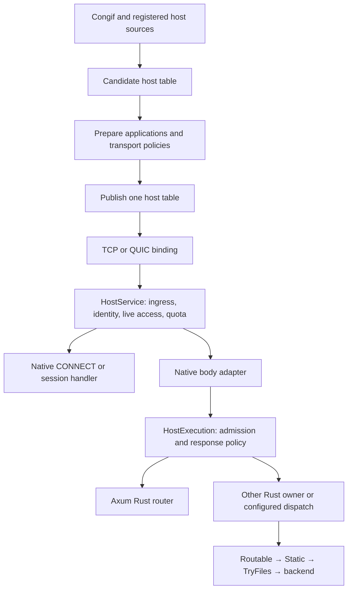

# claviron-edge

HTTP host selection, native dispatch and optional TCP/QUIC drivers.

## Boundaries

- `loader` prepares host declarations and publishes names, policy and applications
  together. Congif owns configuration reads and source watching.
- `service` binds an accepted transport/request to a ready host plan.
- `pipeline` prepares host actions and request owners. Axum is a Rust application
  adapter; files, Embed, Upstream and Link use native dispatch.
- `tcp` and `quic` own wire framing, native body adaptation, accepted connections
  and sessions. Engine execution belongs to the corresponding runtime crate.

Configured H1 WebSocket endpoints precede the dispatch chain. Exclusive Rust
owners compose their own files/backends; Other adds no implicit file handling.
`Unhandled` transfers the same unread body; a handled status, including 404,
never means fallthrough. Active head/response actions use indirect calls;
absent layers install no callback or per-layer future.

## Reload and ownership

Host preparation runs before table publication. A rejected host candidate keeps
the old table. Unchanged declarations retain identity and prepared applications.
TLS/H3 retain the accepted binding; cleartext selects the current host/application
per request. HostBinding observes publications to retire changed connections;
ACL/redirect admission reads the current canonical-host policy per request.
Accepted bodies, sessions and capacity remain with their native owners through
drain; the [graceful ownership contract](../../docs/design/GRACEFUL_OWNERSHIP.md)
defines termination authority. Configured quota changes currently require restart.

Relative disk paths remain process-working-directory relative. Prefix mappings
inherit the nearest declared `path`; URL-derived dot segments are rejected.
Policy-only children retain applicable static mounts and mount-relative rules
unless they remap directories. Backend owners and TryFiles are not inherited.

## Features

| Feature | Enables |
| --- | --- |
| `server` | Provider, host compilation and transport-facing APIs. |
| `tcp`, `tls` | Native cleartext H1; optional TLS H1/H2. |
| `http3`, `quic` | H3 contracts; native Quinn/H3 driver. |
| `axum` | Rust router adapter and HostConfigExt extractor. |
| `lua` | Native Lua backend. |
| `php`, `php_embed`, `php_fcgi` | PHP declarations; Embed or FastCGI adapters. |
| `orbit`, `upstream` | Link or HTTP-upstream dispatch. |
| `websocket`, `webtransport` | Native session bindings and combined runtime adapters. |
| `broadcast` | Pusher REST and broadcast session composition. |
| `rate-limit`, `access-log` | Optional quota and access-record paths. |
| `db`, `postgres` | Hosting alias hydration; PostgreSQL notification adapter. |
| `metrics`, `geoip`, `acme` | HTTP metrics, peer country lookup, HTTP-01 support. |

Features compile capabilities; declarations and registration select what runs.

## `src/`

### Entry points

- [`lib.rs`](src/lib.rs) — Public exports and registration; master/serving-process composition.
- [`config.rs`](src/config.rs) — Host identity, transport policy and normalized route views; read-only backend accessors.
- [`provider.rs`](src/provider.rs) — Congif HTTP configuration owner; validate capabilities and atomically publish HttpSnapshot.
- [`deny.rs`](src/deny.rs) — Compiled URI deny matcher and immutable early-check proof.
- [`access.rs`](src/access.rs) — Optional access-record producer and response-body accounting guard.
- [`listener.rs`](src/listener.rs) — Hosting alias notifications and atomic candidate updates; PostgreSQL NOTIFY or hosting events.
- [`transport.rs`](src/transport.rs) — Public transport-facing re-exports; loader and service remain internal.

### `config/`

- [`routing.rs`](src/config/routing.rs) — Normalize flat/root/prefix declarations, ownership, inheritance and disk mappings.
- [`routing/statics.rs`](src/config/routing/statics.rs) — Compile directory groups into static mounts with derived URL prefixes.
- [`quota.rs`](src/config/quota.rs) — Validate IP limiter declarations without opening quota stores.

### `loader/`

- [`loader.rs`](src/loader.rs) — Module boundary for declaration loading and host publication.
- [`config.rs`](src/loader/config.rs) — VhostDocument, recursive includes, partial reads and unchanged declaration reuse.
- [`error.rs`](src/loader/error.rs) — Declaration and load errors.
- [`table.rs`](src/loader/table.rs) — Canonical names, validated aliases, listener/log selectors and prepared dependencies.
- [`snapshot.rs`](src/loader/snapshot.rs) — Candidate host/alias edits and optional database alias hydration.
- [`resolver.rs`](src/loader/resolver.rs) — Retained sources, dependent preparation, atomic table publication and binding retirement.

### `service/`

- [`service.rs`](src/service.rs) — Transport handoff exports; no file loading or backend execution engine.
- [`authority.rs`](src/service/authority.rs) — Validated cleartext authority and connection-local name identity reuse.
- [`bindings.rs`](src/service/bindings.rs) — Pair live names with the captured TLS policy epoch.
- [`extensions.rs`](src/service/extensions.rs) — VhostCtx and connection-time SNI selection/rejections.
- [`host.rs`](src/service/host.rs) — HostService admission and PreparedRequest body/context handoff.
- [`host/cache.rs`](src/service/host/cache.rs) — Cleartext metadata cache; application selection and live access remain request-local.
- [`host/dispatch.rs`](src/service/host/dispatch.rs) — Select Axum/Other before constructing the execution future.
- [`response.rs`](src/service/response.rs) — Typed early host replies, before native wire framing.

### `pipeline/`

- [`pipeline.rs`](src/pipeline.rs) — Public native composition contracts and optional adapter exports.
- [`apps.rs`](src/pipeline/apps.rs) — Retained factories, directives and per-host application snapshot preparation/reuse.
- [`routable.rs`](src/pipeline/routable.rs) — Provider-owned contributions, native layers and exclusive host bindings.
- [`ext.rs`](src/pipeline/ext.rs) — Typed directive codecs, conditions, handlers and cold layer compilation.
- [`routing.rs`](src/pipeline/routing.rs) — Shared prefix dispatch and route-extension re-exports.
- [`app.rs`](src/pipeline/app.rs) — Optional Axum ApplicationHandler/HostHandler adapter and HostConfigExt extractor.
- [`connect.rs`](src/pipeline/connect.rs) — H2 CONNECT registry, authentication payload and session context.
- [`wt.rs`](src/pipeline/wt.rs) — Native WebTransport handler/session API and exact/fallback registry.
- [`upstream.rs`](src/pipeline/upstream.rs) — Configured upstream selection after local file steps.
- [`apps/broadcast.rs`](src/pipeline/apps/broadcast.rs) — Broadcast H1/H2/H3 session bindings and session admission.
- [`apps/broadcast/rest.rs`](src/pipeline/apps/broadcast/rest.rs) — Claim configured REST endpoints without wrapping unrelated requests.

### `pipeline/host/`

- [`host.rs`](src/pipeline/host.rs) — HostLayer/HostPipeline types and typed request/reply capabilities.
- [`builder.rs`](src/pipeline/host/builder.rs) — Flatten active actions once; failed layer preparation changes nothing.
- [`request.rs`](src/pipeline/host/request.rs) — Head preparation, unread body transfer and deferred typed application call.
- [`response.rs`](src/pipeline/host/response.rs) — Run only reached response/body actions, in reverse registration order.
- [`state.rs`](src/pipeline/host/state.rs) — Ingress/identity/access phase state and native head-only handoff.
- [`binding.rs`](src/pipeline/host/binding.rs) — Connection-owned policy, narrowed HTTP limits and prepared native plan.
- [`ingress.rs`](src/pipeline/host/ingress.rs) — Protocol, authority, early-data, upgrade and URI-deny admission.
- [`identity.rs`](src/pipeline/host/identity.rs) — Shared direct identity; trusted proxy clients remain request-local.
- [`identity/extensions.rs`](src/pipeline/host/identity/extensions.rs) — Typed metadata in request-owned extension boxes.
- [`access.rs`](src/pipeline/host/access.rs) — One live canonical-host policy selection and retained admitted generation.
- [`access/acl.rs`](src/pipeline/host/access/acl.rs) — Compiled segment ACLs and unambiguous comparison paths.
- [`access/policy.rs`](src/pipeline/host/access/policy.rs) — ACL/redirect ordering and prepared redirect templates.
- [`quota.rs`](src/pipeline/host/quota.rs) — Prepared rate admission and committed optional response snapshot.
- [`quota/prepare.rs`](src/pipeline/host/quota/prepare.rs) — Config/Rust quota bindings, resource validation and store lifetime.
- [`exchange.rs`](src/pipeline/host/exchange.rs) — Configured CORS/header actions and request-local origin state.
- [`exchange/cors.rs`](src/pipeline/host/exchange/cors.rs) — Origin admission, preflight response and CORS response headers.
- [`exchange/policy.rs`](src/pipeline/host/exchange/policy.rs) — Effective scoped policies; collapse uniform scopes and header actions.
- [`admission.rs`](src/pipeline/host/admission.rs) — Prepared queue/head timing over application-owned capacity.
- [`reply.rs`](src/pipeline/host/reply.rs) — Explicit response size/idle guards; absent limits install no guard.
- [`access_log.rs`](src/pipeline/host/access_log.rs) — Optional access-channel selection and record/body lifetime transfer.
- [`application.rs`](src/pipeline/host/application.rs) — Consuming terminal call with its concrete future.
- [`handler.rs`](src/pipeline/host/handler.rs) — Routable contributions; Unhandled retains the unread body capability.
- [`dispatch.rs`](src/pipeline/host/dispatch.rs) — Native dispatch steps, synchronous decisions and terminal fallback.
- [`compile.rs`](src/pipeline/host/compile.rs) — Compile prefix scopes, conditions, Rust contributions and backend owners.
- [`backend.rs`](src/pipeline/host/backend.rs) — Prepare configured backend steps and residual index/SPA fallback.
- [`files.rs`](src/pipeline/host/files.rs) — Separate Static and TryFiles steps using the shared files API.
- [`extension.rs`](src/pipeline/host/extension.rs) — Apply only active provider-defined head/response layers.
- [`execution.rs`](src/pipeline/host/execution.rs) — Execution admission, reply-head deadline, response policy and accounting.
- [`websocket.rs`](src/pipeline/host/websocket.rs) — Prepared exact H1 endpoints before Rust/file/backend dispatch.

### `pipeline/embed/`

- [`embed.rs`](src/pipeline/embed.rs) — Embedded adapter boundary; engines and their lifecycle belong to their owning crates.
- [`lua.rs`](src/pipeline/embed/lua.rs) — Lua mount selection; a nonmatch returns synchronously without a future allocation.
- [`lua/origin.rs`](src/pipeline/embed/lua/origin.rs) — Shared socket-origin checks against admitted authority and transport scheme.
- [`lua/websocket.rs`](src/pipeline/embed/lua/websocket.rs) — Lua H1 upgrades and H2 CONNECT from flat/scoped declarations.
- [`lua/webtransport.rs`](src/pipeline/embed/lua/webtransport.rs) — Lua native H3 session admission and stream handoff.
- [`php.rs`](src/pipeline/embed/php.rs) — Resolve PHP mappings and prepare runner-specific mount owners.
- [`php/app.rs`](src/pipeline/embed/php/app.rs) — Persistent application handle; unavailable selected applications own their 503.
- [`php/script.rs`](src/pipeline/embed/php/script.rs) — Script resolver handoff; an unclaimed request retains its body.
- [`php/fcgi.rs`](src/pipeline/embed/php/fcgi.rs) — FastCGI resolver handoff through the native PHP adapter.

### `pipeline/link/`

- [`link.rs`](src/pipeline/link.rs) — Prepared Link targets; concurrent upload/reply streaming and native WebSocket handshake.
- [`body.rs`](src/pipeline/link/body.rs) — Upload task ownership transfers from head wait to response body.
- [`websocket.rs`](src/pipeline/link/websocket.rs) — H1/H2 wire acceptance and bounded Link message relay.
- [`webtransport.rs`](src/pipeline/link/webtransport.rs) — Route-selected H3 sessions and independently owned bidi Link exchanges.

### `pipeline/other/`

- [`other.rs`](src/pipeline/other.rs) — Low-level Rust handler ownership, without implicit files or Axum.
- [`adapters.rs`](src/pipeline/other/adapters.rs) — PHP/Pusher OtherHandler adapters; each owns its existing future erasure.
- [`upstream.rs`](src/pipeline/other/upstream.rs) — Explicit upstream/file composition for caller-owned Rust handlers.

### `tcp/`

- [`mod.rs`](src/tcp/mod.rs) — TCP module exports and native fixture inclusion.
- [`listener.rs`](src/tcp/listener.rs) — Bind groups, shared capacity, accepted tasks/session ownership and drain.
- [`listener/accept.rs`](src/tcp/listener/accept.rs) — Socket-local accept error classification and declared recovery backoff.
- [`io.rs`](src/tcp/io.rs) — Shared socket IO and error readiness without a competing byte reader.
- [`protocol.rs`](src/tcp/protocol.rs) — Hyper H1 builder and TCP socket options from resolved config.
- [`geo.rs`](src/tcp/geo.rs) — Optional peer country lookup.
- [`service.rs`](src/tcp/service.rs) — Hyper request admission, body adaptation and H2 CONNECT handoff.
- [`service/body.rs`](src/tcp/service/body.rs) — Lazy body erasure; preserve trailers and configured body guards.

### `tcp/plain/`

- [`plain.rs`](src/tcp/plain.rs) — Cleartext H1 driver exports.
- [`server.rs`](src/tcp/plain/server.rs) — HttpServer configuration, snapshots and runnable registration.
- [`conn.rs`](src/tcp/plain/conn.rs) — Socket/context setup, H1 driving and connection drain.
- [`handler.rs`](src/tcp/plain/handler.rs) — Per-request cleartext host selection, non-SSL policy and native dispatch.
- [`redirect.rs`](src/tcp/plain/redirect.rs) — HTTPS redirect using validated authority and the declared port.
- [`acme.rs`](src/tcp/plain/acme.rs) — Optional HTTP-01 token validation and challenge-directory reads.
- [`error.rs`](src/tcp/plain/error.rs) — Cleartext driver errors.

### `tcp/secure/`

- [`secure.rs`](src/tcp/secure.rs) — TLS H1/H2 driver exports.
- [`server.rs`](src/tcp/secure/server.rs) — HttpsServer lifecycle and listener/TLS policy preparation.
- [`tls.rs`](src/tcp/secure/tls.rs) — ClientHello/SNI authentication, ALPN intersection and TLS policy epochs.
- [`conn.rs`](src/tcp/secure/conn.rs) — Verified TLS metadata and the accepted host/application binding.
- [`handler.rs`](src/tcp/secure/handler.rs) — TLS handshake deadline, H1/H2 driving and graceful/forced connection drain.
- [`error.rs`](src/tcp/secure/error.rs) — TLS/native connection error classification.

### `quic/`

- [`mod.rs`](src/quic/mod.rs) — Native H3 driver exports.
- [`types.rs`](src/quic/types.rs) — H3 configuration owner, environment binding, snapshots and runnable lifecycle.
- [`tls.rs`](src/quic/tls.rs) — Deferred SNI authentication and coherent host/TLS selector views.
- [`listener.rs`](src/quic/listener.rs) — Endpoint groups, connection capacity, concurrent request/session stream driving.
- [`listener/drain.rs`](src/quic/listener/drain.rs) — Join connection-owned children on completion, explicit force or panic.
- [`request.rs`](src/quic/request.rs) — H3 framing validation, buffered/streaming body adaptation and response IO.
- [`error.rs`](src/quic/error.rs) — Normal closure and interrupted-stream classification.
- [`wt.rs`](src/quic/wt.rs) — Authorize and hand native WebTransport sessions to applications.
- [`wt/streams.rs`](src/quic/wt/streams.rs) — Bounded per-session input; a saturated session never blocks the shared driver.

## `tests/`

Test files mirror their owning modules. Native transport fixtures use isolated
resources; embedded-engine execution is outside Edge tests.

### Entry and configuration

- [`authority.rs`](tests/authority.rs) — Authority rejection precedes body/auth/application dispatch.
- [`deny.rs`](tests/deny.rs) — Deny proof identity and unchanged request ownership.
- [`sni.rs`](tests/sni.rs) — SNI/catchall lookup and bounded name churn.
- [`provider.rs`](tests/provider.rs) — Prepared HTTP values, capability rejection and invalid-candidate retention.
- [`config/routing.rs`](tests/config/routing.rs) — Route normalization, inheritance, mappings and unavailable capability rejection.
- [`unit/file_routes.rs`](tests/unit/file_routes.rs) — Selected file views, Rust interception and shared disk mappings.
- [`fixtures/http/base.yaml`](tests/fixtures/http/base.yaml) — Valid HTTP preparation input.
- [`fixtures/http/changed.yaml`](tests/fixtures/http/changed.yaml) — Changed listener-policy input.
- [`fixtures/http/invalid.yaml`](tests/fixtures/http/invalid.yaml) — Invalid listener-address input.

### `loader/`

- [`table.rs`](tests/loader/table.rs) — Canonical/alias validation, shared policy and listener selectors.
- [`snapshot.rs`](tests/loader/snapshot.rs) — Database alias input validation.
- [`resolver.rs`](tests/loader/resolver.rs) — Boot dependency declaration.
- [`resolver/selection.rs`](tests/loader/resolver/selection.rs) — Coherent application selection, publication failure and generation ownership.
- [`binding.rs`](tests/loader/binding.rs) — Event-driven retirement and atomic alias changes.

### `pipeline/`

- [`apps.rs`](tests/pipeline/apps.rs) — Rust binding/layer composition and duplicate-owner retention.
- [`broadcast.rs`](tests/pipeline/broadcast.rs) — Selected broadcast route ownership.
- [`broadcast/rest.rs`](tests/pipeline/broadcast/rest.rs) — REST endpoint claims and terminal responses.
- [`host.rs`](tests/pipeline/host.rs) — Layer preparation, response scope, body ownership, wakeup and cancellation.
- [`other.rs`](tests/pipeline/other.rs) — Future erasure, head-timing ownership and Noop reply.
- [`quota.rs`](tests/pipeline/quota.rs) — Public quota registration shared by canonical names and aliases.
- [`wt.rs`](tests/pipeline/wt.rs) — Exact native bindings precede Link fallback.
- [`link.rs`](tests/pipeline/link.rs) — Link route misses, H1/H2 handshakes, shutdown and headers.
- [`link/webtransport.rs`](tests/pipeline/link/webtransport.rs) — Independent streams, route ownership, cancellation and partial writes.
- [`embed/lua.rs`](tests/pipeline/embed/lua.rs) — Lua mount precedence and unchanged unread bodies/trailers.
- [`embed/lua/origin.rs`](tests/pipeline/embed/lua/origin.rs) — Origin ambiguity, requested aliases/ports and accepted scheme.
- [`embed/lua/socket_path.rs`](tests/pipeline/embed/lua/socket_path.rs) — Mounted endpoint paths and removed/masked socket ownership.
- [`embed/lua/webtransport.rs`](tests/pipeline/embed/lua/webtransport.rs) — H3 endpoint ownership and effective origin policy.
- [`embed/php.rs`](tests/pipeline/embed/php.rs) — Runner selection and file mapping without starting PHP.

### `pipeline/host/`

- [`ingress.rs`](tests/pipeline/host/ingress.rs) — Active head gates and typed rejection/body ownership.
- [`identity.rs`](tests/pipeline/host/identity.rs) — Fixed identity reuse, proxy trust and independent clients.
- [`access.rs`](tests/pipeline/host/access.rs) — Live access generations, host removal and required identity.
- [`access/acl.rs`](tests/pipeline/host/access/acl.rs) — Segment specificity, escaped paths and ambiguous slashes.
- [`access/policy.rs`](tests/pipeline/host/access/policy.rs) — ACL/redirect order and literal request data in templates.
- [`quota.rs`](tests/pipeline/host/quota.rs) — Shared debt and non-refundable committed admission.
- [`quota/prepare.rs`](tests/pipeline/host/quota/prepare.rs) — Resource collisions, prefix selection, config checks and reload restrictions.
- [`exchange.rs`](tests/pipeline/host/exchange.rs) — Active CORS/header actions, early replies and response ownership.
- [`exchange/policy.rs`](tests/pipeline/host/exchange/policy.rs) — Effective header overrides and identity-only policy.
- [`admission.rs`](tests/pipeline/host/admission.rs) — Capacity ownership, queue cancellation and head timing.
- [`reply.rs`](tests/pipeline/host/reply.rs) — Declared response guards, frames/trailers and drop ownership.
- [`access_log.rs`](tests/pipeline/host/access_log.rs) — Access-log opt-out and record/state ownership.
- [`application.rs`](tests/pipeline/host/application.rs) — Deferred calls, cancellation and payload/response scope.
- [`handler.rs`](tests/pipeline/host/handler.rs) — Rust fallthrough, terminal status, cancellation and optional Axum adapter.
- [`dispatch.rs`](tests/pipeline/host/dispatch.rs) — Native step fallthrough, terminal status and cancellation.
- [`compile.rs`](tests/pipeline/host/compile.rs) — Scope conditions and Static/TryFiles/backend precedence.
- [`files.rs`](tests/pipeline/host/files.rs) — File misses, dynamic-name exclusion and unread backend bodies.
- [`websocket.rs`](tests/pipeline/host/websocket.rs) — Protocol-gated exact endpoints and ordinary request passthrough.

### `service/`

- [`authority.rs`](tests/service/authority.rs) — Authority proofs and connection-local identity allocation reuse.
- [`bindings.rs`](tests/service/bindings.rs) — Name/TLS epoch agreement, alias changes and fail-closed authentication.
- [`extensions.rs`](tests/service/extensions.rs) — Captured metadata, authority binding and proxy identity.
- [`extensions/template.rs`](tests/service/extensions/template.rs) — Typed values, existing box reuse and independent extension maps.
- [`host.rs`](tests/service/host.rs) — Shared admission, live ACL/replies, limits and native auth/body handoff.
- [`host/cache.rs`](tests/service/host/cache.rs) — Metadata reuse without retaining stale applications or policy.
- [`host/dispatch.rs`](tests/service/host/dispatch.rs) — Execution ownership, queue/head cancellation and streamed responses.

### `tcp/`

- [`README.md`](tests/tcp/README.md) — Fixture boundaries and focused transport/resilience invocations.
- [`fixtures/listeners.yaml`](tests/tcp/fixtures/listeners.yaml) — Reserved loopback listener configuration.
- [`support/accept.rs`](tests/tcp/support/accept.rs) — Synthetic accept outcomes and deterministic wake control.
- [`support/framing.rs`](tests/tcp/support/framing.rs) — Shared raw H1 framing and keepalive cases.
- [`support/tls.rs`](tests/tcp/support/tls.rs) — Isolated TLS/Hyper connection fixture and structured cleanup.
- [`unit/accept.rs`](tests/tcp/unit/accept.rs) — Socket-local retry state and error classification.
- [`unit/body.rs`](tests/tcp/unit/body.rs) — Ended/lazy bodies, trailers and configured guards.
- [`unit/config.rs`](tests/tcp/unit/config.rs) — Sibling transport changes do not invalidate unrelated inputs.
- [`unit/head.rs`](tests/tcp/unit/head.rs) — Native H1 header-size boundary.
- [`unit/listener.rs`](tests/tcp/unit/listener.rs) — Port sharing, group capacity, accept failures and owned drain.
- [`unit/plain.rs`](tests/tcp/unit/plain.rs) — Cleartext host selection, live policies and H1 upgrade.
- [`unit/plain/authority.rs`](tests/tcp/unit/plain/authority.rs) — Authority rejection and absolute-target selection.
- [`unit/plain/framing.rs`](tests/tcp/unit/plain/framing.rs) — Malformed/ambiguous framing and keepalive.
- [`unit/plain/timeout.rs`](tests/tcp/unit/plain/timeout.rs) — Captured header deadlines and reload behavior.
- [`unit/redirect.rs`](tests/tcp/unit/redirect.rs) — IPv6, query and declared redirect port.
- [`unit/service.rs`](tests/tcp/unit/service.rs) — Native H2 CONNECT admission before auth/body handoff.
- [`unit/timeout.rs`](tests/tcp/unit/timeout.rs) — Driver-default, disabled and explicit header deadlines.
- [`unit/tls.rs`](tests/tcp/unit/tls.rs) — Host ALPN preference and alias/TLS publication.
- [`unit/tls/authority.rs`](tests/tcp/unit/tls/authority.rs) — TLS authority rejection scoped to the correct connection/stream.
- [`unit/tls/churn.rs`](tests/tcp/unit/tls/churn.rs) — Opt-in TLS slot-reclamation probe.
- [`unit/tls/framing.rs`](tests/tcp/unit/tls/framing.rs) — TLS H1 framing and keepalive.
- [`unit/tls/rejections.rs`](tests/tcp/unit/tls/rejections.rs) — Handshake/authority refusal and capacity release.
- [`unit/tls/resilience.rs`](tests/tcp/unit/tls/resilience.rs) — Independent H2 streams, controlled IO and declared drain.

### `quic/`

- [`error.rs`](tests/quic/error.rs) — Normal closure does not hide nonzero failures.
- [`listener.rs`](tests/quic/listener.rs) — Worker-only UDP port sharing and request-body mode selection.
- [`listener/drain.rs`](tests/quic/listener/drain.rs) — Force/panic cleanup joins owned children without cancelling siblings.
- [`request.rs`](tests/quic/request.rs) — Framing/body rejection, transport interruptions and early reply metadata.
- [`tls.rs`](tests/quic/tls.rs) — Alias/TLS selector publication.
- [`wt/streams.rs`](tests/quic/wt/streams.rs) — Bounded input, session completion and dropped receivers.
