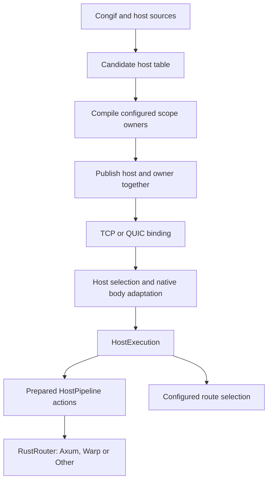

# claviron-edge

HTTP host selection, native dispatch and optional TCP/QUIC drivers.

## Boundaries

- `loader` prepares host declarations and publishes names, policy and applications
  together. Congif owns configuration reads and source watching.
- `service` binds an accepted transport/request to a ready host plan.
- `pipeline` prepares host actions and request owners. Axum is a Rust application
  adapter; files, Embed, Upstream and Link use native dispatch.
- Wire framing, native body adaptation, accepted connections and sessions belong
  to `claviron-transport`, which borrows this crate; this crate opens no socket.
  Engine execution belongs to the corresponding runtime crate.

`HostLayer` is a cold preparation contract. Active head checks, asynchronous
waits, consuming calls and response hooks share one flat plan. `Unhandled`
transfers the same unread body; a handled status never signals fallthrough.
Only reached layers shape a reply. Axum is an application adapter.

## Backend contract

[EDGE_BACKENDS](../../docs/design/EDGE_BACKENDS.md) defines the application-server
boundary, policy ownership and body delivery rules for Rust applications, Embed,
Upstream and Link. Every Backend declares identity export and response lifetime
at preparation through `BackendContract`. The flat driver applies external SSE
shutdown after a handled reply; it does not add another request future box.
`pipeline/backend.rs` owns the separate `BackendFactory` configuration contract.
Factories prepare execution owners after policy resolution and explicitly
select BeforeFiles or AfterFiles. Route extensions prepare controls/hooks.

## HostPipeline order

[`host/compile.rs`](src/pipeline/host/compile.rs) builds each host's scope plans at
boot/reload, before publication. Each eligible listener/host pair retains its own compiled plan.
Only declared or registered actions enter it. `HostLayer::prepare` may add
nothing; the builder retains no runtime node for an empty layer. Requests execute
the prepared actions without checking whether each capability is enabled.

A scoped route layer prepares against the selected file view and effective HTTP
policy. Inherited directives establish policy before local directives, direct
code registrations and provider layers. `register_layer` accepts the shared
RouteLayer contract; `register_pipeline` accepts a factory producing a builder
or compiled pipeline. Selectors run only during preparation. Appending a plan
moves its actions into the same flat arrays and preserves reached reply scopes.
An exchange action can defer work on the same request's reply.
Plans without exchange actions use the dispatch owner without reply-hook state.

`Routable::match_protocol` and `HostBindingProvider::match_protocol` select
`RouteProtocol::{Http, Https, Quic}` during preparation; their default accepts
all. Existing host selectors and factories are unchanged. Restricted providers
contribute only to matching listener plans, including their directive effects.
Unbound lookups contain only protocol-independent contributions. Each eligible listener gets its own plan from its complete effective input;
a rejected candidate keeps the old publication.

Host selection precedes the pipeline. Multiple prefix scopes or entry conditions
add `RouteSelectionLayer`; a single unconditional root scope uses its plan
directly. Prefix and condition matching still happen per request.

Listener `explicit` defaults to false. Hosts with no `listeners` selection join
compatible non-explicit listeners. An explicit listener requires its ID in that
selection. A supplied host list restricts every listener, including non-explicit
ones; `[]` exposes the host nowhere. Selection is resolved before publication.

For plain HTTP, `transport.non_ssl: serve` prepares the normal host pipeline.
Redirect (the default) and reject retain host admission without preparing an
application router, route layers or backends. They use the listener's concrete
`NonServingPipeline`: one fixed flow takes the selected host as input. It
preserves the requested hostname, path and query when redirecting, using the
listener's `redirect_port`; reject returns 403. An unhosted name returns 404.
Non-serving policies remain available when the host's application protocols
exclude H1. TLS TCP and QUIC still require a compatible application protocol.

`InterceptsNonServing` is an optional single `dyn` binding on `HostAppRegistry`.
A fixed binding or `bind_non_serving_interception_with` factory selects it during
plain-listener preparation. The factory reads staged configuration; None installs
no hook, and failure retains the old publication. TLS/QUIC do not call it.
Its request-time call precedes both redirect and reject. It receives `HostRequest`
and borrowed `NonServingContext` (host config, canonical key, connection and
effective HTTP policy). Handled is terminal; Unhandled retains the same unread
body. Without a binding, no interception context, body erasure or extension map
is created. Routable providers and normal host layers do not run on this path.

TLS H1/H2 and H3 validate each request authority against the hostname pinned by
SNI before pipeline or native session dispatch: malformed authority returns 400,
a different hostname returns 421. Plain H1 validates and resolves authority on
each request; keep-alive does not pin it to the first host or require trusted
forwarding. Listener eligibility is compiled before connection acceptance.

Each connection keeps the authority fields of the last request it accepted:
HTTP version, target scheme and authority, and the Host field. A request that
repeats them is admitted without parsing the authority again, and on plain H1
without selecting the host again when the publication is also the same. Any
other request, including another spelling of the same name, goes through full
validation, so the check itself is unchanged.

Native Hyper H1 upgrade support is compiled with `websocket`. A WebSocket stage
still requires registered endpoints, host `transport.h1.upgrade: true` and H1
support in both the host and the listener. H2-only and QUIC plans omit it.

QUIC `quic.enable_early_data` controls listener 0-RTT capability. After SNI host
resolution, only early streams consult the host's `transport.h3.early_data`
policy; refusals return 425 before dispatch. Established streams skip this
check. WebTransport rejects 0-RTT independently. A host policy cannot enable
listener 0-RTT; declaring it is valid even on listeners without early data.

Within the selected scope, entries follow this order. Every entry is conditional
on effective configuration (including inherited defaults) or explicit Rust
registration. No layer is installed unconditionally.

`ConnCtx` belongs to the accepted connection. Native actions borrow it through
`HostContext` without populating request extensions.

Work whose inputs are complete at acceptance is done there, once. An
`AcceptLayer` registered with `HostAppRegistry::register_accept_layer` is
selected per host and protocol family when the host table is prepared and
kept with that host's execution. After the TLS or QUIC handshake, with the
protocol decided and before the first request, the transport runs the selected
layers over the complete facts and freezes what they prepared into
`ConnCtx.state`. Requests read it through `HostContext::conn_state`. A host
with no selected layer runs and allocates nothing at acceptance. Cleartext
connections have no host until a request names one and run no layer.

| Order | Entry | Selected by |
| --- | --- | --- |
| 0 | HTTP metrics | `metrics` feature and an explicit `http.yaml` metrics block. Counts through the response head or cancellation on every serving listener. |
| 1 | Response-header hooks | Effective HTTP defaults → host → prefix edits; empty declarations install nothing. |
| 2 | Trusted proxy / real IP | Nonempty forwarding headers and trusted networks on this listener. |
| 3 | Access-log start | Effective host/prefix channel or logging default; `off` and absent channels install no layer or log state. |
| 4 | Response-body guard (register hook) | Effective listener → host → prefix size/idle bounds; both off installs nothing. |
| 5 | Deny → IP ACL | Nonempty HTTP deny defaults; restrictive host/prefix ACL rules. |
| 6 | Quota admission | Prepared host quota rules. |
| 7 | CORS admission / preflight | Effective host/prefix CORS declaration. |
| 8 | Request-body bounds | Effective listener → host → prefix size/idle policy; both off installs no layer. |
| 9 | Directive layers → code registrations → Routable layers | Inherited directives first, then local directives; matching code and provider contributions in registration order. |
| 10 | Identity | Required by a prepared Backend; absent from native file-only plans. |
| 11 | H1 WebSocket endpoints | H1 upgrades enabled and registered endpoints present. |
| 12 | Rust contributions and scope handler | Matching Routables or a handler directive. |
| 13 | Custom redirect | Effective host/prefix `redirect`; terminal after contributions, before the Rust router. |
| 14 | RustRouter | An explicit Axum/Warp/Other binding. |
| 15 | Pre-file Backends → Static → TryFiles | Configured owners explicitly placed before files, static mounts, enabled TryFiles. |
| 16 | Link → registered Backends | Configured declarations; factories prepare owners in registration order. |
| 17 | Index/SPA file fallback | An index or SPA declaration. |

Custom `redirect` terminates a serving host's selected scope after Routable
contributions; it does not change `non_ssl`. Redirecting scopes prepare no later
file/backend owners. Plain `non_ssl: redirect` instead uses the listener's shared
NonServingPipeline and its `redirect_port`.

`Backend<B>` is the request handoff contract for Rust routers/handlers,
embedded runtimes, Upstream and Link. WebSocket and broadcast application calls
use the same boundary. Protocol/provider filters run at boot/reload; host/scope
selection and earlier policies run before handoff. A backend states at
boot/reload whether it reads identity through the required
`BackendHandler::contract` declaration. The builder inserts Identity once,
immediately before the first Backend that reads it. A plan whose owners read
none inserts none: the request reaches its owner as it arrived and no
extension map is created. Every Backend call is lent the accepted connection,
host name and its scope's policy through `HostContext`; Link, Lua and Upstream
take them there and export nothing. PHP, WebSocket and broadcast read identity
from the request. A Rust handler
(`OtherHandler`, `HostHandler`) never receives it; a Rust owner that needs the
accepted facts is a route extension and borrows them from `HostContext`, which
writes nothing. For `OtherHandler` this is a rule
(`OTHER_HANDLER: NO_EDGE_INPUT`, in the HTTP crate's notes): the edge passes
it the request and nothing of its own, so that the handler stays servable
below the edge. An Axum or Warp router has no declaration of its own and
always receives it. Static, TryFiles and file
fallback remain native steps; requests answered there before any Backend create
no identity extension map.

Identity exports the existing `Arc<ConnCtx>`, selected `HostName` and
effective scope `HttpPolicy`. Scheme, protocol, TLS and peer GeoIP stay in
`ConnCtx`; only configured trusted forwarding adds request-local `RealIpExt`.
Body ownership is transferred unchanged. Later Backend fallthrough does not
repeat metadata insertion; the direct Rust-router path uses the same prepared
contract. Transport-free callers retain their explicit metadata without
fabricated connection facts.

Header hooks are registered before request policies, so they also cover early
refusals. Edits fold from outer to inner at preparation; within one declaration,
unset precedes set. Response hooks unwind in reverse order. No implicit Server
header is added and header handling never reads or wraps the response body.

Proxy and ACL borrow accepted connection facts. Forwarding changes only the
request's `RealIpExt`; an untrusted peer cannot choose its ACL or quota identity.
ACL refusals do not charge quota. Quota refusals do not enter application
extensions. Authentication, sessions and CSRF remain application/framework work.
An allow-all ACL alone installs no action; an allow-all child remains an explicit
exception when a parent is restrictive. A deny-all rule remains active.

Access logging starts after forwarding and before access/quota refusals. Its
head hook records the response status; its guard moves into a nonempty response
body until end/drop. Empty responses finish the record without a body wrapper.
Connection facts are borrowed through `HostContext`; logging requires no
`IdentityPolicy` or connection-extension insertion.
`access_log: off` overrides inherited channels. Only logging-enabled plans own
log state; quota state is added independently when admission is configured.

Reply guarding registers after access-log start and before access checks. On the
response path it wraps the original body before the access-log wrapper, preserving
frames, trailers and cancellation ownership. Size-only, idle-only and combined
guards are selected at boot; empty bodies retain their owner. Limits only
narrow; when both effective bounds are off, no action is installed. Transport
write limits and reply-head deadlines retain their own owners. Listener plans include the complete effective request and reply policy.

`Handled` ends dispatch, including error responses. `Unhandled` transfers the
same unread request to the next entry. If nothing handles it, the plan returns
404. A terminal `RustRouter` with no preceding actions uses the direct-call path.

CORS captures the accepted origin and registers its response hook after access-log
start, before Deny/ACL/Quota. Its admission action follows quota, so preflight
spends quota and allowed-origin refusals retain CORS headers. Ordinary OPTIONS
requests without Access-Control-Request-Method continue to applications. Origin
patterns starting with `^` compile at boot; other origins match exactly. No
CORS declaration means no CORS actions or request state. Explicit `disabled`
refuses requests carrying Origin. Broadcast's own CORS policy remains separate.

Response-head and body hooks run in reverse order, only for reached scopes.
Request-body guarding follows CORS admission and precedes registered route layers.
Response-head deadline ownership remains separate from transport limits.

Body bounds select size-only, idle-only or combined guarding at boot/reload.
Nonempty bodies receive one wrapper; frame bytes and trailers retain their owners.
Immediate frames need no idle timer. Empty bodies retain their original owner.
Listener defaults are narrowed through the host root and prefix ancestors;
`off` cannot widen an inherited ceiling. Listener-specific plans publish with
host declarations in the listener snapshot. Native listener selection never falls back to the transport-free plan.

H1/H2/H3 enter this same pipeline with lazy `RouteBody` values. H3 validates
its protocol framing and adapts receive frames; it neither buffers requests
before dispatch nor applies a second size limit. Backend owners decide whether
they need to collect an already-guarded body.
PHP backends consume this input without re-narrowing policy or repeating the
request-size checks. Runner provides the same ingress contract outside Edge.

## Reload and ownership

Host preparation runs before table publication. A rejected host candidate keeps
the old table. Unchanged declarations retain identity and prepared applications.
Each listener compiles from its retained effective HTTP input and the candidate
host declarations. Unchanged host declarations and inputs reuse prepared owners during source
publications. Explicit reload and start re-evaluate application factories.
The transport-free resolver does not compile listener plans.

The listener's atomic snapshot contains its wire settings, ready host plans and,
for TLS/QUIC, the matching TLS policy. Acceptance loads this snapshot once.
`VhostTable::resolve_application_on` is the shared name/alias/default selection
for plain TCP, TLS TCP and QUIC. A listener match requires its prepared plan;
an excluded exact name never falls through to the default host. TLS config
preparation enumerates those same prepared canonical entries. TLS TCP and QUIC
retain canonical config maps, not a separate host/alias membership registry;
QUIC's ClientHello selector borrows the captured table before admitting TLS.
Cleartext authority selection still runs per request, against the captured view;
TLS/H3 retain the host selected during handshake. No request reloads a resolver.
HostBinding observes source publications to retire changed TLS/H3 bindings.
Accepted bodies, sessions and capacity remain with their native owners through
drain; the [graceful ownership contract](../../docs/design/GRACEFUL_OWNERSHIP.md)
defines termination authority. Configured quota changes currently require restart.

`HttpServer`, `HttpsServer` and `H3Server` are declaration factories. Each
produces named `Listener:<id>` instances. An instance owns its effective config,
prepared snapshot, serving loop and targeted `Runnable::as_reloadable` hook;
its run dependencies contain no parent server. Manager start/stop/reload addresses
that instance. A targeted reload prepares the current config source through
Congif and applies only that listener and its inherited defaults. Execution
changes take effect on the next start.

`HttpsServer` and `H3Server` need the certificate source `tls.yaml` declares.
Without the file a process has none (see the TLS crate's architecture), and a
server with no declared listener asks for nothing: a plain-only configuration
boots and reloads without it. A declared TLS or QUIC listener is refused by
name in the server's `validate`, and in `refresh` when a reload would add one.

VhostResolver retains weak listener preparation registrations. Its existing
source publication stages every listener's affected host view before committing
any snapshot; there is no per-listener watcher task. Certificate rotation uses
the existing live CertResolver. Host, alias, client-auth or listener ALPN changes
prepare a new matching host/TLS view; accepted work retains its previous owner.
Host `tls.client_auth.authority` uses the CertStore `local` or `cn` selector.
Vhost boot and reload resolve the public CA once per selector before listener
publication. TCP TLS and QUIC build their verifiers from that prepared view.
`VhostResolver::serving_mtls_h2_port` reads the live TLS listener snapshots
when a caller needs an address for an exact SNI and canonical host.

A shared cold binding catalog prevents conflicts across cleartext, TLS and QUIC
factories and retains retiring socket ownership through drain. Active bind/gate
changes require stop/restart. All addresses of one listener share its admission
gate and generation. Unchanged instances retain management identity; removals
cancel and drain that instance, and re-addition retains a still-draining handle.

Each listener selects `execution: shared` or `execution: current_thread` through
its resolved `ListenerConfig`. `defaults.listener.execution` supplies the default;
individual declarations override it. The three concrete Runnable types use the
same `ListenerConfig::execution_spec()` API. Shared uses ambient Tokio;
current-thread uses a listener-named, process-local domain retained through
provider finalization. Bind, accept and connection tasks stay on the selected
executor, including Hyper H2 tasks and Quinn endpoint/stream tasks. Changes apply
to the next instance start/restart. Listener count and process count jointly
determine the selected executor count; this setting supplies no CPU affinity.

Relative disk paths remain process-working-directory relative. Prefix mappings
inherit the nearest declared `directory`; URL-derived dot segments are rejected.
Policy-only children retain applicable static mounts and mount-relative rules
unless they remap directories. Backend owners and TryFiles are not inherited.
Configuration cannot tell an owner directive from another registered one, so it
records a mount as inherited and preparation leaves it out of an owned scope.

## Features

| Feature | Enables |
| --- | --- |
| `tcp`, `tls` | Host-selection support for the transport's cleartext H1 and TLS H1/H2 drivers. |
| `http3`, `quic` | H3 contracts; host-selection support for the transport's Quinn/H3 driver. |
| `axum` | Rust router adapter. |
| `orbit` | Native Link dispatch. Upstream contributes through its own backend factory. |
| `websocket`, `webtransport` | Native session bindings and combined runtime adapters. |
| `rate-limit`, `access-log` | Optional quota and access-record paths. |
| `db`, `postgres` | Hosting alias hydration; PostgreSQL notification adapter. |
| `metrics` | HTTP metrics. |

Features compile capabilities; declarations and registration select what runs.
Transport snapshots retain wire/listener settings. New policy execution uses
explicit host layers; TCP handoff installs no fallback policy executor. H3 owns native framing and lazy receive/send stream adaptation.

## `src/`

### Entry points

- [`lib.rs`](src/lib.rs) — Public exports and registration; master/serving-process composition.
- [`config.rs`](src/config.rs) — Host identity, transport policy and normalized route views; read-only backend accessors.
- [`provider.rs`](src/provider.rs) — Congif HTTP configuration owner; validate capabilities and atomically publish HttpSnapshot.
- [`log`](src/log.rs) — Optional access-record producer; retained metadata, response progress and body/drop accounting.
- [`listener.rs`](src/listener.rs) — Hosting alias notifications and atomic candidate updates; PostgreSQL NOTIFY or hosting events.
- [`transport.rs`](src/transport.rs) — What `claviron-transport` may use of this crate: host selection, request handoff and connection-level handlers; loader and service stay internal behind it.
- [`transport/publication.rs`](src/transport/publication.rs) — Listener input selection, host compilation, weak publication contract and shared bind geometry.

### `config/`

- [`routing.rs`](src/config/routing.rs) — One RouteConfig schema for root/prefix declarations; `directory` selects disk mapping. Scope settings retain one declaration owner.
- [`routing/statics.rs`](src/config/routing/statics.rs) — Compile directory groups into static mounts with derived URL prefixes.
- [`quota.rs`](src/config/quota.rs) — Validate the same rate-limit declaration at every scope without opening stores.

### `loader/`

- [`authority.rs`](src/loader/authority.rs) — Prepare shared public client-auth CA material for host publications.
- [`loader.rs`](src/loader.rs) — Module boundary for declaration loading and host publication.
- [`config.rs`](src/loader/config.rs) — VhostDocument, recursive includes, partial reads and unchanged declaration reuse.
- [`error.rs`](src/loader/error.rs) — Declaration and load errors.
- [`table.rs`](src/loader/table.rs) — Canonical names, validated aliases, shared listener-plan selection and prepared dependencies.
- [`snapshot.rs`](src/loader/snapshot.rs) — Candidate host/alias edits and optional database alias hydration.
- [`resolver.rs`](src/loader/resolver.rs) — Retained sources, dependent preparation, atomic table publication and binding retirement.

### `service/`

- [`service.rs`](src/service.rs) — Transport handoff exports; no file loading or backend execution engine.
- [`authority.rs`](src/service/authority.rs) — Validated cleartext authority and connection-local name identity reuse; borrowed access to the admitted request.
- [`bindings.rs`](src/service/bindings.rs) — Pair live names with the captured TLS policy epoch.
- [`ctx`](src/service/ctx.rs) — VhostCtx and connection-time SNI selection/rejections.
- [`host.rs`](src/service/host.rs) — HostService and native request handoff; no fixed Ingress/Identity/Access chain.
- [`host/cache.rs`](src/service/host/cache.rs) — Cleartext metadata cache, owner selection against the supplied publication, and reuse of the last admitted owner for a repeated authority on that same publication.
- [`host/dispatch.rs`](src/service/host/dispatch.rs) — Execute the prepared host owner; retain the direct-call optimization only for a plan without preceding actions.
- [`response.rs`](src/service/response.rs) — Typed early host replies, before native wire framing.

### `pipeline/`

- [`pipeline.rs`](src/pipeline.rs) — Public native composition contracts and optional adapter exports.
- [`accept.rs`](src/pipeline/accept.rs) — AcceptLayer registration, per-host selection and the once-per-connection preparation of `ConnState`.
- [`apps.rs`](src/pipeline/apps.rs) — Retained factories, directives and per-host application snapshot preparation/reuse.
- [`routable.rs`](src/pipeline/routable.rs) — Provider-owned contributions, native layers and exclusive host bindings.
- [`non_serving.rs`](src/pipeline/non_serving.rs) — Fixed plain redirect/reject flow and the optional single request interceptor.
- [`backend.rs`](src/pipeline/backend.rs) — BackendFactory, effective preparation input and mandatory identity/reply ownership.
- [`extension.rs`](src/pipeline/extension.rs) — Typed directives and boot-time RouteContext; borrow inherited settings and prepare effective policy.
- [`routing.rs`](src/pipeline/routing.rs) — Shared prefix dispatch and route-extension re-exports.
- [`apps/axum.rs`](src/pipeline/apps/axum.rs) — Axum host registration and ApplicationHandler/HostHandler adaptation.
- [`apps/warp.rs`](src/pipeline/apps/warp.rs) — Warp host registration and native handler adaptation.
- [`apps/other.rs`](src/pipeline/apps/other.rs) — Other host registration and re-exports of the shared HTTP handler contract.
- [`connect.rs`](src/pipeline/connect.rs) — H2 CONNECT registry, explicit binding execution, authentication payload and session context.
- [`wt.rs`](src/pipeline/wt.rs) — Native WebTransport handler/session API and exact/fallback registry.

### `pipeline/host/`

Scope compilation puts extensions, WebSocket endpoints, Rust contributions,
Static, TryFiles and configured backends into the same flat layer builder.
There is no separate application/dispatch chain or automatic SelectedRoute
extension insertion. Rust router and backend calls implement `HostLayer`.
HostExecution retains the compiled host plan. Only an empty prefix of actions
may retain a direct Rust call; selecting Other never bypasses host layers.
Disabled file steps allocate no prepared file owner.

- [`host.rs`](src/pipeline/host.rs) — HostLayer/HostPipeline types and typed request/reply capabilities.
- [`context.rs`](src/pipeline/host/context.rs) — Borrowed connection, selected-host and arrival facts.
- [`owner.rs`](src/pipeline/host/owner.rs) — Retain prepared owners while direct calls await.
- [`builder.rs`](src/pipeline/host/builder.rs) — Prepare flat action arrays; append builders or compiled plans; preserve atomic layer preparation and response scopes.
- [`registration.rs`](src/pipeline/host/registration.rs) — Direct code-defined layers and pipeline factories, selected per host/protocol at preparation.
- [`request.rs`](src/pipeline/host/request.rs) — Flat head/async/request execution, unread body transfer and reached response scopes.
- [`response.rs`](src/pipeline/host/response.rs) — Run only reached response/body actions, in reverse registration order.
- [`binding.rs`](src/pipeline/host/binding.rs) — Accepted connection facts and narrowed declaration data; no implicit actions.
- [`application.rs`](src/pipeline/host/application.rs) — Consuming terminal call with its concrete future.
- [`handler.rs`](src/pipeline/host/handler.rs) — Routable contributions; Unhandled retains the unread body capability.
- [`dispatch.rs`](src/pipeline/host/dispatch.rs) — Consume synchronous DispatchCall decisions before await; only compact pending futures enter suspended state, reusing existing application erasure.
- [`execution.rs`](src/pipeline/host/execution.rs) — Published host execution; separate from the Axum/Other router choice.
- [`compile.rs`](src/pipeline/host/compile.rs) — Compile prefix scopes, conditions, Rust contributions and backend owners.
- [`backend.rs`](src/pipeline/host/backend.rs) — Backend handoff actions and native Link/file fallback preparation.

### `pipeline/layers/`

`HostLayer::prepare` supplies cold builder actions. Concrete implementations
and their preparation paths:

| Implementation | Native preparation |
| --- | --- |
| `ProxyLayer`, `DenyLayer`, `AclLayer` | Effective nonempty listener/host access policy. |
| `HeaderSetLayer`, `HeaderClearLayer` | Folded response-header edits. |
| `MetricsLayer` | An explicit HTTP metrics block, before request checks. |
| `AccessLogLayer` | A selected access channel. |
| `ReplyPolicy`, `RequestBodyLayer` | Effective nonempty response/request body bounds. |
| `CorsLayer`, `CorsCapture`, `CorsAdmission` | A declared CORS policy, split around access/quota admission. |
| `QuotaPolicy`, `QuotaHeaders` | Prepared quota rules; response headers only when requested by a rule. |
| `RouteSelectionLayer` | Multiple scopes or a route condition. |
| `&L` where `L: RouteLayer` | Shared code/provider/directive effects. |
| `IdentityPolicy` | The first Backend marks its metadata insertion; the direct-router path uses the same contract. |
| `Backend<B>` | Effective-policy handoff to a prepared backend. |
| `RustRouter`, `Arc<dyn HostHandler>` | Through `Backend`; their own HostLayer implementations support explicit builder use. |
| `StaticStage`, `TryFilesStage`, `Arc<dyn DispatchStep>` | Native file/fallback steps; the Arc adapter installs their consuming calls. |
| `LinkBackend` and registered Backend owners | Configured owners through `Backend`; typed HostLayer adapters support explicit builder use. |
| `Arc<WebSocketStage>` | Registered H1 endpoints through `Backend`, gated by host and listener capabilities. |
| `RedirectLayer` | First effective custom redirect, after contributions and before the terminal router. |

- [`metrics.rs`](src/pipeline/layers/metrics.rs) — Optional request activity guard for serving host scopes.
- [`deny.rs`](src/pipeline/layers/deny.rs) — Explicit nonempty URI matcher; no transport snapshot or proof wrapper.
- [`proxy.rs`](src/pipeline/layers/proxy.rs) — Trusted-peer forwarding layer; only request RealIpExt changes.
- [`acl.rs`](src/pipeline/layers/acl.rs) — Explicit ACL layer; borrow accepted identity or a selected forwarding result.
- [`acl/path.rs`](src/pipeline/layers/acl/path.rs) — Compiled segment ACLs and unambiguous comparison paths.
- [`redirect.rs`](src/pipeline/layers/redirect.rs) — Scoped redirects and prepared Location values; URL selection belongs to the common route table.
- [`quota.rs`](src/pipeline/layers/quota.rs) — Rate-admission layer for typed or native replies and its committed snapshot.
- [`quota/prepare.rs`](src/pipeline/layers/quota/prepare.rs) — Config/Rust quota bindings, resource validation and store lifetime.
- [`selection.rs`](src/pipeline/layers/selection.rs) — Prefix/condition selection as a HostLayer; single-scope hosts omit it.
- [`files.rs`](src/pipeline/layers/files.rs) — Separate Static and TryFiles steps using the shared files API.
- [`extension.rs`](src/pipeline/layers/extension.rs) — Route-layer preparation adapter.
- [`websocket.rs`](src/pipeline/layers/websocket.rs) — Prepared exact H1 endpoints before Rust/file/backend dispatch.
- [`layers.rs`](src/pipeline/layers.rs) — HostLayer preparation contract and concrete exports.
- [`app.rs`](src/pipeline/layers/app.rs) — RustRouter and HostHandler builder adapters.
- [`call.rs`](src/pipeline/layers/call.rs) — Shared DispatchStep builder adapter.
- [`link.rs`](src/pipeline/layers/link.rs) — Link Backend builder adapter.
- [`fallback.rs`](src/pipeline/layers/fallback.rs) — Index/SPA fallback without repeating Static or TryFiles.
- [`identity.rs`](src/pipeline/layers/identity.rs) — Explicit accepted-connection and selected-host metadata; scheme, protocol and TLS remain in ConnCtx.
- [`identity/extensions.rs`](src/pipeline/layers/identity/extensions.rs) — One metadata export at Backend entry; preserve existing boxes and request-local forwarding.
- [`headers.rs`](src/pipeline/layers/headers.rs) — Effective response edits folded before publication; no implicit Server header.
- [`reply.rs`](src/pipeline/layers/reply.rs) — Boot-selected response size/idle guards; absent bounds install no action.
- [`body.rs`](src/pipeline/layers/body.rs) — Cold size/idle selection and one lazy body guard after CORS admission.
- [`cors.rs`](src/pipeline/layers/cors.rs) — Boot-compiled origin selection, early response context and post-quota admission.
- [`cors/rules.rs`](src/pipeline/layers/cors/rules.rs) — Preflight detection, response headers and Vary token selection without String/Vec assembly.
- [`log.rs`](src/pipeline/layers/log.rs) — Access-record hooks borrow accepted facts; inactive channels install no layer.

### `pipeline/link/`

- [`link.rs`](src/pipeline/link.rs) — Prepared Link targets; concurrent upload/reply streaming and native WebSocket handshake.
- [`body.rs`](src/pipeline/link/body.rs) — Upload task ownership transfers from head wait to response body.
- [`websocket.rs`](src/pipeline/link/websocket.rs) — H1/H2 wire acceptance and bounded Link message relay.
- [`webtransport.rs`](src/pipeline/link/webtransport.rs) — Route-selected H3 sessions and independently owned bidi Link exchanges.

### Native drivers

The TCP and QUIC drivers and their listener owners are not in this crate. They
live in [`claviron-transport`](../transport/ARCHITECTURE.md), whose `edge`
module borrows this crate through [`transport.rs`](src/transport.rs). The `tcp`,
`tls` and `quic` features here compile only the host-selection support those
drivers call.

## `tests/`

Test files mirror their owning modules. They exercise parsing, routing, body
ownership and isolated state transitions without provider boot or live listeners.

### Entry and configuration

- [`log.rs`](tests/log.rs) — Active body accounting, original frames, gRPC trailers, cancellation and empty/error responses without logger boot.

- [`sni.rs`](tests/sni.rs) — SNI/catchall lookup and bounded name churn.
- [`provider.rs`](tests/provider.rs) — Prepared HTTP values, capability rejection and invalid-candidate retention.
- [`config/routing.rs`](tests/config/routing.rs) — Route normalization, inheritance, mappings and unavailable capability rejection.
- [`fixtures/http/base.yaml`](tests/fixtures/http/base.yaml) — Valid HTTP preparation input.
- [`fixtures/http/changed.yaml`](tests/fixtures/http/changed.yaml) — Changed listener-policy input.
- [`fixtures/http/invalid.yaml`](tests/fixtures/http/invalid.yaml) — Invalid listener-address input.

### `loader/`

- [`table.rs`](tests/loader/table.rs) — Canonical/alias validation, declaration ownership and listener selectors.
- [`snapshot.rs`](tests/loader/snapshot.rs) — Database alias input validation.
- [`resolver.rs`](tests/loader/resolver.rs) — Boot dependency declaration.
- [`resolver/selection.rs`](tests/loader/resolver/selection.rs) — Coherent application selection, publication failure and generation ownership.
- [`resolver/listeners.rs`](tests/loader/resolver/listeners.rs) — Staged listener publication, targeted isolation, retained views and cross-driver bind ownership.
- [`binding.rs`](tests/loader/binding.rs) — Event-driven retirement and atomic alias changes.

### `pipeline/`

- [`apps.rs`](tests/pipeline/apps.rs) — Rust binding/layer composition, duplicate-owner retention and HTTP-policy cache invalidation.
- [`apps/protocol.rs`](tests/pipeline/apps/protocol.rs) — Cold protocol selection, listener name/alias/default admission, inactive directives and plan isolation.
- [`apps/listeners.rs`](tests/pipeline/apps/listeners.rs) — Explicit listener selection, static non-serving policy, interception and unread-body ownership.
- [`apps/reply.rs`](tests/pipeline/apps/reply.rs) — Listener/prefix reply bounds, early responses, lazy frames and cancellation.
- [`host.rs`](tests/pipeline/host.rs) — Layer preparation, response scope, body ownership, wakeup and cancellation.
- [`apps/warp.rs`](tests/pipeline/apps/warp.rs) — Warp rejection remains a terminal handled response.
- [`quota.rs`](tests/pipeline/quota.rs) — Public quota registration shared by canonical names and aliases.
- [`wt.rs`](tests/pipeline/wt.rs) — Exact native bindings precede Link fallback.
- [`link.rs`](tests/pipeline/link.rs) — Link route misses, handshake construction, message forwarding and cancellation.
- [`link/webtransport.rs`](tests/pipeline/link/webtransport.rs) — Independent streams, route ownership, cancellation and partial writes.

### `pipeline/host/`

- [`registration.rs`](tests/pipeline/host/registration.rs) — Config-free selection, effective scope input, router ordering and failed preparation.
- [`composition.rs`](tests/pipeline/host/composition.rs) — Flat append, early response boundaries, frame/trailer ownership, identity deduplication and cancellation.
- [`application.rs`](tests/pipeline/host/application.rs) — Deferred calls, cancellation and payload/response scope.
- [`backend.rs`](tests/pipeline/host/backend.rs) — Native-step exclusion, one-time metadata handoff, fallthrough and cancellation.
- [`dispatch.rs`](tests/pipeline/host/dispatch.rs) — Compact pending state, synchronous unread-body transfer, existing erasure and cancellation.
- [`handler.rs`](tests/pipeline/host/handler.rs) — Rust fallthrough, terminal status, cancellation and optional Axum adapter.
- [`compile.rs`](tests/pipeline/host/compile.rs) — Scope conditions and Static/TryFiles/backend precedence.
- [`compile/defense.rs`](tests/pipeline/host/compile/defense.rs) — Defense order, CORS/quota replies, body-policy narrowing and absent-rule direct calls.
- [`compile/redirect.rs`](tests/pipeline/host/compile/redirect.rs) — Scoped redirects after contributions, terminal router ordering and unread body ownership.
- [`compile/headers.rs`](tests/pipeline/host/compile/headers.rs) — Header inheritance, early refusals and absent-policy direct calls.

### `pipeline/layers/`

- [`body.rs`](tests/pipeline/layers/body.rs) — Early declared-size refusal, lazy byte accounting and unchanged frame/trailer ownership.
- [`cors.rs`](tests/pipeline/layers/cors.rs) — Origin matching, preflight/OPTIONS ownership, early refusals, Vary and cancellation.
- [`identity.rs`](tests/pipeline/layers/identity.rs) — Accepted identity reuse and unchanged body ownership.
- [`identity/extensions.rs`](tests/pipeline/layers/identity/extensions.rs) — Runtime metadata, existing box reuse, independent maps and no host-configuration retention.
- [`acl/path.rs`](tests/pipeline/layers/acl/path.rs) — Segment specificity, escaped paths and ambiguous slashes.
- [`quota.rs`](tests/pipeline/layers/quota.rs) — Borrowed connection identity, shared debt, cancellation and committed reply headers.
- [`quota/prepare.rs`](tests/pipeline/layers/quota/prepare.rs) — Resource collisions, prefix selection, config checks and reload restrictions.
- [`redirect.rs`](tests/pipeline/layers/redirect.rs) — Ordered path redirects and literal request data in templates.
- [`deny.rs`](tests/pipeline/layers/deny.rs) — Empty declarations omit the layer; active rules match the path.
- [`headers.rs`](tests/pipeline/layers/headers.rs) — Explicit header overrides and rejected invalid values.
- [`reply.rs`](tests/pipeline/layers/reply.rs) — Declared response guards, frames/trailers and drop ownership.
- [`files.rs`](tests/pipeline/layers/files.rs) — File misses, dynamic-name exclusion and unread backend bodies.
- [`websocket.rs`](tests/pipeline/layers/websocket.rs) — Protocol-gated exact endpoints and ordinary request passthrough.

### `service/`

- [`host/authority.rs`](tests/service/host/authority.rs) — Per-request SNI comparison, malformed/conflicting authority, unread body ownership and repeats admitted only for the fields last accepted.
- [`authority.rs`](tests/service/authority.rs) — Authority proofs and connection-local identity allocation reuse.
- [`host.rs`](tests/service/host.rs) — Narrowed request limits, accepted facts, body mapping, deferred native dispatch and cleartext repeats bound only on the same publication.
- [`host/identity.rs`](tests/service/host/identity.rs) — Shared H1/H2/H3 metadata delivery to direct Rust routers and registered application handlers.

