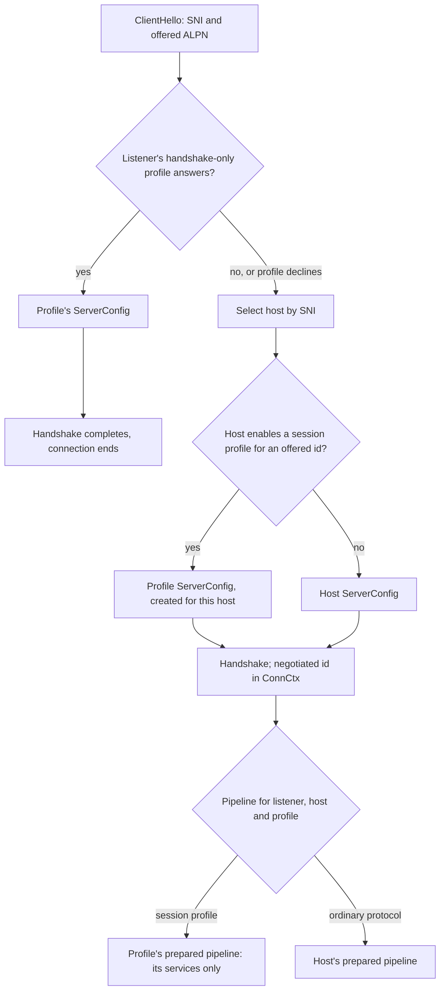

# ALPN Routing

Status: handshake-only profiles (`AlpnProfile`, `acme-tls/1`) and session
profiles with their own handshake and execution (`SessionProfile`) are
implemented. Session plans, which inherit admission and take per-host
parameters, are in progress.

A TLS client names the protocol it wants to speak in its ClientHello. That
choice selects a handshake before any request exists, which makes it the one
place where a connection can be given terms different from its host's
without a second host or a second listener. This note says where that branch
sits, who owns it, and what it may and may not change.

ALPN negotiates; it never authenticates. A client chooses the protocol it
offers, so a protocol id selects which handshake and which services a
connection gets, never whom the server trusts.

## Where it sits



A host is a pair: a `ServerConfig` for its handshake and an application for
its connections. A session profile gives the same host a second pair, chosen
by the protocol id the client offers:

```text
ClientHello -> SNI -> host
  ordinary ALPN (h2, http/1.1)  -> (host ServerConfig,    host application)
  a session id the host enables -> (profile ServerConfig, profile application)
```

ALPN routing chooses the pair, once, at acceptance; no request checks a
protocol id. How the chosen application is built is the pipeline's, as for
any host: everything after the handshake is the ordinary connection driver
and [Hot Pipeline](HOT_PIPELINE.md).

## Three shapes

| Shape | After the handshake | Example | Pipeline |
| --- | --- | --- | --- |
| Handshake only | The connection ends | `acme-tls/1` (RFC 8737) | None |
| Session | HTTP on the same host | A registration service | The profile's prepared pipeline |
| Opaque protocol | A non-HTTP byte stream | None yet | None; needs its own contract |

A handshake-only profile owns the whole handshake, with its own certificate,
and ends the connection. It is independent of virtual hosts, consulted
before host selection, and is enabled on a listener. It narrows itself: it
answers only names its own state holds, such as an ACME order's active
challenge, and declines every other hello. A session profile speaks HTTP to
services registered for it, under the host's certificate, and is enabled per
host, since nothing in the profile says which host should offer it. An
opaque protocol would bypass the pipeline entirely and needs a contract of
its own, documented apart from it; nothing needs one today.

## Ownership

Code registers a profile; configuration enables it. Claviron's TLS and Edge
crates name no protocol id: they provide the registry and the selection. A
profile is written against Claviron's public API alone; a package Claviron
ships, such as gRPC enrollment, gets no hook another package could not use.

- The package that speaks a protocol registers its id, the handshake it
  requires and, for a session profile, the services the connection may reach.
  One id has one profile in a process; a second registration is refused at
  boot.
- A handshake-only profile is enabled in code, for the listener its clients
  reach. An application enables ACME's `acme-tls/1` once with
  `register_local(state, listener)`, naming the listener the CA connects to;
  first issuance and every renewal are new orders on that listener, and no
  host or configuration file lists the id.
- A host enables a session profile by its id. An id no profile registered is
  a configuration error, not a no-op, and a host that does not list an id
  never selects its profile. Which hosts list it is setup, in the host
  declaration, not the registering package's configuration.
- Neither id is known to the TLS or Edge crates.

```yaml
grpc.example.com:
  tls:
    client_auth: required          # ordinary h2: client certificates
    alpn:
      example-enroll/1:            # a session profile registered by its package
        validity_days: 30          # this host's parameters for it
```

What sits under an id is the profile's: Edge hands it over undecoded, the
profile decodes it into its own type and an entry that does not decode
refuses the host's preparation. A profile without parameters is enabled with
an empty mapping. The same profile can take different parameters on
different hosts, and a package's own configuration file needs nothing for it.

A profile can relax what the handshake demands, such as a client
certificate, only together with narrowing what the connection reaches.
Relaxing it from configuration alone would let a connection without a
certificate reach every service of its host, so a session profile's handshake
terms are the profile's, and enabling it is the host's.

## Server configs

A session profile's `ServerConfig` is created for each host that enables it,
not derived by overriding the host's own. Its inputs are the host's
certificate source and the profile's handshake requirements; its ALPN list is
the profile's ids alone. Configs are created when the host is prepared, at
boot or reload, and kept with the host's TLS view like its ordinary config.
Certificate rotation reaches both through the same certificate resolver.

## Pipelines

Each listener and host already has its own prepared pipeline. A session
profile adds one per listener, host and profile, compiled by the same
pipeline compiler from a different entry: the session plan.

- The host's admission layers the profile asks for. A profile declares what
  it inherits, as a component declares its dependencies; each is applied when
  the host declares it and absent when it does not. Nothing is inherited
  unless asked for, so no layer is imposed on a profile.
- Layers the profile adds in code, with the ordinary route layer contract,
  in place of or beside what it inherits.
- The profile's backend, its only owner.

The host's site takes no part: no redirect, files, routes, backends or
router of the host's are in a session plan. A connection that negotiated the
profile reaches only that plan; an ordinary connection cannot reach it. The
services authenticate their callers themselves; for mTLS enrollment that is
the application's `EnrollGuard`.

| Admission, which a profile may inherit | Site, which a session never takes |
| --- | --- |
| Trusted proxy identity | Redirect |
| Deny and ACL | CORS and response headers |
| Quota | Route selection |
| Request body and reply bounds | Files, backends, the Rust router |
| Access log, metrics | |

Only host-level declarations are inherited: a session has no routes, so a
layer declared for one route prefix does not reach it.

## Open questions

- QUIC: HTTP/3 negotiates `h3`; a session profile over QUIC would need its own
  id there and is not proposed.
- Clients: a session profile is for clients that set ALPN themselves, such as
  native tools. Browsers cannot offer a custom id.
