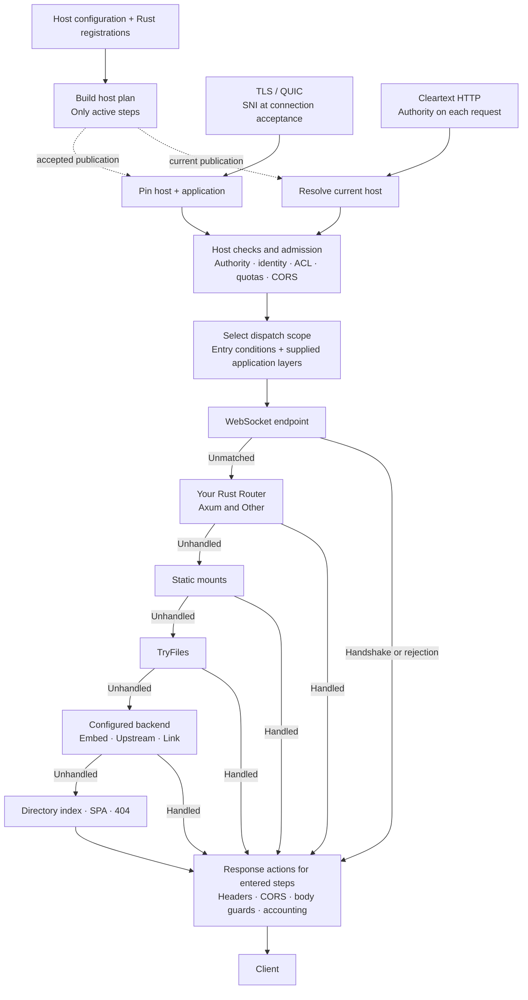

# HostPipeline

Design identifier: `HOST_PIPELINE`.

Claviron prepares a request path for each host at boot or reload. The plan
contains its required checks, configured policies, Rust router and backends.
This puts [APPLICATION_FIRST](APPLICATION_FIRST.md) into practice: one
application can be presented through hosts with different policies.

## One host, one plan

Required host checks always run; optional steps are installed only when
configured. A rejected route condition selects the
original fallback scope, skipping that route's router contributions and
WebSocket. H2 CONNECT and WebTransport use their own session entry points.

## Connection binding

| Transport | Host selection |
| --- | --- |
| TLS over TCP or QUIC | SNI selects the hostname, TLS/client-auth policy and application before the handshake completes. The connection retains that binding. |
| Cleartext HTTP/1 | Each request resolves its authority against the current host table, including on keepalive. Host policy selects serving, redirect or rejection. |

A TLS request for a different hostname receives **421 Misdirected Request**.
An alias or an overlapping certificate SAN does not permit switching hosts;
ports do not change the hostname comparison. Invalid authority is rejected
separately. A legal HTTP/1.0 request without authority can use its TLS binding.
Unknown or absent SNI cannot select a hosted binding.

Reload publishes a new plan for subsequent connections. Accepted TLS connections
keep their host, authentication and application; live ACL/redirect rules can
still change. Ending existing sessions requires an explicit lifecycle operation.
Cleartext requests use the current publication and reuse prepared limits while
the host binding is unchanged. Trusted proxy headers identify the client IP;
they do not replace the accepted TLS host or supply client-certificate identity.

## Request flow

1. **Check the request.** Validate its host and transport, determine the client
   IP, then apply configured deny rules, ACL, redirects and rate limits.
   Forwarded IP headers are used only on the trusted-proxy path.
2. **Admit it.** CORS can answer a preflight or refuse an origin before the
   application runs. Declared capacity and time limits govern admission and
   waiting for response headers.
3. **Call the owner.** WebSocket endpoints get first claim, followed by your
   Rust router, Static, TryFiles and the configured backend. A handler that
   answers ends dispatch, including when its answer is 404.
4. **Send the reply.** Apply the reached steps' response headers, CORS and body
   guards. Access logging follows the reply through streaming and completion.
   Later steps do not decorate an earlier reply.

Disabled policies add no step. Static and TryFiles share the files API; they
are not repeated inside the backend. A matched but unavailable backend answers
with its own error rather than silently trying another application.

## Your Rust Router

`RustRouter` has two variants:

| Variant | Request owner |
| --- | --- |
| `Axum` | An Axum router. |
| `Other` | Another Rust router or handler, or the host's compiled dispatch plan. |

Both retain host admission and response policy. Axum is an application adapter;
files, Embed, Upstream and [Link](ORBIT_LINK.md) use their own request interfaces.
Rust contributions can handle selected paths while an existing PHP, Lua or
external application continues serving the rest.
Whole-host routers own their reply; contributions within a configured host can
yield `Unhandled` to its next step.

Config extensions compile into native route conditions, Rust contributions or
`HostPipeline` actions. They require no Axum router. Layers surround the selected
WebSocket/application/backend path; inactive layers leave no execution step.

## Request and body ownership

Host checks inspect the head without collecting or decoding the body.
`Unhandled` transfers the same request and unread body to the next owner.
A terminal handler owns its reply; a response status never signals fallthrough.

Cancellation drops the pending call and the request resources it owns.
Admission capacity is held until response headers arrive or the call is
cancelled; streaming bodies retain their transferred resources until completion
or drop. A committed rate-limit charge is not refunded by cancellation.

Body limits and buffering remain explicit policies. Streaming forwards data and
trailers without requiring the host pipeline to collect the response.

## Code

- Host selection: [TCP TLS](../../crates/edge/src/tcp/secure/tls.rs),
  [QUIC](../../crates/edge/src/quic/tls.rs),
  [authority checks](../../crates/edge/src/service/extensions.rs).
- Host plan: [compiler](../../crates/edge/src/pipeline/host/compile.rs) and
  [HostPipeline](../../crates/edge/src/pipeline/host.rs).
- Rust routing: [RustRouter and registry](../../crates/edge/src/pipeline/apps.rs),
  [Axum adapter](../../crates/edge/src/pipeline/app.rs).
- Request lifetime: [HostExecution](../../crates/edge/src/pipeline/host/execution.rs).
