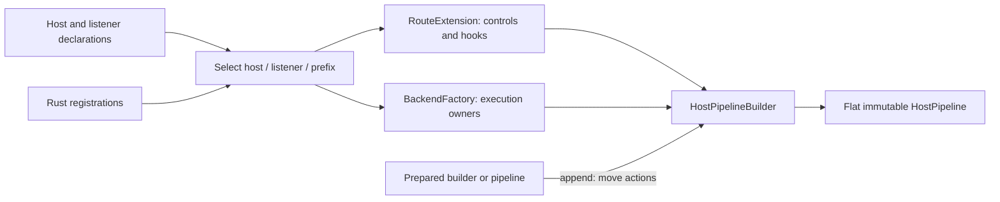
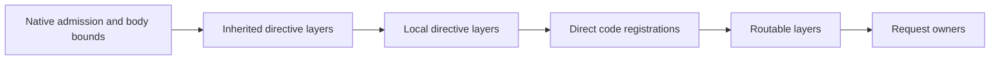
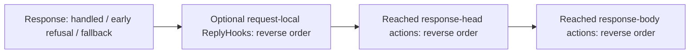

# HostPipeline

`HostLayer` prepares request and response actions at boot/reload.
`HostPipelineBuilder` builds one flat immutable plan from selected actions.
An omitted or empty layer leaves no runtime entry. Active actions use indirect calls.

## Application first

Applications register providers, shared services and request owners. Host bindings
select where those contributions are exposed; each listener/host pair gets its
own prepared pipeline while retaining the providers' shared state.

The pipeline composes Rust routers, Embed, Link, Upstream and native file steps.
Axum, Warp and Other are application adapters inside that plan. Host admission
and configured policies run before the selected owner. Authentication and session
policy remain with application providers and frameworks.

Route extensions prepare controls and interception independently of the Rust
application adapter. Backend factories prepare execution owners after effective
policy resolution. PHP Embed, FCGI, Lua, Upstream and Broadcast supply optional Edge adapters
from their own crates; native engine/Runner use does not require Edge. Link
remains native in Edge.

[EDGE_BACKENDS](EDGE_BACKENDS.md) defines request handoff;
[LIFETIME_POLICY](LIFETIME_POLICY.md) defines preparation and publication.

## Preparation



`RouteLayer::prepare_scoped` receives the selected file view, effective
`HttpPolicy` and application eligibility through `PreparedScope`. These inputs
are resolved during preparation, before request execution.

| Layer | Work |
| --- | --- |
| Identity / Proxy | Explicit typed metadata or trusted forwarding identity. |
| Deny / ACL | Configured access decisions. |
| Redirect | Custom host/prefix target after Routable contributions, before the Rust router. |
| CORS / HeaderSet / HeaderClear | Origin admission and response headers. |
| Quota | Committed rate admission. |
| RequestBody / Reply | Declared streaming size and idle bounds. |
| AccessLog | Record and response-body lifetime. |
| RouteSelection | One prefix/condition selection; omitted for a single scope. |
| RustRouter / HostHandler | Axum, Warp or Other, or a fallthrough Rust contribution. |
| Static / TryFiles / Embed / Upstream / Link | Prepared native request owners. |

Listener/host eligibility is compiled before publication. Plain H1 selects its
host per request; TLS H1/H2 and H3 compare request authority with the accepted
SNI hostname before pipeline or native session dispatch. Hyper H1 upgrades are
compiled with `websocket`; registered host endpoints still require H1 and the
host's upgrade permission.

QUIC listener 0-RTT capability and host replay policy are independent. Only
native early streams are checked, after SNI resolution and before dispatch;
refused streams return 425. No protocol-policy layer enters HostPipeline.

## Routable contributions

`Routable` provides a typed extension API in place of a conventional edge
server's loadable module API. Registered providers implement this Rust trait;
host and listener-protocol matching run at boot/reload. A provider can contribute
handlers, `RouteLayer` actions, native session bindings, WebSocket endpoints
and `RouteExtension` codecs.
A directive compiles into a handler, layer or route condition. Requests execute
the prepared contributions; they do not query the provider again.

These contributions precede custom `redirect` and the terminal `RustRouter`
(Axum, Warp or Other). `Handled` stops; `Unhandled` retains the unread body for
the next action. A custom redirect terminates that scope before router, file or
backend dispatch. Plain `non_ssl: redirect` remains a separate listener policy.

## Code-defined layers

`HostAppRegistry::register_layer(select, layer)` installs a `RouteLayer` directly.
The selector receives the canonical host, its declaration and the listener
protocol at boot/reload. The same layer may also be returned by a configured
`RouteExtension`. Both enter the scope compiler before Rust router execution.



The full conditional sequence is listed in
[HostPipeline order](../../crates/edge/ARCHITECTURE.md#hostpipeline-order).

```rust
use std::ops::ControlFlow;
use claviron::edge::{Host, HostAppRegistry};
use claviron::edge::extension::{HostLayerBuilder, RouteLayer};

#[derive(Clone)]
struct RequestMarker;

struct MarkRequest;

impl RouteLayer for MarkRequest {
    fn prepare(&self, layer: &mut HostLayerBuilder) -> claviron::edge::Result<()> {
        layer.before(|head, _| {
            head.extensions.insert(RequestMarker);
            ControlFlow::Continue(())
        });
        Ok(())
    }
}

// After registering Edge, before preparing hosts.
let hosts = state.registry_ref().resolve::<HostAppRegistry>()
    .expect("Edge has been registered");
let host: Host = "app.example.test".parse().expect("valid canonical host");
hosts.register_layer(move |key, _, _| key == &host, MarkRequest);
```

`register_pipeline(select, prepare)` accepts a factory returning a
`HostPipelineBuilder` or a compiled `HostPipeline`. Its `LayerContext` supplies
the selected file view, effective policy, prefix and listener. The factory runs
for each selected serving scope. An empty result adds no action. Registrations
precede the first publication and remain available for reloads. Unbound lookups
include only registrations accepted on every protocol family.

`HostPipelineBuilder::append` moves either form into the current flat plan.
Both plans use the same request state and reply type. Action order, reached
response scopes and one-time identity export survive composition. Host/listener
eligibility and route-prefix selection remain with the host compiler.

## Execution and ownership



- Head actions borrow request parts. They cannot access the body.
- An asynchronous head action borrows its prepared owner and request state;
  the driver retains the untouched body while it waits.
- `HostHandler` may return `Unhandled` only with its unread `HostRequest`.
  `apps::axum::application_if` selects from the head before handing over the body.
- A low-level request action owns the request while running. Returning
  `Unhandled` transfers it back; explicit buffering must restore all consumed
  bytes, trailers and the remaining stream. A handled status, including 404,
  ends dispatch.
- `ExchangeAction` may retain request-local response work in `ReplyHooks`.
  Registered hooks run once, in reverse order, before prepared response actions,
  including on later refusal or fallback. An empty hook stack allocates nothing.
- Prepared response actions run in reverse order for entered layers only. A later layer
  cannot decorate an earlier reply.
- Cancellation drops the active future, request and state. Capacity remains
  in its declared state until reply-head completion or cancellation. Response
  guards retain only the resources transferred to their bodies. Pending reply
  hooks are dropped without being run.

Production preparation selects an exchange-capable owner only when the plan
contains an `ExchangeAction`. Other plans use the plain compiled owner without
request-local reply-hook state.

`HostExecution` is the published host owner for every transport. `RustRouter`
selects an application-owned Axum/Warp router or an Other Rust handler/router
inside that plan. Other has no pipeline, fallback or built-in backend variants.
All router choices use the same scope compiler. A direct Rust call is retained
only when preparation contributes no preceding action.

The driver is a flat loop. There is no recursive `Next`, Tower wrapper chain,
per-request registration, body decoding or implicit collection.

## NonServingPipeline

Each plain listener has one fixed `NonServingPipeline` for `non_ssl: redirect`
(the default) and `reject`. The selected host is passed as input; no application
pipeline is built. A fixed binding or `bind_non_serving_interception_with` factory
prepares the optional interceptor at boot/reload. The factory runs only for plain
listeners; None installs no hook. A prepared `InterceptsNonServing` receives the
request and borrowed context before the policy. `Handled` replies; `Unhandled`
continues to redirect/reject. This path does not query `Routable`.

## Binding and reload

Host preparation completes before table publication. Failed candidates keep
the previous publication. TLS/QUIC retain the accepted host and owner; plain
HTTP/1 selects the current host on each request. Connection retirement follows
the existing binding lifecycle. The resolver retains no separate live ACL or
redirect executor.

Forwarded identity is request-local `RealIpExt`. It does not rewrite physical
socket, listener, TLS or protocol facts. URI denial and forwarding are explicit
layers, never transport snapshot attributes.

## Code

- [Types and contracts](../../crates/edge/src/pipeline/host.rs)
- [Backend contracts and factories](../../crates/edge/src/pipeline/backend.rs)
- [Builder](../../crates/edge/src/pipeline/host/builder.rs)
- [Code registration](../../crates/edge/src/pipeline/host/registration.rs)
- [Execution and body ownership](../../crates/edge/src/pipeline/host/request.rs)
- [Response scopes](../../crates/edge/src/pipeline/host/response.rs)
- [Scope compiler](../../crates/edge/src/pipeline/host/compile.rs)
- [Module index](../../crates/edge/ARCHITECTURE.md)
