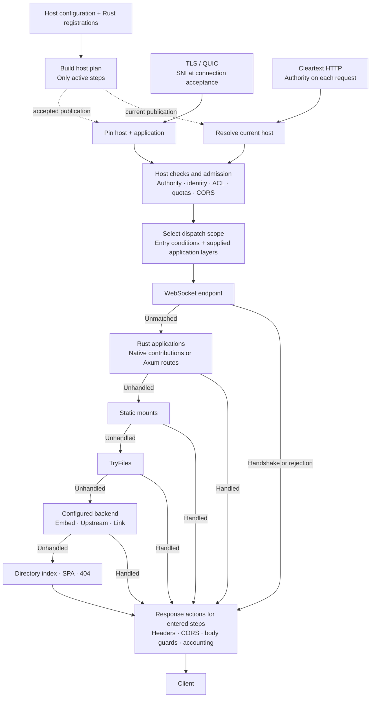

# HostPipeline

Design identifier: `HOST_PIPELINE`.

This is the serving-pipeline application of
[APPLICATION_FIRST](APPLICATION_FIRST.md). It covers connection-level host
selection and the prepared request pipeline that runs under that binding.

If your repository has both `app/*.php` and `src/main.rs`, routing should help
those parts work together. It should not force you to put another server between
them, or rewrite the application before Rust can handle its first request.

Claviron is an edge, but its pipeline is built around the application it serves.
TLS, host admission and HTTP transport belong to the edge. Which application
owns a path, and which parts you choose to implement in Rust, need not be fixed
for the whole host or for the lifetime of the project.

## One host, one plan

For a configured host, connection binding leads into the following request flow.
Boot and reload build the plan; requests use the selected publication.

Only configured steps appear in the prepared plan. A handled response ends
dispatch, including a handled 404. `Unhandled` passes the same unread request
body to the next owner. A rejected entry condition selects the original
fallback scope without the rejected route's applications or WebSocket.

The diagram shows ordinary HTTP requests and the HTTP/1 WebSocket handoff.
H2 CONNECT and WebTransport use their native session entry points.

## Connection binding

Claviron does not wait until application routing to decide what a TLS
connection belongs to. The ClientHello selects a hosted name, its TLS policy
and its application binding together. Configure the client or proxy to connect
to that host; do not treat the accepted connection as a reusable entrance to
any site that happens to be served by the same binary.

This starts from an edge-facing deployment. Running behind another proxy is
possible, but the proxy must preserve this connection-level host choice rather
than expecting a later `Host` header to replace it.

### Select once, check each request

For TLS over TCP and QUIC, the accepted binding captures the requested hostname,
the canonical vhost, its application and the relevant handshake policy.
Listener capabilities and host declarations jointly determine the protocols
that connection may use. Required client authentication is selected before the
handshake finishes, not added after an HTTP request arrives.

Every ordinary HTTP request still has its authority parsed and validated.
A different hostname receives **421 Misdirected Request** instead of being
rerouted to another application on that connection. Ports do not change this
host-identity comparison. Invalid authority is a separate malformed-request
failure; the legal HTTP/1.0 missing-authority case can use the established TLS
binding.

A certificate covering several names is not routing permission. Neither an
overlapping SAN nor an alias pointing to the same application permits a client
to switch the accepted hostname mid-connection.

Unknown or absent SNI cannot select a hosted binding. Refusing that handshake
is a consequence of the model, not its whole purpose: a default certificate
must not silently choose an unrelated application.

### Reload and accepted connections

A new host publication can affect subsequent connection acceptance. Existing
connections retain their accepted TLS/authentication and application binding.
Policies explicitly read live, such as host access rules and early replies,
may change without turning the connection into a different host.

This is not retroactive revocation of an established TLS session. If a change
requires existing sessions to end, that needs its own lifecycle operation.

The immutable host binding prepares the listener/host request and response
limits once. Cleartext requests reuse them while that binding matches the
current host configuration; replacement prepares new limits without changing
already admitted requests.

### Cleartext host selection

There is no SNI binding on a cleartext HTTP/1 connection. Each request resolves
its validated authority against the current host table, including on keepalive.
The host's non-SSL policy then selects reject, redirect or explicit serving.
Cleartext cannot satisfy a required TLS client-certificate policy.

Likewise, trusted forwarded headers can help resolve a request's client IP;
they do not select a different TLS host. A proxy routing multiple public names
must use connections with the appropriate upstream SNI instead of relying on
cross-host reuse of one accepted connection.

## Start with what already runs

You can keep an existing application as the main request owner and add native
Rust routes where they are useful. `Routable` describes application routing;
interceptors let selected paths be handled before the configured fallback.
Unmigrated paths can continue to reach the existing application.

This makes a gradual Rust migration possible, but migration is not required.
Keeping PHP for presentation and Rust for a particular service can be the
finished design. An application may also run in a separate process reached
through [Orbit Link](ORBIT_LINK.md) rather than being embedded.

These are explicit bindings, not automatic discovery of every file in your
repository. The application and its host configuration declare what is served.

## Bypass is a choice of dispatch, not an escape from admission

Host composition is native. The application registry supports
different composition shapes:

| Shape | What you choose |
| --- | --- |
| Configured routing | Compile declared native steps and optional Rust applications per host. |
| An application-owned router | Supply a Rust router while retaining shared host admission. |
| Bypass | Dispatch directly to a native `BypassHandler` or a built-in backend without an Axum router. |

The choice is per host, not a server-wide mode. A native resource service and a
mixed application can live behind the same edge without taking the same route
through it.

Bypass remains behind shared host admission: accepted authority and transport,
deny/access rules and the narrowed HTTP policy still apply. Request admission,
head timing and response-body guards are not Axum-only facilities. Skipping the
router must not make an application invisible to exchange accounting either.

Typed request extensions remain request-owned. Context replacement reuses an
existing value's box and releases the old value; unrelated entries remain
untouched. A fresh request still needs independent typed values and the ordinary
`http::Extensions` allocations. The prepared host map does not share mutable
extension storage between requests.

## Request flow

At boot or reload, Edge builds a `HostPipeline` containing the host's required
checks and enabled policies. Each request passes those checks and admission
before reaching its application or backend. Disabled policies install no step.

Checks inspect the request head. Each request owns its state and body; an
unclaimed request passes that same unread body to the next handler. Response
actions run in reverse order, only for the layers the request entered.

First, `IngressPolicy` checks authority, connection binding, early data,
H1 upgrade permission and deny rules, returning a typed rejection on failure.
Inactive upgrade/deny gates add no action. Accepted connections keep their plan;
replacing a cleartext host binding prepares a new one.

`IdentityPolicy` runs after ingress and prepares typed connection/host
extensions without reading the body. The binding selects direct, peer-only or
trusted-proxy handling once. Forwarding headers are resolved per request only
on the trusted-proxy path; accepted TLS, protocol and listener facts stay fixed.
HTTP extensions and native authentication retain the same `Arc<ConnCtx>`.
`AccessPolicy` follows identity and applies live canonical-host ACL and redirect
rules before application routing. Each admission selects the current rule
snapshot; an open host traverses no rules and clones no rule Arc. The canonical
lookup remains necessary so removal or newly enabled rules also reach existing
connections. Host ACL, route ACL and redirects contain only active checks,
compiled in that order. An admitted request retains its selected generation
through dispatch or cancellation.

With `rate-limit`, `QuotaPolicy` is the next prepared head step. Only configured
limits or explicit Rust registrations create a quota plan. A uniform root limit
selects its direct path during preparation; scoped limits retain canonical path
checks and longest-prefix selection. Key providers borrow the parsed head and
typed extensions, and a successful admission retains its committed snapshot.
Cancellation does not refund a charge or perform another store read.

Quota plans stay with the selected `HostApp`, which owns the stores, rather
than the cleartext metadata cache. `HostService` continues the prepared head
through that plan after access and before reassembling the original body for
dispatch. It does not clone the plan or quota handle per admission. Unconfigured
hosts skip quota execution.

`ExchangeLayer` prepares only the declared CORS and response-header actions for
an effective host/prefix scope. CORS runs once against the request head; its
accepted origin stays in `ExchangeState`. Response processing applies the final
header unsets/sets, then CORS headers, including on preflight, rejected-origin
and admission/timeout replies. An empty scope contributes no actions.

`prepare_head` borrows request parts and returns any early decision together
with a `PreparedResponse` scope. The caller retains its request body while
waiting for admission or a reply. Finishing the scope applies only the armed
response actions; dropping it releases state without running those callbacks.
A host without exchange policy does not enter this preparation or split its
request for it. Prefix selection and the plan remain with the pinned
`HostApp`; the native execution stage borrows them during dispatch.

`ReplyPolicy` selects response-body guarding when the effective listener/host
policy is prepared. Without a size or idle limit there is no guard policy.
Native dispatch uses that typed policy directly after exchange response actions
and before access accounting. A composed HostPipeline can register the same
policy as a body action; it contributes no request or response-head callback.
The guard forwards data and trailers without collecting or decoding them,
and dropping the body releases its original source. Idle timers still start
only when HTTP polls a guarded body. Transport write limits, buffering and
queue/head deadlines retain their existing owners.

`AdmissionPolicy` prepares queue/head timing from the same effective request
policy. It borrows the selected application's `Admission` capacity instead of
keeping a semaphore in cached connection metadata. `enter` returns HTTP's
existing future directly; its permit still lives until the reply head or
cancellation. Backend timing ownership is queried only for a declared head
limit, so a backend enforcing that limit is not timed twice. The existing
HTTP head future retains first-poll deadline and cancellation behavior.
This asynchronous execution stage stays outside synchronous `HostLayer` head
actions; it adds no erased layer future, task or implicit duration.

With `access-log`, `AccessLogLayer` prepares the producer capability and
canonical host declaration when a ready process binds a host. `off` or an
absent producer contributes no layer. An existing producer retains a live
channel selector, including when its current default is empty: later channel
configuration changes must still reach existing connections. No record or
body wrapper is created when that lookup has no destination.

`AccessLogState` owns one record through admission and the response body.
Native dispatch uses the prepared layer directly without splitting its request;
composed pipelines install it after identity and outside response shaping/body
guards. The execution owner marks actual admission. An early 503/504 completes
the empty reply record, while a normal response transfers it to the stream.
HTTP/gRPC status, trailers, byte counts and drop/completion behavior retain the
same recorder. Runtime activity accounting remains independent of access logs.

## Application dispatch

`ApplicationHandler<B>` is the typed terminal call after host admission. It
consumes one request and returns that owner's concrete response future.
`PreparedRequest::dispatch_to` defers the call until first poll and finishes
the armed response actions. An unhandled request still owns its original body
before this handoff; no status code, including 404, implicitly returns ownership.
The existing closure-based `dispatch` remains available.

Native Bypass and Axum dispatch use this same contract without another future
box or service clone. Bypass keeps its existing handler future; Axum uses its
native oneshot. Application selection happens before those futures are built,
and the host execution boundary still owns capacity, head timing and accounting.
Host registration and engine lifecycle remain with their existing owners.

`Routable::application` now prepares the native Rust contribution through the
existing host registry. It returns an `ApplicationInterceptor`; no parallel
exclusive route registry is introduced. The contribution is compiled once per
changed host alongside the existing route/upgrade capabilities, and remains
pinned with that host's application publication.

`ApplicationStage<H>` visits only those contributions before its configured
owner. An `InterceptRequest` exposes the parsed head but keeps its original body
private. `Unhandled` carries that same capability onward. Claiming the body
consumes it through `into_request`, after which it cannot be reconstructed for
fallthrough. A handled 404 or other error remains a handled response. No body
buffer, replay, decode, lock, timer or task is introduced by this handoff.

Absent contributions keep the original direct owner at preparation. Active
heterogeneous contributions have an explicit erased-future boundary; the outer
pipeline future stays concrete until its existing application adapter boundary.
The combined Rust/backend call keeps Edge's declared whole-head deadline;
backend-specific narrowed deadlines remain with their execution owner.

The native host compiler installs this stage inside the selected route's policy
scope. Rust Axum applications remain optional and retain route precedence; their
delegation handle calls the already-selected native chain without re-entering
the Rust router or looking up the prefix again. A rejected entry selects the
original fallback without its native application contributions or WebSocket.
Axum is not the host compiler or the embedded-backend invocation path.

`host/compile.rs` prepares only declared steps for each effective scope. It
reuses HTTP's RouteDispatch for longest segment-prefix selection and conditions;
a sole unconditional root needs no dispatch-table wrapper. SelectedRoute metadata
is inserted before the chosen scope executes. File/backend preparations are
immutable and stay with the accepted host publication across reload.

`Routable::layer_routes` explicitly returns Option<Router>. None installs no
Axum invocation, including for a registered provider whose only contribution is
a native application. Active application layers and Rust route handlers retain
an optional Axum adapter. Configured Pusher REST endpoints still use that Rust
application adapter before files and backends. User native contributions retain
precedence over these configured endpoints. The native backend plan contains no
Axum router. Configured hosts use native compilation; explicit standalone
routers and Bypass application APIs remain available.

## Files and backends

Configured file dispatch prepares **Routable → Static → TryFiles → backend**.
Static and TryFiles are separate asynchronous steps using `claviron-files`,
never implementations of cache, traversal checks or file delivery in Edge.
Each static mount prepares its URL/disk mapping once. A selected route supplies
only its own steps; disabled declarations produce no step. Missing files obey
`none_found`, and dynamic extensions yield without disk work. Each miss returns
the original `Request<RouteBody>`; no request body is polled or collected.

The residual backend file view omits both Static and TryFiles, retaining only
directory-index/SPA fallback. Each selected scope prepares its own file view;
an empty child does not inherit the root probe. Direct public UpstreamBypass
callers keep their explicit file composition. Engines and transport backends
supply native calls and do not supply Axum builders.

The local runtime category is named Embed. `pipeline/embed` owns its native
backend adapters; it is not an Axum application category. Lua's prepared mounts
preserve segment boundaries, specificity
and the former equal-prefix precedence. Only a nonmatching mount yields the
unchanged request; a matching unavailable application owns its 503 response.
`LuaApplicationAdapter` retains the existing live generation, policy and execution
path. Lua no longer provides an Axum feature or router binding. HTTP/1 WebSocket
handshake/admission belongs to Edge; the engine receives the upgraded transport.
The native compiler preserves configured backend precedence and never invokes
a Lua router builder.

For PHP, pipeline/embed/php.rs prepares mounts
from resolved PhpRuntime values; its only runner match is at preparation.
Script, Application and FCGI each own a separate request future. Application
execution therefore carries no script resolver, filesystem probe or Script
future state. It retains PhpApplicationHandle's live generation semantics and
always owns a matched response, including unavailability. Script and FCGI use
consuming native try_handle calls whose Unhandled contract returns the original
unread request. Native DispatchStep owners pass Request<RouteBody> directly;
only Rust application interception uses InterceptRequest. A backend does not
construct or restore an interception capability. Dropping the call retains the engine's existing cancellation path.

The PHP contract, embed and FCGI crates no longer contain an Axum feature,
dependency or binding. PHP, Lua, Upstream and Link are DispatchStep owners in
the same prepared native chain. Existing script/application engine capacity,
INI, environment and lifecycle contracts are unchanged.

UpstreamStage selects the existing live UpstreamApp profile, then transfers
Request<RouteBody> directly to call_upstream_service. Explicit/root selection,
request forwarding, response lease ownership and profile retirement remain with
Upstream. Static and TryFiles are not repeated inside this stage. A selected
upstream with no matching service retains its final 404 rather than entering
another backend. The separately exposed UpstreamBypass retains its file-first
composition contract.

LinkBackend prepares destination targets and segment-safe mounts at boot/reload.
It retains specificity and equal-prefix precedence. An unmatched mount returns
the untouched request synchronously; an unavailable matched target owns its 503.
Exchange metadata retains the existing Link wire encoding; body chunks are not
JSON-decoded or routed through an Axum Body. The response is a native StreamBody
bounded by the existing Link window. Body delivery policy can still request
buffering explicitly.

A nonempty upload keeps its existing independently driven task and backpressure.
The pending head owns its abort-on-drop handle, then transfers it into the
response body. Cancellation, head failure, body drop, EOF or response error
releases that owner; an unfinished upload resets its own input direction.
Empty requests create neither an upload task nor its response wrapper. Native
WebSocket session handoff and WebTransport streams retain their existing owners
and shutdown signals. No retry, deadline, polling or SHM ABI change is added.

## WebSocket sessions

When declared, WebSocket is the first dispatch step before Rust applications.
Its preparation requires a registered exact path, permission for HTTP/1 and an
enabled H1 handshake in the host transport policy. Otherwise no WebSocket step
is installed. Preparation captures an immutable host endpoint map, so ordinary
requests require neither a registry lock nor an allocated future for a miss.
The protocol boundary owns acceptance and listener session hand-off independently
of Axum. Required security/admission/CORS precede it; response actions still
finish the handshake response before it is sent.

Native built-ins use `DispatchStep`, distinct from `ApplicationInterceptor`.
`DispatchFuture` keeps synchronous decisions inline and erases only asynchronous
work. `Unhandled` transfers the same Request<RouteBody>, without body polling,
collection or decoding. Cancellation drops the currently owned request/future.

## Request lifetime

Native execution lives in `pipeline::host`: `HostPolicy` prepares the
immutable binding and `HostExecution` owns one ordinary exchange. `HostService`
still selects/adapts the admitted application for the transport. It returns the
same concrete execution future directly, without an additional async wrapper.

Execution retains the existing order: activity/access record, configured
exchange policy, request metadata, capacity, head timing, application response,
response policy and stream accounting. Capacity and quota stores remain with
the selected `HostApp`; the cleartext metadata cache retains neither. Queue/head
cancellation releases that request's body and guards. A streamed response keeps
only the body resources transferred to it. These are internal native owners;
public composition continues through `HostPipeline` and `ApplicationHandler`.

## Route selection

The shared HTTP `dispatch::RouteDispatch<H>` selects a prepared owner from a
borrowed method, URI and header view. It has no Axum dependency or execution
engine knowledge. It selects the longest segment prefix and checks only that
entry's conditions; rejection selects the explicit rejected owner, never a
shorter prefix. The returned reference belongs to the prepared table, so the
caller can transfer the original request directly to its owner.

The existing Axum route adapter now delegates that decision to this selector.
Its `routing::ConfiguredRoute`, `routing::RouteDispatch`, `RouteCondition` and
`RuleContext` paths remain available. Native configured-backend compilation uses this same selection contract.

## Bypass and Axum

Native transports adapt their request bodies to `RouteBody`; bypass handlers
return `RouteResponse`. The bypass dispatch chain does not require Axum types.
That lets a backend participate without pretending to be a router middleware.

On native TCP, the host-dispatch future stays inline for bypass requests. The
handler returns its erased `RouteFuture`; the transport does not add a second
future box. Axum erases its own selected dispatch future separately, so its
concrete state cannot enlarge bypass dispatch. Admission and head timing retain
the same handler future until completion or cancellation, while response bodies
keep their independent streaming lifetime.

Conversely, middleware attached only to a router does not run merely because a
bypass handler serves the same host. Framework-specific validation, CSRF and
response formatting belong to the application/framework composition, not an
implicit promise that every dispatch shape executes every layer.

The goal is a pipeline suited to your application, not a claim that bypass is
always faster or should replace routing everywhere.

## Follow the implementation

- [TCP TLS acceptance](../../crates/edge/src/tcp/secure/tls.rs).
- [QUIC host and TLS policy](../../crates/edge/src/quic/tls.rs).
- [Host identity and authority comparison](../../crates/edge/src/service/extensions.rs).
- [Cleartext host selection](../../crates/edge/src/tcp/plain/handler.rs).
- [TLS capabilities](../../crates/tls/README.md).
- [Edge routing and composition guide](../../crates/edge/README.md).
- [Routable bindings](../../crates/edge/src/pipeline/routable.rs).
- [Host application registry](../../crates/edge/src/pipeline/apps.rs).
- [Native bypass dispatch](../../crates/edge/src/pipeline/bypass.rs).
- [Prepared host pipeline](../../crates/edge/src/pipeline/host.rs).
- [Request identity and proxy policy](../../crates/edge/src/pipeline/host/identity.rs).
- [Live host access policy](../../crates/edge/src/pipeline/host/access.rs).
- [Prepared quota policy](../../crates/edge/src/pipeline/host/quota.rs).
- [CORS and response-header layer](../../crates/edge/src/pipeline/host/exchange.rs).
- [Response-body policy](../../crates/edge/src/pipeline/host/reply.rs).
- [Prepared admission timing](../../crates/edge/src/pipeline/host/admission.rs).
- [Access-record layer](../../crates/edge/src/pipeline/host/access_log.rs).
- [Typed application call](../../crates/edge/src/pipeline/host/application.rs).
- [Native application interception](../../crates/edge/src/pipeline/host/intercept.rs).
- [Native host execution](../../crates/edge/src/pipeline/host/execution.rs).
- [Shared host admission and dispatch](../../crates/edge/src/service/host.rs).

Use `HOST_PIPELINE` for connection binding, prepared host policy and native application dispatch.
