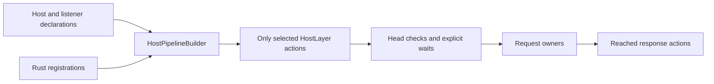

# HostPipeline

`HostLayer` prepares one host action at boot/reload. `HostPipelineBuilder`
flattens the selected actions into an immutable plan. An omitted or empty layer
leaves no runtime entry. Active actions use indirect calls.

## Preparation

| Layer | Work |
| --- | --- |
| Authority / Reject / Upgrade / EarlyData | Request-part and selected transport policy. |
| Identity / Proxy | Explicit typed metadata or trusted forwarding identity. |
| Deny / ACL / Redirect | Configured request decisions. |
| CORS / HeaderSet / HeaderClear | Origin admission and response headers. |
| Quota | Committed rate admission. |
| RequestBody / Reply | Declared streaming size and idle bounds. |
| AccessLog | Record and response-body lifetime. |
| RouteSelection | One prefix/condition selection; omitted for a single scope. |
| RustRouter / HostHandler | Axum or Other, or a fallthrough Rust contribution. |
| Static / TryFiles / Embed / Upstream / Link | Prepared native request owners. |
| Http01 / HttpsRedirect | Explicit challenge replies or HTTPS redirects. |

The native compiler currently selects Rust contributions, route extensions,
WebSocket endpoints, files and configured backends through this contract.
Automatic listener/host policy selection and native session handoff are still
being connected. Prepared policy APIs do not enforce themselves at transport
handoff. Head-deadline integration is separate from capacity acquisition.

## Execution and ownership

- Head actions borrow request parts. They cannot access the body.
- An asynchronous head action borrows its prepared owner and request state;
  the driver retains the untouched body while it waits.
- A consuming action receives the request once. `Unhandled` returns that same
  request and unread body. A handled status, including 404, ends dispatch.
- Response hooks run in reverse order for entered layers only. A later layer
  cannot decorate an earlier reply.
- Cancellation drops the active future, request and state. Capacity remains
  in its declared state until reply-head completion or cancellation. Response
  guards retain only the resources transferred to their bodies.

`HostExecution` is the published host owner for every transport. `RustRouter`
selects only an application-owned Axum router or an Other Rust handler/router
inside that plan. Other has no pipeline, fallback or built-in backend variants.
Both router choices use the same scope compiler. A direct Rust call is retained
only when preparation contributes no preceding action.

The driver is a flat loop. There is no recursive `Next`, Tower wrapper chain,
per-request registration, body decoding or implicit collection.

## Binding and reload

Host preparation completes before table publication. Failed candidates keep
the previous publication. TLS/QUIC retain the accepted host and owner; plain
HTTP/1 selects the current host on each request. Connection retirement follows
the existing binding lifecycle. The resolver retains no separate live ACL or
redirect executor.

Forwarded identity is request-local `RealIpExt`. It does not rewrite physical
socket, listener, TLS or protocol facts. URI denial and forwarding are explicit
layers, never transport snapshot attributes.

## Code

- [Types and contracts](../../crates/edge/src/pipeline/host.rs)
- [Builder](../../crates/edge/src/pipeline/host/builder.rs)
- [Execution and body ownership](../../crates/edge/src/pipeline/host/request.rs)
- [Response scopes](../../crates/edge/src/pipeline/host/response.rs)
- [Scope compiler](../../crates/edge/src/pipeline/host/compile.rs)
- [Module index](../../crates/edge/ARCHITECTURE.md)
